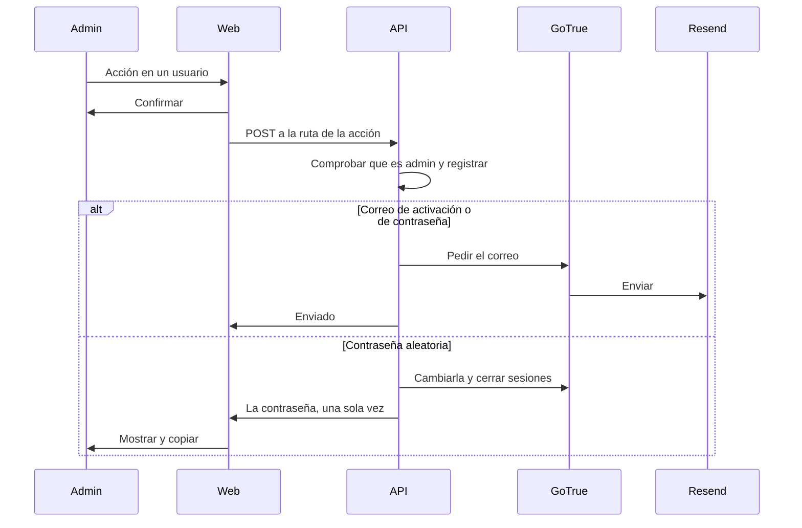

# Plan: acciones de cuenta en Administración › Usuarios

> Planeación original. Estado: **propuesta**, pendiente de aprobación de Daniel.

Daniel (2026-11-03) quiere, desde el panel de Usuarios: reenviar el correo de activación, enviar el correo para cambiar la contraseña y cambiar la contraseña por una aleatoria. Elige el admin entre las dos últimas.

## Decisiones tomadas

Las marcadas "a confirmar" son propuestas; Daniel las confirma al aprobar.

| Tema | Decisión | Por qué |
|---|---|---|
| Quién | Solo el rol `admin` (`requireAdmin`), no moderadores (a confirmar) | Estas acciones dan control sobre una cuenta ajena |
| Confirmar el correo al registrarse | Encenderlo: `ENABLE_EMAIL_AUTOCONFIRM=false` (a confirmar) | Lo decidió el plan del corte (2026-11-03) y nunca se aplicó: la nube confirmaba sola y el VPS copió ese valor. Con la confirmación apagada, el reenvío no tendría ninguna cuenta a la que aplicar: hoy hay 0 sin confirmar |
| Cuentas que ya existen | No cambian | Todas están confirmadas |
| Contraseña aleatoria | La API usa la clave de administrador (`SUPABASE_SERVICE_KEY` en `api.env`) y `auth.admin.updateUserById` (a confirmar) | Es el camino oficial: GoTrue la cifra. La alternativa, escribir el hash en `auth.users` por SQL, se salta GoTrue. La clave solo se usa en estas rutas |
| Cómo se entrega | Se genera en la API, se muestra una sola vez al admin con botón de copiar y no se guarda en ningún lado ni sale en los logs | El admin se la pasa al jugador |
| Al cambiarla | Se cierran todas las sesiones de esa cuenta | Si la cuenta estaba comprometida, el intruso queda afuera |
| Cuenta propia y otros admins | No se puede usar la aleatoria sobre la propia cuenta ni sobre otro admin (a confirmar) | La propia se cambia en Mi perfil. Un admin no toma la cuenta de otro |
| Registro | Tabla nueva con quién, a qué cuenta, qué acción y cuándo. Nunca la contraseña | Queda rastro de una acción sensible |
| Confirmación en pantalla | Diálogo antes de cada acción. El reenvío solo está activo en cuentas sin confirmar | Evita clics por error |

## 1. El flujo completo

## 2. API

Rutas nuevas en `web/backend/src/routes/admin-players.ts`, con `requireUser` y `requireAdmin`:

| Ruta | Qué hace |
|---|---|
| `POST /api/v1/admin/users/{id}/resend-confirmation` | `auth.resend({ type: 'signup' })`. 409 si ya está confirmada |
| `POST /api/v1/admin/users/{id}/send-password-reset` | `resetPasswordForEmail`, con el link a `/reset-password` |
| `POST /api/v1/admin/users/{id}/random-password` | Genera 16 caracteres con `crypto`, la cambia, cierra sesiones y la devuelve con `Cache-Control: no-store` |

- La API se despliega desde la base de producción (`0d573288`), no desde `feat/frontend-fase-1`. Las rutas van en las dos.
- `SUPABASE_SERVICE_KEY` entra en `/etc/cmleague/api.env`, en un cliente propio que solo usan estas rutas.
- La respuesta de la aleatoria no pasa por los logs de la API.

## 3. Base

Replanteo `72`:
- `account_admin_actions` (admin, cuenta, acción, fecha), sin permisos para `anon` ni `authenticated` salvo lectura de admins.
- Una función que registra la acción y devuelve el correo y si está confirmado. Comprueba `is_admin()`.
- Se aplica en staging y en producción (el VPS).

## 4. Web

- En `AccountsTab.tsx`, un menú de acciones por usuario, con su diálogo de confirmación.
- Diálogo de resultado para la aleatoria: la contraseña, copiar y el aviso de que no se vuelve a mostrar.
- Estado de la cuenta (confirmada o no) en la lista.
- Solo en `feat/frontend-fase-1`.

## 5. Correo y GoTrue

- Requiere lo de [`2026-11-03-recuperar-contrasena`](../2026-11-03-recuperar-contrasena/) desplegado: rutas, `/reset-password` y plantillas.
- `ENABLE_EMAIL_AUTOCONFIRM=false` con `sudo sb up -d --no-deps auth`. Comprobar que el registro de la web le avise al jugador que revise su correo y que el link lleve a la web.
- Revisar `GOTRUE_RATE_LIMIT_EMAIL_SENT`: el límite de correos por hora es para toda la instancia, y con registros y recuperaciones se puede quedar corto.

## 6. Manual y legales

- Manual: `docs/manual/admin/usuarios-y-fichas.md`, y `docs/manual/jugador/crear-cuenta.md` por la confirmación del correo.
- Revisar `/privacidad` y su `.html`: el registro de acciones guarda quién actuó sobre qué cuenta.
- `CHANGELOG_DISCORD.txt`, porque cambia el registro para los jugadores.

## 7. Pruebas

- Unitarias de la API: solo admin, 409 en cuenta confirmada, bloqueo sobre la propia y sobre otro admin, y que la contraseña no aparezca en logs.
- Web: menú, diálogos y copiar.
- En producción, con una cuenta de prueba: los tres caminos, entrar con la aleatoria, y que la sesión anterior deje de valer.

## 8. Requisitos antes de empezar

- Aprobación de este plan y de las decisiones "a confirmar".
- Recuperar la contraseña desplegado y probado.

## 9. Orden de implementación

1. Replanteo `72` en staging.
2. API y sus pruebas, en las dos bases.
3. Web y sus pruebas.
4. Manual, legales y changelog.
5. Sin partidas en curso: replanteo en producción, `api.env`, API, web y GoTrue.
6. Prueba con la cuenta de prueba.
