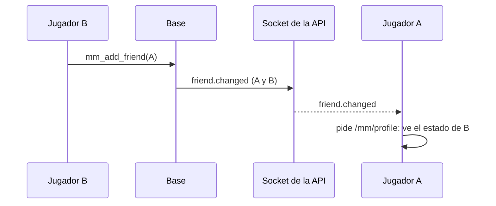
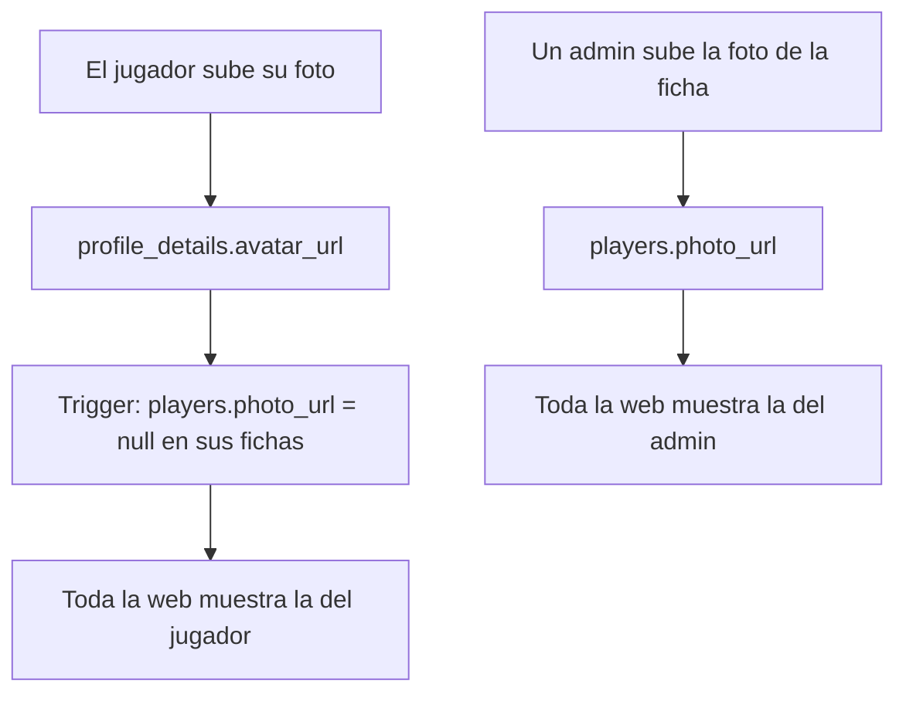

# Amigos al instante y la misma foto de perfil en toda la web: documentación

## Qué hace

Dos arreglos reportados por Daniel el 2026-11-03.

**Amigos.** En el matchmaking no hay solicitudes de amistad: cada uno marca a quien quiera, y el estado de un amigo (libre, en cola, jugando) solo se ve si él también te marcó. Hasta ahora, sumar o sacar a alguien no avisaba nada por el socket, así que la otra persona seguía viendo "Todavía no te marcó" hasta que la web volvía a pedir el estado. Ahora `mm_add_friend` y `mm_remove_friend` avisan `friend.changed` a la otra persona y a quien lo hizo, y la web vuelve a pedir la lista de amigos.

**Foto de perfil.** Cada persona puede tener dos fotos: la que sube desde su cuenta (`profile_details.avatar_url`) y la de su ficha (`players.photo_url`), que pone un admin. Casi toda la web muestra `coalesce(players.photo_url, avatar_url)`, así que la de la ficha le ganaba siempre a la del jugador. Pero el menú de la cuenta y Mi perfil mostraban solo la del jugador. Por eso, al cambiar la foto, se veía en el menú de la cuenta (abajo, en el sidebar) y en el resto seguía la vieja. Ahora **gana la última que se subió** (Daniel, 2026-11-03).

## Reglas

| Caso | Qué pasa |
|---|---|
| B suma o saca a A | Aviso `friend.changed` a A y a B (`d.player_id` = la ficha de A) |
| Sumar a quien ya estaba, o sacar a quien no estaba | Sin aviso |
| La ficha no tiene cuenta | El aviso va solo a quien lo hizo. Nunca con la lista vacía, que en `mm_emit` es "a todos" |
| El jugador sube su foto | Se borra la de su ficha y se ve la suya en todos lados |
| Después un admin le pone otra a la ficha | Se ve la del admin, también en el menú de la cuenta y en Mi perfil |
| El jugador quita su foto o cambia otro dato del perfil | La foto de la ficha no se toca |
| Cuentas que ya tenían las dos fotos distintas | El replanteo borra la de la ficha (pasa a verse la del jugador) y la guarda en `replanteo71_fotos_ficha` |

## Base de datos (replanteo `71_amigos_y_foto_perfil.sql`)

| Pieza | Qué hace |
|---|---|
| `mm_friend_users(ficha)` | Quien hace la acción más el usuario de la ficha, si tiene cuenta. Solo para las funciones |
| `mm_add_friend`, `mm_remove_friend` | Como en la `48`, y si cambió algo, `mm_emit('friend.changed', …)` |
| `profile_avatar_clears_player_photo()` y el trigger `profile_details_avatar_photo` | Después de guardar una foto nueva en `profile_details`, `players.photo_url = null` en las fichas de esa cuenta |
| `replanteo71_fotos_ficha` | Respaldo de las fotos de ficha que borró el arreglo de datos. RLS sin políticas. La inversa las restaura (si la ficha sigue sin foto) y la borra |

## Web

- `features/matchmaking/queries.ts`: `friend.changed` pide solo el perfil del matchmaking (la lista de amigos), no el estado completo.
- `features/profile/lib/photo.ts`: `myPhotoUrl(perfil)`, la misma regla que la base. La usan el menú de la cuenta (`AccountMenu`), Mi perfil (`ProfileSection`) y la Bienvenida.
- `useUploadAvatar`: al subir la foto se renuevan todas las consultas, no solo Mi perfil. La URL vieja se borra del bucket y quedaba rota en el resto de las pantallas hasta que se volvían a pedir.
- La API no cambia: el socket reparte cualquier aviso de `mm_emit` a los usuarios que nombra.

## Qué cambia para cada rol

| Rol | Qué cambia | Página del manual |
|---|---|---|
| Jugador | Ve al instante cuando alguien lo suma a amigos. Su foto nueva se ve en toda la web | `docs/manual/jugador/crear-cuenta.md` (la foto). Amigos no tiene página propia todavía |
| Admin | La foto que pone en una ficha se ve hasta que el jugador sube una suya | `docs/manual/admin/usuarios-y-fichas.md` |
| Capitán, organizador, moderador, streamer y dueño de un servidor externo | Nada | — |

## Términos y privacidad

Sin cambios: no se guarda ni se publica ningún dato nuevo (la foto de perfil ya figura en la política de privacidad).

## Dónde está cada cosa

| Qué | Archivo / ubicación |
|---|---|
| Replanteo | `supabase/replanteo/71_amigos_y_foto_perfil.sql` |
| Inversa | `docs/bitacora/2026-10-14-replanteo-modelo-datos/reversas/71_amigos_y_foto_perfil.sql` |
| Pruebas SQL | `pruebas/` de esta carpeta (`correr_local.sh`, `70.sql`, `70_caso_previo.sql`, `70_datos.sql`, `70_inversa.sql`) |
| Web | `web/frontend/src/features/matchmaking/queries.ts`, `features/profile/lib/photo.ts`, `features/profile/api/queries.ts`, `features/profile/pages/ProfileSection.tsx`, `features/shell/components/AccountMenu.tsx` y `features/onboarding/pages/WelcomeFlow.tsx` |
| Pruebas de la web | `features/matchmaking/queries.test.tsx` y `features/profile/lib/photo.test.ts` |
