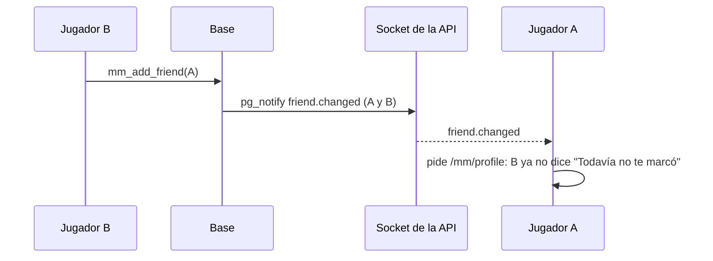
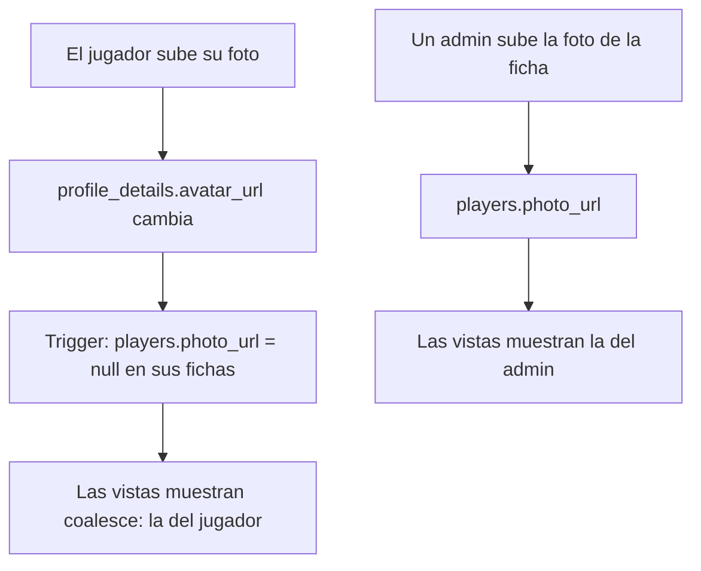

# Plan: amigos al instante y la misma foto de perfil en toda la web

> Planeación original. Estado: **aprobado por Daniel el 2026-11-03** (reporte suyo; en la foto, "gana la última que se subió").

## Decisiones tomadas

| Tema | Decisión |
|---|---|
| Amigos | `mm_add_friend` y `mm_remove_friend` mandan `friend.changed` por el socket a la otra persona (para que su lista muestre el estado sin "Todavía no te marcó") y a quien lo hizo (sus otras pestañas). La web vuelve a pedir el perfil del matchmaking |
| Destinatarios | Solo usuarios concretos. `mm_emit` con la lista vacía avisa a todos: si la ficha no tiene cuenta, el aviso va solo a quien lo hizo |
| Qué foto manda | **La última que se subió** (Daniel, 2026-11-03). Cuando el jugador sube su foto, se borra la de su ficha (`players.photo_url`) y en todos lados se ve la suya. Si después un admin le pone otra a la ficha, se ve la del admin |
| Cómo | Trigger en `profile_details`: al cambiar `avatar_url` a una foto, pone `players.photo_url = null` en las fichas de esa cuenta. Las vistas ya usan `coalesce(players.photo_url, avatar_url)`, así que no cambian |
| Lo que ya está mal | Las cuentas con las dos fotos distintas pasan a mostrar la del jugador. Las fotos de ficha que se borran quedan en una tabla de respaldo para la inversa |
| Menú de la cuenta y Mi perfil | Muestran lo mismo que el resto: la foto de la ficha y, si no hay, la de la cuenta. Hoy muestran solo la de la cuenta |
| Pantallas con la foto vieja | Al subir la foto, la web invalida todas las consultas (no solo "mi perfil"): la URL vieja se borra del bucket y quedaba rota en las demás pantallas hasta que se volvían a pedir |
| Ramas | `friend.changed` es del matchmaking: la base va en `feat/frontend-fase-1` y en `feat/mm-claim-en-sala` (regla de `CLAUDE.md`). La web, solo en `feat/frontend-fase-1` |

## 1. El flujo

## 2. Base de datos (replanteo `70_amigos_y_foto_perfil.sql`)

- `mm_add_friend(p_player)` y `mm_remove_friend(p_player)`: igual que en la `48`, más `mm_emit('friend.changed', null, <usuarios>, {'player_id': ...})` con el usuario de la ficha (si tiene cuenta) y `auth.uid()`.
- `profile_avatar_clears_player_photo()` y el trigger `profile_details_avatar_photo` (`after insert or update of avatar_url`): si la foto nueva no es `null` y cambió, `update players set photo_url = null where user_id = new.user_id and photo_url is not null`.
- Arreglo de los datos: respaldo en `replanteo70_fotos_ficha (player_id, photo_url)` de las fichas con cuenta, foto de cuenta y una foto de ficha distinta, y después `photo_url = null` en esas fichas.
- Inversa: devuelve las funciones de la `48`, borra el trigger y su función, restaura las fotos del respaldo y borra la tabla.
- Pruebas SQL con `pg_safeupdate` cargado.

## 3. Web

- `queries.ts` del matchmaking: `friend.changed` pide solo el perfil (`needs.profile`).
- `useUploadAvatar`: `invalidateQueries()` de todo al subir.
- `AccountMenu`, `ProfileSection` y la Bienvenida: la foto con `player.photo_url ?? details.avatar_url`.

## 4. Requisitos antes de empezar

Docker con la base local (para las pruebas SQL).

## 5. Orden de implementación

1. Replanteo `70`, inversa y pruebas.
2. Web y sus pruebas.
3. `DOCUMENTACION.md`, `GUIA_IMPLEMENTACION.md`, índice, README de replanteos y `docs/PENDIENTES.md`.
4. Commit en las dos ramas y staging cuando Daniel lo pida.
