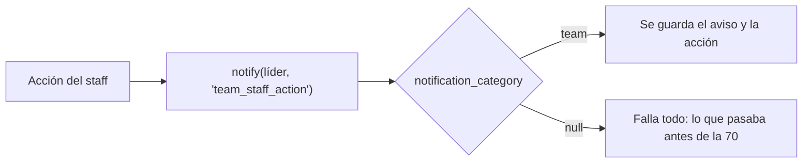

# Disolver y moderar equipos (replanteo 70)

Cada acción del staff sobre un equipo (`team_staff_*`) le avisa al líder con el aviso `team_staff_action`, de la categoría `team` y obligatorio. Es el caso de disolver, renombrar, quitar el logo, quitar o sumar un miembro, cambiar el rol o cambiar el líder. Desde el replanteo `70`, `notification_category('team_staff_action')` vuelve a dar `team`.

**Para el que escriba un replanteo:** no hay que rehacer `notification_category` desde una copia vieja. Se cambia reemplazando texto sobre `pg_get_functiondef`, como hacen la `43` y la `70`, para no pisar los tipos que sumaron los replanteos anteriores.
