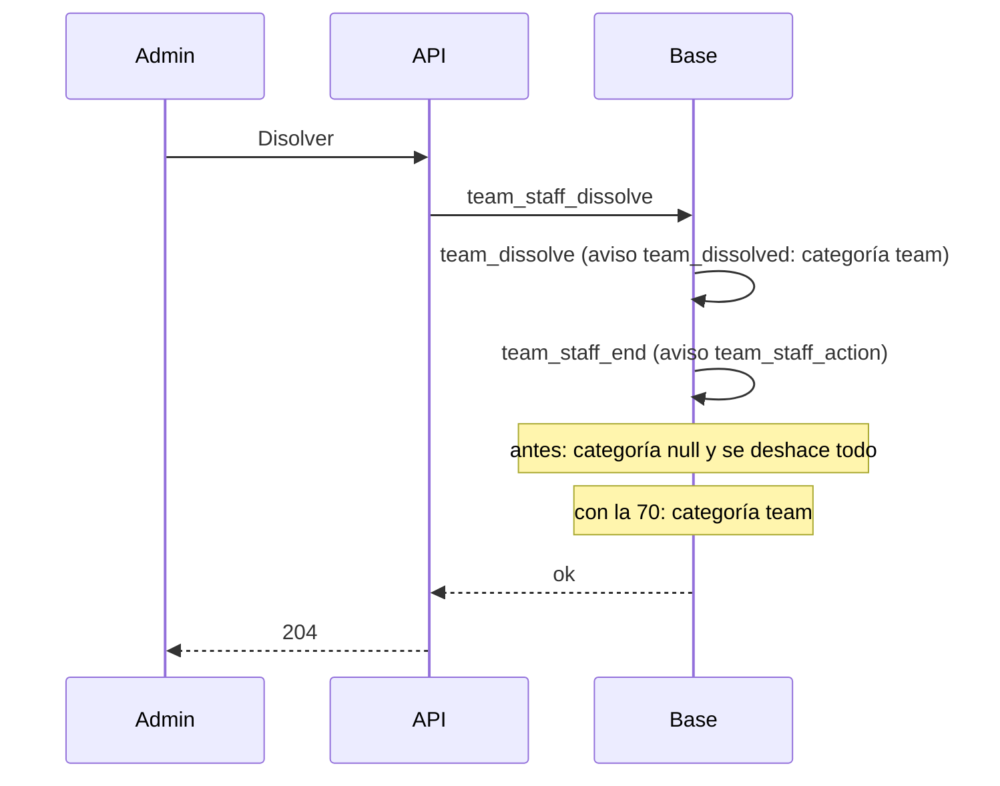

# Plan: disolver y moderar equipos vuelve a funcionar (replanteo 70)

> Planeación original. Estado: **aprobado por Kyan** (2026-11-03).

## El problema

Kyan, el 2026-11-03: al disolver un equipo desde Administración › Equipos sale "Algo salió mal" (código de seguimiento `1b4536aa-c97d-4e79-8303-1bbe2a54f178`). En los logs de la Supabase de producción quedaron dos `POST | 400 | rpc/team_staff_dissolve` a las 17:39 UTC, con este error:

```
null value in column "category" of relation "notifications" violates not-null constraint
```

Toda acción del staff sobre un equipo (`team_staff_*`: disolver, renombrar, quitar el logo, quitar o sumar un miembro, cambiar el rol o el líder) le manda al líder el aviso `team_staff_action`. `notification_category('team_staff_action')` devuelve `null`, así que el aviso no se puede guardar y se deshace la acción completa. Disolver como líder (`team_dissolve`) funciona, porque manda `team_dissolved`.

**Causa:** el replanteo `43` sumó `team_staff_action` a `notification_category` reemplazando texto en la función. El `56` y el `58` (de la rama del matchmaking) la vuelven a crear completa desde una copia anterior al `43`, y la pisan. Pasa igual en staging y en producción. Es el único tipo de aviso que quedó sin categoría: se revisaron todos los tipos que aparecen en un `notify(…)` de las funciones y en `notifications.type`.

## Decisiones

| Tema | Decisión | Por qué |
|---|---|---|
| Arreglo | Replanteo `70`: vuelve a sumar `team_staff_action` a la categoría `team`, reemplazando texto como el `43` | Es lo mínimo y no toca el `56` ni el `58`, que ya están aplicados |
| Control | Aborta si `notification_category` cambió. Al terminar, comprueba que `team_staff_action` sea `team` y que siga siendo obligatorio (`notification_required`) | Que no vuelva a fallar sin avisar |
| Bases | Staging y producción | El error está en las dos |
| Inversa | Saca `team_staff_action` | Como las demás, en `reversas/` |



## Pasos

1. `supabase/replanteo/70_aviso_staff_equipos.sql` y su inversa.
2. Aplicarlo en staging y en producción.
3. Comprobar `notification_category('team_staff_action') = 'team'` en las dos bases y que no quede ningún tipo sin categoría.
4. No toca el plugin ni la API: no hay nada que subir a los servidores (#1 MVZG, #2 flow, #3 `aurav34`).
