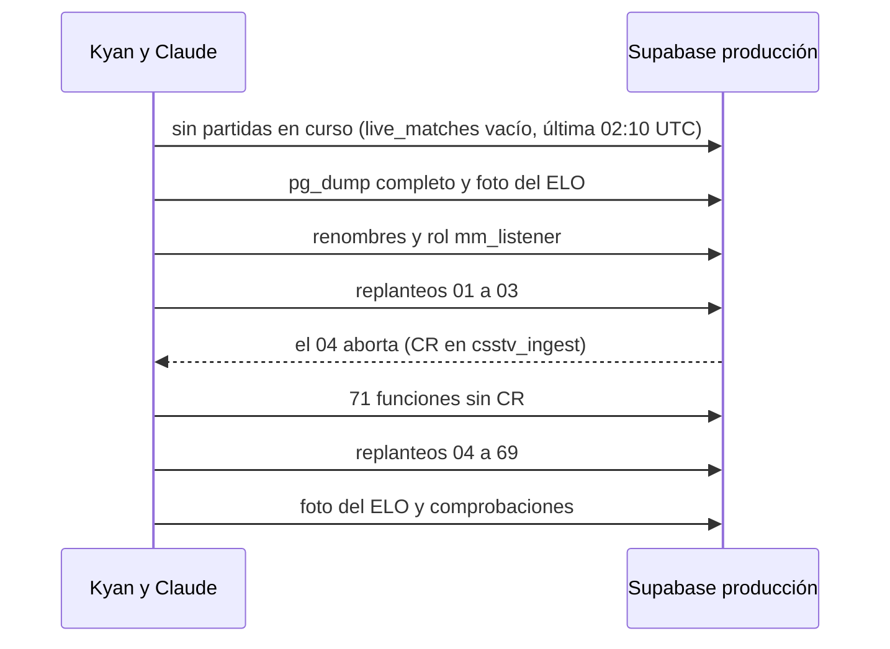

# Guía de implementación: corte a la base de producción

> El plan está en `PLAN.md` de esta carpeta, en la rama `feat/frontend-fase-1` (`911f491`). Esta guía anota lo que se hizo y en qué se apartó del plan.

**Estado (2026-11-03, 17:40 UTC):** la base de producción ya tiene los replanteos `01` a `69`. **El VPS todavía apunta a staging**: no se pudo entrar por SSH desde la PC de Kyan. Lo pidió Kyan ("solo cambiar la base de datos a producción", sin desplegar API ni web) y lo hizo Claude.

## 1. Qué se hizo

| Paso | Resultado |
|---|---|
| Respaldo | `pg_dump -Fc` completo (958 KB: `public`, `auth`, `storage`), en `C:\Users\Agus\Documents\respaldos_cmleague\prod_antes_corte_20261103.dump`, fuera del repo |
| Foto del ELO antes | `foto_elo.sql` dentro de `begin … rollback` (no escribe en producción). El recálculo coincide con lo guardado: 109 SteamIDs, 95 partidas, 943 filas de stats, 150 fichas |
| Paso 2.2 | `pruebas/antes_de_los_replanteos.sql` del plan: `geusz_2`, `Thorfinn_2` y la cuenta `musul_2` (confirmado por Kyan). Rol `mm_listener` con `MM_LISTENER_PASSWORD` del `.env` |
| Paso 2.3 | `01` a `69` sin CR, uno por archivo, con `ON_ERROR_STOP`. `notify pgrst, 'reload schema'` |
| Foto del ELO después | **Idéntica** a la de antes, línea por línea |

Herramienta: la imagen oficial `postgres:17` de Docker (no hay `psql` en la PC de Kyan), con `pruebas/pg.sh`, que lee la conexión `PG_*` del `.env`.

## 2. En qué se apartó del plan

- **CR en las funciones de producción.** El `04` abortó sin cambiar nada: no encontró en `csstv_ingest` el texto que reemplaza. **71 funciones de `public` (61 PL/pgSQL y 10 SQL) tenían CR en el cuerpo**, porque las migraciones se aplicaron con `psql` desde Windows. El ensayo no lo vio porque armó la base desde el repo, con LF.
  - Se revisó que ningún CR estuviera dentro de un texto entre comillas: en todas era solo fin de línea.
  - Con el sí de Kyan, `pruebas/sin_cr_funciones.sql` las volvió a crear con `pg_get_functiondef` sin CR, en una transacción. Después se siguió desde el `04`.
  - **Para cualquier otra base que venga de producción (por ejemplo, un ensayo con una copia), hay que correr ese script antes del `04`.**
- `01` a `03` entraron antes de encontrar el problema. Cada uno es una transacción, así que no quedó nada a medias.
- No se hizo lo de las secciones 2.4 a 7 (configuración copiada de staging, temporada BETA, Auth, VPS y servidores).

## 3. Comprobaciones

| Qué | Resultado |
|---|---|
| `elo_config` | 1 fila |
| Tablas del replanteo | `team_members` (106 filas, de los equipos de antes), `mm_queue`, `site_config`, `ac_server_policy` (0 filas: anticheat no obligatorio), `mix_deletions`, `seasons`, `notifications` |
| `mm_listener` | Puede ejecutar las 4 funciones `mm_*` que no son públicas |
| `manual_valores()` | Solo `authenticated`, igual que en staging |
| `site_auth_image()` como `anon` por PostgREST | `200` |
| Funciones con CR | 0 |
| Buckets | `ac-evidence`, `avatars`, `photos`, `proofs`, `sounds` |
| Cuentas | 59, sin cambios |
| Estructura contra staging | Mismas 491 funciones. Columnas: producción tiene además `vip_status.active_since` y `days_active` (migración `vip_dias`, que staging no tiene) |
| Permisos de ejecución | Iguales a staging, salvo 19 que **staging tiene de más**: `anon`/`authenticated` sobre `csstv_ingest`, `csstv_auth`, `csstv_check_token`, `demo_auth`, `elo_apply_match`, `create_server_token`, `rotate_server_token` y otras internas. En producción solo las ejecuta `service_role`, como antes del corte. Es staging el que está abierto de más (ver `PENDIENTES.md`) |

Los permisos de tablas y los triggers no se compararon: el usuario de solo lectura de staging no los ve.

## 4. Falta

1. **VPS** (sección 4 del plan): `api.env`, `season.env` y `demos.env` a producción, con los viejos como `.staging`, y reiniciar los servicios. En la PC de Kyan no hay llave SSH (`ubuntu@` responde `Permission denied (publickey)`): **lo hace Daniel** (decidido por Kyan el 2026-11-03). Las claves de producción ya están en el `.env` (`PRODUCTION_SUPABASE_ANON_KEY`, `PRODUCTION_SUPABASE_SERVICE_KEY`). **Hasta entonces, la web nueva sigue contra staging y no hay ninguna web contra producción.**
2. La configuración copiada de staging (2.4, `copiar_config.sh` sin escribir). Sin ella, el matchmaking de producción no tiene modos, mapas ni sonidos.
3. La temporada BETA (2.5) y los roles.
4. Auth de producción (sección 3): SMTP de Resend, URL del sitio y confirmar el correo. Ya está `SUPABASE_ACCESS_TOKEN_PROD`.
5. Los servidores (sección 5). flow y el #3 reportan a producción con el reporter de antes: hay que verificar que la próxima partida de flow entre bien (`ingest_server_chunk`) y que el Worker de demos y el render de clips sigan andando (sección 6).
6. Bajar `csstv.gamer.gd` si todavía no se hizo: la web vieja ya no funciona con esta base.

## 5. Volver atrás

Restaurar el respaldo en producción. Se pierde lo que haya entrado después de las 17:00 UTC del 2026-11-03.
