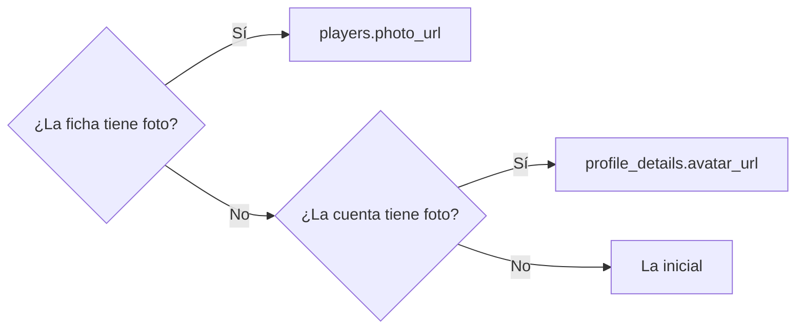

# La foto de cada integrante en el plantel de un equipo: documentación

## Qué hace

El plantel de un equipo y la tarjeta **Roles de equipo** muestran la foto de cada integrante, también la que subió desde su cuenta. Antes mostraban la inicial si la ficha del jugador no tenía foto propia.

## La regla

`team_members_view.photo_url = coalesce(players.photo_url, profile_details.avatar_url)`, igual que `player_overview`. La usan `GET /api/v1/teams/{id}/members` (la página del equipo, el plantel y Roles de equipo) y el plantel de Mi equipo. La API y la web no cambian.

## Qué cambia para cada rol

| Rol | Qué cambia | Página del manual |
|---|---|---|
| Jugador y capitán | En la página del equipo se ve la foto de cada integrante | — (el manual no lo describe) |
| Los demás | Nada | — |

## Términos y privacidad

Sin cambios: la foto ya era pública en el perfil del jugador.

## Dónde está cada cosa

| Qué | Archivo / ubicación |
|---|---|
| Replanteo | `supabase/replanteo/69_foto_en_plantel.sql` |
| Inversa | `docs/bitacora/2026-10-14-replanteo-modelo-datos/reversas/69_foto_en_plantel.sql` |
| Pruebas | `pruebas/69.sql` y `pruebas/correr.sh` |
