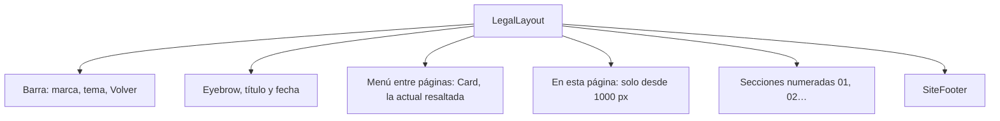

# Términos y privacidad en el frontend nuevo: documentación

## Qué hace

Un centro de ayuda y legales en el frontend nuevo, con cinco páginas públicas y un menú lateral que pasa de una a otra (diseño que pasó Kyan el 2026-11-03):

| Ruta | En el menú | Contenido |
|---|---|---|
| `/ayuda` | Preguntas frecuentes | Cuenta, servidores y comandos, ELO, equipos, VIP, demos y anticheat |
| `/soporte` | Soporte | Qué mandar, canales (Discord y correo), `!calladmin`, reportes, apelaciones, datos y VIP |
| `/terminos` | Términos de uso | El mismo texto que `terms/terminos.html` |
| `/privacidad` | Privacidad | El mismo texto que `terms/privacidad.html` |
| `/seguridad` | Seguridad | Contraseña, estafas, Steam, servidores, anticheat, qué hacemos, cuenta robada y vulnerabilidades |

Se llega desde la columna **Legal** del pie (Ayuda, Términos y Privacidad) y desde el texto de abajo del registro y del inicio de sesión. Preguntas frecuentes, Soporte y Seguridad existen solo en el frontend nuevo: no tienen versión `.html`.

## Archivos (en `web/frontend/src/`)

| Archivo | Qué tiene |
|---|---|
| `components/brand/SiteFooter.tsx` | El pie de la landing: la marca a la izquierda y la columna **Legal** (Ayuda, Términos y Privacidad) a la derecha |
| `features/legal/lib/pages.ts` | `HELP_PAGES`: las cinco páginas del menú, en orden |
| `features/legal/pages/FaqPage.tsx`, `SupportPage.tsx`, `SecurityPage.tsx` | Preguntas frecuentes, Soporte y Seguridad |
| `routes/ayuda.tsx`, `routes/soporte.tsx`, `routes/seguridad.tsx` | Las rutas nuevas |
| `features/legal/components/LegalLayout.tsx` | `LegalLayout`, `Pending` (dato a completar) y `Wip` (función que no está disponible) |
| `features/legal/pages/TermsPage.tsx` | Las 22 secciones de los términos |
| `features/legal/pages/PrivacyPage.tsx` | Las 13 secciones de la privacidad, con las tablas de proveedores y plazos |
| `features/legal/lib/meta.ts` | `LEGAL_UPDATED`, la fecha de la versión |
| `features/legal/pages/legal.test.tsx` | En las cinco páginas: una entrada de "En esta página" por sección y sin enlaces `#…` rotos; y que el menú lleve a las cinco |
| `routes/terminos.tsx`, `routes/privacidad.tsx` | Las rutas |
| `features/auth/components/AuthShell.tsx` | "Al continuar aceptas los términos y condiciones y la política de privacidad", con links |

## Cosas a tener en cuenta

- **La página actual del menú** la marca el router con `data-status="active"`: no hace falta pasarle cuál es.
- **Lo que se promete en Seguridad y Soporte** (no pedir contraseñas, plazos de respuesta, no actuar contra quien reporte una falla de buena fe) tiene que cumplirse.

- **Dos copias del texto:** la del frontend y la de los `.html`. Si se cambia una, se cambia la otra y `LEGAL_UPDATED`. Las dos tienen un comentario que lo recuerda.
- **La sección de Google Drive** de la privacidad es la que revisa Google para «CMLeague clips». La URL que tiene cargada Google es la de `terms/privacidad.html`.
- **Texto en tuteo**, como el resto de la web.
