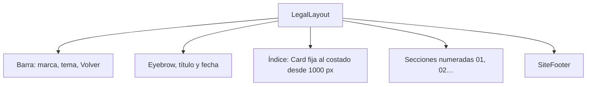

# Términos y privacidad en el frontend nuevo: documentación

## Qué hace

Dos páginas públicas del frontend nuevo, `/terminos` y `/privacidad`, con el mismo texto que `terms/terminos.html` y `terms/privacidad.html` y el aspecto de la landing. Se llega desde el pie de la landing y desde el texto de abajo del registro y del inicio de sesión.

## Archivos (en `web/frontend/src/`)

| Archivo | Qué tiene |
|---|---|
| `components/brand/SiteFooter.tsx` | El pie de la landing, con los links a Términos y Privacidad |
| `features/legal/components/LegalLayout.tsx` | `LegalLayout`, `Pending` (dato a completar) y `Wip` (función que no está disponible) |
| `features/legal/pages/TermsPage.tsx` | Las 22 secciones de los términos |
| `features/legal/pages/PrivacyPage.tsx` | Las 13 secciones de la privacidad, con las tablas de proveedores y plazos |
| `features/legal/lib/meta.ts` | `LEGAL_UPDATED`, la fecha de la versión |
| `features/legal/pages/legal.test.tsx` | Que el índice tenga una entrada por sección y que no haya enlaces `#…` rotos |
| `routes/terminos.tsx`, `routes/privacidad.tsx` | Las rutas |
| `features/auth/components/AuthShell.tsx` | "Al continuar aceptas los términos y condiciones y la política de privacidad", con links |

## Cosas a tener en cuenta

- **Dos copias del texto:** la del frontend y la de los `.html`. Si se cambia una, se cambia la otra y `LEGAL_UPDATED`. Las dos tienen un comentario que lo recuerda.
- **La sección de Google Drive** de la privacidad es la que revisa Google para «CMLeague clips». La URL que tiene cargada Google es la de `terms/privacidad.html`.
- **Texto en tuteo**, como el resto de la web.
