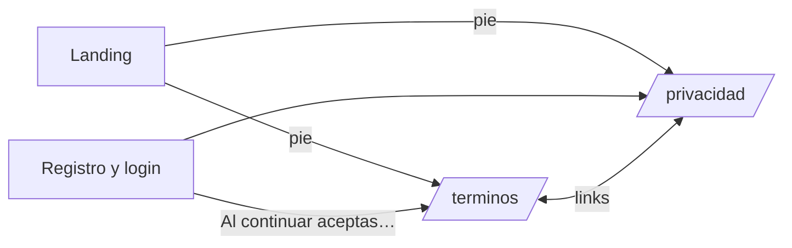

# Plan: términos y privacidad en el frontend nuevo

> Planeación original. Estado: **pedido por Kyan** el 2026-11-03 ("que se vea igual que en la web").

Los textos de [`2026-11-03-terminos-y-condiciones`](../2026-11-03-terminos-y-condiciones/) y [`2026-11-03-politica-privacidad`](../2026-11-03-politica-privacidad/) existen como páginas estáticas para la web vieja. El frontend nuevo necesita sus propias rutas con el estilo de la landing.

## Decisiones tomadas

| Tema | Decisión | Por qué |
|---|---|---|
| Rutas | `/terminos` y `/privacidad`, públicas, sin guarda | Se leen con o sin sesión, y antes de registrarse |
| Aspecto | Barra flotante como la de la landing, `Eyebrow`, índice en una `Card variant="outline"` (fijo al costado desde 1000 px), secciones numeradas y el mismo pie | Las piezas que ya usa la landing |
| Pie | Se saca de `routes/index.tsx` a `components/brand/SiteFooter.tsx` y se le suman los dos links | Lo usan la landing y las dos páginas |
| Registro e inicio de sesión | El "Al continuar aceptas las reglas de la comunidad" de `AuthShell` pasa a enlazar los términos y la privacidad | Que la aceptación tenga a qué remitir |
| Texto | El mismo de los `.html`, como JSX en `features/legal/pages/` | Sin `dangerouslySetInnerHTML` (regla del frontend) |
| Datos faltantes | `Pending` (resaltado naranja) para los `[…]` y `Wip` (`Badge soft`) para lo que no está disponible | Se ven igual que en los `.html` |

## 1. El flujo completo

## 2. Orden de implementación

1. `SiteFooter`, `LegalLayout`, las dos páginas y las dos rutas.
2. Texto de `AuthShell`.
3. Prueba del índice y los enlaces internos, typecheck, lint y navegador.
