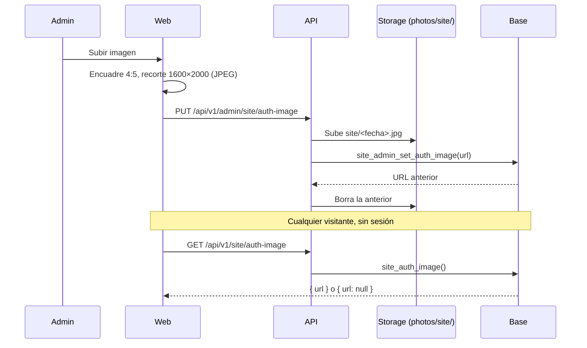

# Imagen del inicio de sesión configurable: documentación

## Qué hace

Iniciar sesión, Registro y Bienvenida (completar el perfil) tienen el formulario a la izquierda y un panel a la derecha (`AuthShell`). Ese panel era gris desde el diseño original, con la imagen pendiente. Ahora un admin sube la imagen en **Administración › Usuarios › Inicio de sesión**, y el panel la muestra. Si no hay imagen, el panel sigue gris, como antes (Daniel, 2026-11-03).

La imagen es vertical **4:5** y se guarda en **1600 × 2000**. El admin la encuadra en el navegador antes de subirla y la API valida la proporción y las medidas. Se guarda en el bucket `photos` (carpeta `site/`), y al cambiarla o quitarla se borra el archivo anterior.

## Cómo se ve en cada pantalla

El panel ocupa la mitad derecha con todo el alto, y la imagen lo cubre centrada (`object-cover`): se recorta lo que sobra.

| Pantalla | Panel | Qué se ve de la imagen |
|---|---|---|
| 1366 × 768 | ~683 × 768 | Casi toda, algo recortada arriba y abajo |
| 1440 × 900 | ~720 × 900 | Entera (4:5) |
| 1920 × 1080 | ~960 × 1080 | Recortada arriba y abajo |
| Teléfono (menos de 960 px) | Ancho completo × 320 px, debajo del formulario | Una franja horizontal del medio |

Por eso lo importante va en el centro. El cuarto de abajo lo tapa la tarjeta con el texto de cada vista (por ejemplo, "43 mixes reportados por el servidor").

## Reglas

| Caso | Qué pasa |
|---|---|
| Sin imagen | Panel gris (`bg-muted`) |
| La consulta falla | Panel gris; no se reintenta |
| Imagen que no es 4:5 (±3 %) | La API responde 400 y no sube nada |
| Menos de 800 × 1000 o más de 3200 × 4000 | 400 |
| Más de 4 MB, o que no es JPG, PNG ni WebP | 400 (la web la recorta a JPEG de hasta 1,5 MB antes) |
| Un usuario que no es admin | 403, en la API y en la base |
| La base rechaza el guardado | La API borra el archivo recién subido |
| Cambiar o quitar | Se borra del bucket el archivo anterior, sin demorar la respuesta |

## Base de datos (replanteo `67_imagen_login.sql`)

| Pieza | Qué hace |
|---|---|
| `site_config` | Configuración del sitio fuera de un módulo. Una sola fila (`id = 1`, con `check`). RLS activa y sin políticas: no se lee ni se escribe directo |
| `site_config.auth_image_url` | URL de la imagen; `null` = panel gris |
| `site_auth_image()` | Devuelve la URL. `security definer`, ejecutable por `anon` y `authenticated` (el login se ve sin sesión) |
| `site_admin_set_auth_image(url)` | Solo admins (`42501` si no). Guarda la URL (`null` o vacío = quitar) y devuelve la anterior. `UPDATE` con `where id = 1` por `pg_safeupdate` (replanteo `62`) |

## API (`web/backend/src/routes/site.ts`)

| Ruta | Quién | Respuesta |
|---|---|---|
| `GET /api/v1/site/auth-image` | Cualquiera (`optionalUser`) | `{ url }` |
| `PUT /api/v1/admin/site/auth-image` | Admin. Multipart `file` | `{ url }` nueva |
| `DELETE /api/v1/admin/site/auth-image` | Admin | `{ url: null }` |

El esquema de la respuesta es `AuthImage` en la OpenAPI (etiqueta "Sitio").

## Web

- **`AuthShell`** (`features/auth/components/AuthShell.tsx`): pide la imagen con `authImageOptions` (se guarda 5 min, sin reintentos) y la pone de fondo del panel, decorativa (`alt=""`).
- **`authImage.ts`** (`features/auth/api/`): la consulta y las mutaciones. Llama con `authFetch` porque `schema.d.ts` no tiene las rutas todavía (ver la guía).
- **`AuthImageTab`** (`features/admin/users/components/`): pestaña "Inicio de sesión" de Administración › Usuarios (`?tab=login`), con la vista previa 4:5, Subir o Cambiar (diálogo de encuadre `AvatarCropDialog` con `aspect={4 / 5}`) y Quitar.
- **`cropAuthImage`** (`lib/image.ts`): recorta a 1600 × 2000 en JPEG, hasta 1,5 MB.

## Qué cambia para cada rol

| Rol | Qué cambia | Página del manual |
|---|---|---|
| Jugador y cualquier visitante | Ve la imagen en Iniciar sesión, Registro y la bienvenida, si el admin subió una | Ninguna (no hay nada que hacer) |
| Admin | Pestaña nueva "Inicio de sesión" en Administración › Usuarios para subir, cambiar o quitar la imagen | `docs/manual/admin/imagen-inicio-sesion.md`, **pendiente**: la sección Admin del manual todavía no se escribió (punto 1.49 de `docs/PENDIENTES.md`) |
| Capitán, organizador, moderador, streamer y dueño de un servidor externo | Nada | — |

## Términos y privacidad

Sin cambios: es una imagen del sitio, no un dato de los usuarios.

## Dónde está cada cosa

| Qué | Archivo / ubicación |
|---|---|
| Replanteo | `supabase/replanteo/67_imagen_login.sql` |
| Inversa | `docs/bitacora/2026-10-14-replanteo-modelo-datos/reversas/67_imagen_login.sql` |
| Pruebas SQL | `pruebas/67.sql` y `pruebas/correr_local.sh` (esta carpeta) |
| API | `web/backend/src/routes/site.ts`, montada en `web/backend/src/app.ts` |
| Pruebas de la API | `web/backend/test/unit/site-auth-image.test.ts` |
| Web | `web/frontend/src/features/auth/api/authImage.ts`, `features/auth/components/AuthShell.tsx`, `features/admin/users/components/AuthImageTab.tsx`, `features/admin/users/pages/AdminUsersPage.tsx` y `lib/image.ts` |
| Pruebas de la web | `AuthShell.test.tsx` y `AuthImageTab.test.tsx`, al lado de cada componente |
| Archivos subidos | Bucket `photos`, carpeta `site/` |
