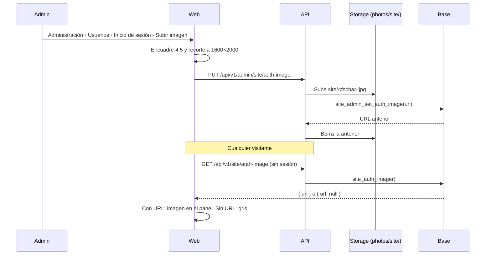

# Plan: imagen del inicio de sesión configurable por el admin

> Planeación original. Estado: **aprobado por Daniel el 2026-11-03** (los tres puntos: base, API y web; sin imagen, el panel queda gris como hoy).

## Decisiones tomadas

| Tema | Decisión |
|---|---|
| Dónde se ve | El panel derecho de `AuthShell`: Iniciar sesión, Registro y Bienvenida (completar perfil). Hoy es un panel gris (`bg-muted`) desde el diseño de `2026-10-16-frontend-diseno-landing-auth` |
| Sin imagen | El panel queda gris, como hoy (Daniel, 2026-11-03). No hay imagen por defecto dentro de la app |
| Proporción | **4:5 vertical**, guardada en **1600 × 2000**. El panel ocupa media pantalla con todo el alto: en 1440 × 900 es 720 × 900 (4:5) y en 1920 × 1080 es casi cuadrado. La imagen cubre el panel (`object-cover`) y se recorta lo que sobra, centrada |
| Zona segura | Lo importante va en el centro. El cuarto de abajo lo tapa la tarjeta con el texto de cada vista. En teléfono el panel baja debajo del formulario y muestra una franja horizontal del medio |
| Quién la cambia | Solo el admin, en Administración › Usuarios, pestaña nueva "Inicio de sesión" (es la sección de las cuentas con las que la gente entra a la web) |
| Cómo se sube | Igual que la imagen del MVP (replanteo `54`): la web la encuadra en 4:5 y la sube recortada; la API valida tipo, peso y medidas, la guarda en el bucket `photos` (carpeta `site/`) y borra la anterior |
| Quién la lee | Cualquiera, sin sesión: el login se ve sin sesión. Endpoint público y función de la base con `grant` a `anon` |
| Dónde se guarda la URL | Tabla nueva `site_config` de una sola fila (`id = 1`), para lo que se configure del sitio fuera de un módulo. RLS activa y sin políticas: se lee y escribe solo por funciones `security definer` |
| Legibilidad | Una imagen clara puede competir con la tarjeta del texto: la tarjeta ya tiene fondo casi opaco y desenfoque, así que no se agrega degradado |
| Ramas | Base, API y web en `feat/frontend-fase-1`. No es del matchmaking, así que la regla de las dos ramas no aplica; si staging se despliega desde `feat/mm-claim-en-sala`, se lleva ahí la base y la API (queda en la guía) |

## 1. El flujo completo

## 2. Base de datos (replanteo `67_imagen_login.sql`)

- Tabla `site_config` (`id int primary key default 1 check (id = 1)`, `auth_image_url text`), con su fila. RLS activa, sin políticas.
- `site_auth_image()`: devuelve la URL. `security definer`, `stable`, ejecutable por `anon` y `authenticated`.
- `site_admin_set_auth_image(p_url text)`: exige `is_admin()`, guarda la URL (`null` o vacío = quitar) con `where id = 1` (por `pg_safeupdate`, ver replanteo `62`) y devuelve la anterior.
- Inversa en `docs/bitacora/2026-10-14-replanteo-modelo-datos/reversas/67_imagen_login.sql` y pruebas SQL en `pruebas/`.

## 3. API (`web/backend/src/routes/site.ts`)

| Ruta | Quién | Qué hace |
|---|---|---|
| `GET /api/v1/site/auth-image` | Público (`optionalUser`) | `{ url }` |
| `PUT /api/v1/admin/site/auth-image` | Admin | Multipart `file`: valida JPG, PNG o WebP, 4:5 (±3 %), entre 800 × 1000 y 3200 × 4000, hasta 4 MB; sube a `photos/site/`, guarda y borra la anterior. Si la base falla, borra lo subido |
| `DELETE /api/v1/admin/site/auth-image` | Admin | La quita y borra el archivo |

Pruebas unitarias como las de la imagen del MVP (`test/unit/site-auth-image.test.ts`).

## 4. Web

- `AuthShell`: pide la imagen (consulta pública, se guarda 5 min) y la muestra con `object-cover`, centrada, decorativa (`alt=""`). Sin URL o si falla la consulta: gris.
- Administración › Usuarios › **Inicio de sesión**: tarjeta con la vista previa en 4:5, Subir o Cambiar (con el encuadre 4:5 del diálogo de recorte) y Quitar. Recorte con `cropImage` a 1600 × 2000 en JPEG, hasta 1 MB.
- Regenerar `schema.d.ts` no hace falta: la web llama con el cliente tipado si la ruta está en la OpenAPI; si no se puede regenerar, se usa `fetch` como en la imagen del MVP.

## 5. Requisitos antes de empezar

Ninguno: el bucket `photos` ya existe y el admin ya puede escribir en cualquier carpeta (`supabase/schema/auth_storage.sql`).

## 6. Orden de implementación

1. Replanteo `67`, su inversa y sus pruebas SQL.
2. Rutas de la API y sus pruebas.
3. `AuthShell` y la pestaña de Administración, con sus pruebas.
4. `DOCUMENTACION.md`, `GUIA_IMPLEMENTACION.md`, fila en `docs/bitacora/README.md` y punto en `docs/PENDIENTES.md`.
5. Despliegue en staging (`67`, API y web) cuando Daniel lo pida.
