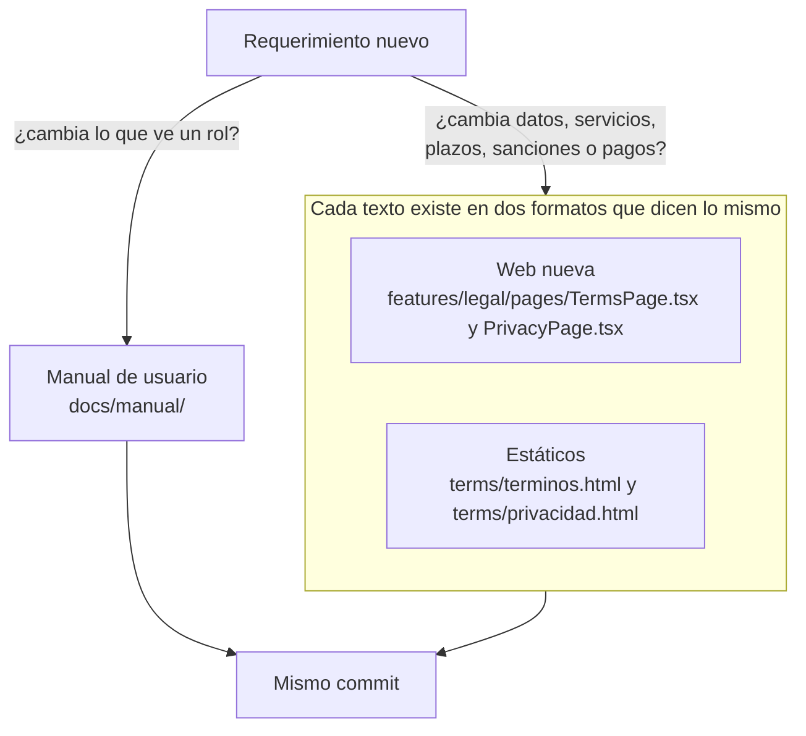

# Términos y privacidad al día con la plataforma: documentación

## Qué hace

Los términos y condiciones (`/terminos`) y la política de privacidad (`/privacidad`) describen toda la plataforma, también lo que todavía no está hecho. Este requerimiento los alineó con lo que funciona hoy:

- Lo que está planteado pero no implementado lleva la marca **"En preparación"**.
- Lo que funcionaba distinto a lo descrito se reescribió.
- Se agregó lo que faltaba.

Además quedó una regla: cada requerimiento nuevo revisa si cambia estos textos y el manual de usuario.

## Qué se marcó como "En preparación"

| Texto | Frase | Por qué |
|---|---|---|
| Privacidad › Qué datos usamos | Partidas favoritas y búsquedas guardadas | No existen en la base, la API ni la web. Están planteadas para el VIP |
| Privacidad › Lo que subes | Capturas y notas de los reportes de resultados | La web nueva no tiene reportes con capturas (la vieja sí, hasta el corte) |
| Términos › Moderación | La lista pública de baneos | `GET /api/v1/bans` responde sin sesión, pero no hay página pública |
| Términos › Mixes | Las reglas del ELO publicadas en la web | Solo se ven en Administración › Servidores |
| Términos › Torneos | Las PCW | En el menú están en gris con "Pronto" |

## Qué se reescribió

- **Resultados de torneos y PCW:** antes decía que los capitanes los reportan con capturas. Desde el replanteo `56` el resultado lo manda el servidor reservado al terminar, y si falla decide un administrador.
- **PCW y ranking:** antes decía que no cuentan para el ranking. No mueven el ELO de los jugadores (solo los mixes), pero sí cuentan para el ranking de equipos (vista `team_results`, replanteo `27`).

## Qué se agregó

- **Discord, en la tabla de servicios de la privacidad:** el aviso de la cola del matchmaking en #avisos (replanteo `57`), que publica el tag de quien avisa.

## La regla para lo que venga

- Está en `CLAUDE.md` (al lado de la del manual) y en `docs/bitacora/PLANTILLA.md`.
- Cada `DOCUMENTACION.md` lleva la sección "Términos y privacidad", aunque sea para decir "Sin cambios".
- Disparan un cambio: un dato nuevo que se guarda o se publica, un servicio externo nuevo, un plazo, una sanción, un pago o algo que deja de estar "En preparación".
- Cuando algo marcado se implementa, se le quita la marca en los dos formatos.
- La fecha de la versión está en `features/legal/lib/meta.ts` (`LEGAL_UPDATED`) y arriba de cada `.html`. Se actualiza si el cambio es de fondo.

## Qué cambia para cada rol

| Rol | Qué cambia | Página del manual |
|---|---|---|
| Todos (con o sin cuenta) | `/terminos` y `/privacidad` dicen lo que pasa hoy y marcan lo que todavía no está | Ninguna (los legales no son parte del manual) |

## Términos y privacidad

Es el objeto de este requerimiento: los seis cambios de arriba, en la web y en los `.html`.

## Dónde está cada cosa

| Qué | Archivo / ubicación |
|---|---|
| Términos (web) | `web/frontend/src/features/legal/pages/TermsPage.tsx` |
| Privacidad (web) | `web/frontend/src/features/legal/pages/PrivacyPage.tsx` |
| Marca "En preparación" (web) | `Wip` en `web/frontend/src/features/legal/components/LegalLayout.tsx` |
| Términos y privacidad (estáticos) | `terms/terminos.html` y `terms/privacidad.html` (``) |
| La regla | `CLAUDE.md` y `docs/bitacora/PLANTILLA.md` |
