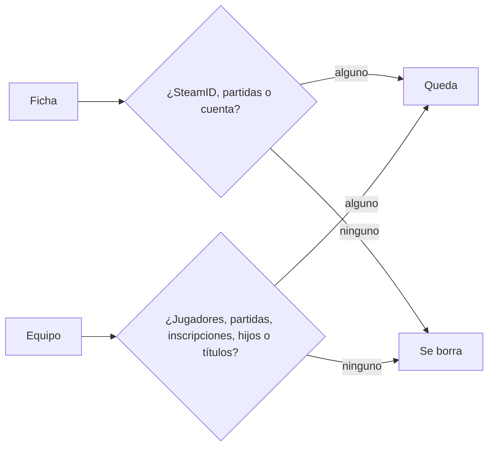

# Limpieza de fichas y equipos vacíos

El 2026-11-03, por pedido de Kyan, se borraron de **producción** las fichas que no servían para nada y los equipos que no tenían ningún jugador.

| Qué | Criterio | Cantidad |
|---|---|---|
| Fichas | Sin SteamID (ni principal ni adicional), sin partidas (ni stats ni alineaciones) y sin cuenta. Venom queda | 34 |
| Equipos | Sin ninguna fila en `team_members` (ni activa ni pasada), sin partidas, inscripciones, equipos hijos ni títulos | 10 |

- La ficha de "Ls. piedra" no tiene SteamID ni partidas, pero tiene cuenta: queda (decisión de Kyan).
- Al borrar una ficha se borran en cascada sus filas de `team_members`. Las 34 estaban en 12 equipos y ninguno quedó vacío.
- Staging no se tocó.
- No toca el plugin: no hay nada que subir a los servidores (#1 MVZG, #2 flow, #3 `aurav34`).
