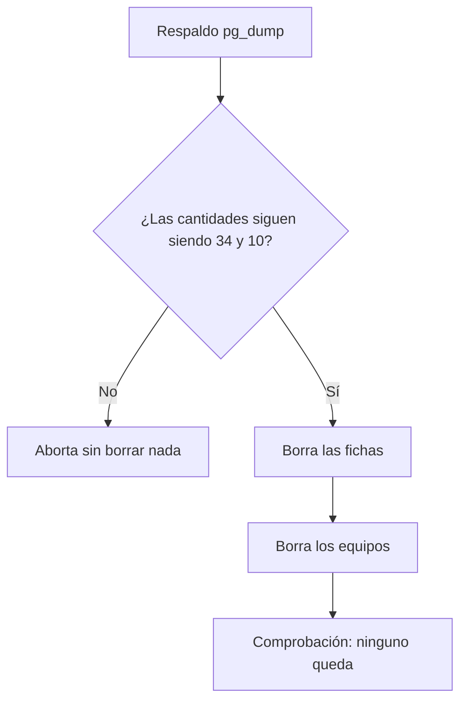

# Plan: limpieza de fichas y equipos vacíos en producción

> Planeación original. Estado: **aprobado por Kyan** (2026-11-03).

Pedido por Kyan el 2026-11-03, después del corte a producción: borrar las fichas que no sirven para nada y los equipos que no tienen jugadores.

## Decisiones

| Tema | Decisión | Por qué |
|---|---|---|
| Fichas | Se borran las que no tienen SteamID (ni principal ni adicional en `player_extra_steam_ids`), ni partidas (`match_player_stats` ni alineaciones de `matches`) **ni cuenta** | Kyan: "solo sin cuenta". La ficha de "Ls. piedra" tiene cuenta y queda |
| Venom | No se borra | Lo pidió Kyan (además tiene cuenta) |
| Equipos | Se borran los que no tienen ninguna fila en `team_members`, activa ni pasada, y tampoco partidas, inscripciones ni equipos hijos | `matches.team1`/`team2` borran en cascada: un equipo con partidas no se toca (lo frena además `teams_safe_delete`) |
| Base | Solo producción | Staging tiene datos de prueba |

Al 2026-11-03 son **34 fichas** y **10 equipos**. Ninguna de las fichas tiene baneos ni pedidos de SteamID. Las fichas salen de 12 equipos y ninguno queda vacío: el que menos conserva tiene un jugador activo.

## Pasos

1. Respaldo completo de producción (`pg_dump`), fuera del repo.
2. `pruebas/limpieza.sql`, en una transacción. Aborta si las cantidades no son las del inventario.
3. Comprobación después del borrado.

## Volver atrás

Restaurar las filas desde el respaldo (`pg_restore --data-only` de `players`, `team_members` y `teams`, filtrando por los ids anotados en la guía).
