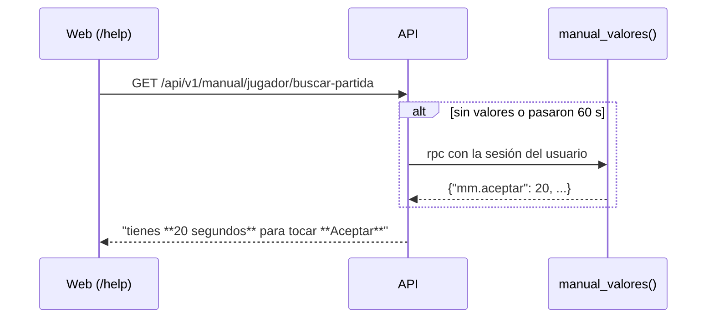

# Valores reales de la base en el manual: documentación

## Qué hace

Las páginas del manual (`docs/manual/`) llevan **marcadores** donde va un número que un admin cambia desde la web: `{{mm.aceptar}}`, `{{mm.sanciones}}`, `{{equipo.capitan_max}}`. Al servir una página, la API los reemplaza por el valor vigente de la base, ya con su unidad: "20 segundos", "5 minutos, 15 minutos, 1 hora y 24 horas", "1 equipo".

Así el manual dice siempre lo mismo que hace la web. Antes, el tiempo para aceptar figuraba como 15 s y en staging ya estaba en 20 s.

## Los marcadores

| Marcador | De dónde sale | Formato | Por defecto |
|---|---|---|---|
| `mm.grupo_max` | `mm_config.max_party_size` | número | 2 |
| `mm.grupo_dif_elo` | `mm_config.party_max_elo_gap` | número | 500 |
| `mm.aceptar` | `mm_config.accept_seconds` | segundos | 15 |
| `mm.veto` | `mm_config.veto_seconds` | segundos | 15 |
| `mm.conectar` | `mm_config.connect_minutes` | minutos | 5 |
| `mm.espera_servidor` | `mm_config.server_wait_minutes` | minutos | 3 |
| `mm.volver` | `mm_config.reconnect_minutes` | minutos | 3 |
| `mm.sanciones` | `mm_config.penalty_ladder` | lista de duraciones | 5, 15, 60, 1440 |
| `mm.sancion_min`, `mm.sancion_max` | el primero y el último de la escalera | duración | 5 min, 24 h |
| `equipo.max_miembros` | `team_config.max_members` | número | 10 |
| `equipo.capitan_max` | `team_config.max_led` | "N equipo(s)" | 1 |
| `clips.por_partida`, `clips.por_jugador` | `clip_config.per_match`, `per_player` | número | 10, 2 |
| `elo.min_pct`, `elo.full_pct` | `elo_config.min_pct`, `full_pct` | porcentaje | 35, 90 |
| `claim.max_steam_ids` | `claim_config.max_steam_ids` | número | 3 |

- **Duraciones** (en minutos): menos de una hora o no redonda, "90 minutos"; horas redondas, "1 hora" y "24 horas"; días redondos desde 2, "2 días".
- **Números** con separador de miles (`es-AR`): "1.500".
- Singular y plural según el valor: "1 segundo", "2 segundos".

## Reglas

| Regla | Detalle |
|---|---|
| Dónde se permiten | Solo en el cuerpo. En `titulo` o `resumen`, error de validación (el índice no lee la base) |
| Marcador desconocido o mal escrito | Error de validación: `marcador desconocido: {{…}}`. El build de la API falla; la API arranca igual y lo muestra en el log |
| Caché | 60 s en memoria, igual para todos |
| Si la base falla | Los últimos valores leídos; si nunca se leyeron, los de por defecto. Un aviso en el log (`manual: no se pudieron leer los valores…`), y el error también se recuerda 60 s |
| Valor con otra forma | Si `manual_valores()` trae algo que no es un número (o una escalera vacía), ese marcador usa su valor por defecto |

## La base: replanteo `65`

`manual_valores() returns jsonb`, `stable security definer`. Devuelve solo las claves de la tabla (la escalera como arreglo). `execute` para `authenticated`; `anon` y `public`, no. No escribe nada.

## La API

| Pieza | Qué hace |
|---|---|
| `MARCADORES` (`src/lib/manual.ts`) | El catálogo: formato, valor por defecto y, si hace falta, la clave de la base (`mm.sancion_min` lee `mm.sanciones`) |
| `aplicarMarcadores(markdown, valores)` | El reemplazo |
| `marcadoresDesconocidos(texto)` | Lo que está entre `{{ }}` y no es del catálogo; lo usa `armarManual` |
| `valoresDelManual(c)` (`src/routes/manual.ts`) | La lectura con caché |
| `GET /api/v1/manual/{seccion}/{tarea}` | El `markdown` sale con los marcadores reemplazados. El índice no cambia |

## Qué cambia para cada rol

| Rol | Qué cambia | Página del manual |
|---|---|---|
| Todos | Los números de la ayuda son los vigentes: si un admin cambia, por ejemplo, el tiempo para aceptar, la ayuda lo dice enseguida | `jugador/buscar-partida`, `baneos-y-sanciones`, `equipo`, `clips-y-demos`, `elo-y-estadisticas`, `vincular-steamid` |
| Moderador | La escalera de sanciones en su página sale de la configuración | `moderador/sanciones-matchmaking` |
| Quien escribe el manual | Usa marcadores para los números configurables | `docs/manual/README.md`, sección "Valores de la configuración" |

## Dónde está cada cosa

| Qué | Archivo |
|---|---|
| Función de la base | `supabase/replanteo/65_manual_valores.sql` (en las dos ramas) |
| Inversa | `docs/bitacora/2026-10-14-replanteo-modelo-datos/reversas/65_manual_valores.sql` (en las dos ramas) |
| Pruebas SQL | `pruebas/65_manual_valores.sql` y `pruebas/correr.sh` |
| Catálogo y reemplazo | `web/backend/src/lib/manual.ts` (rama `feat/mm-claim-en-sala`) |
| Lectura con caché | `web/backend/src/routes/manual.ts` |
| Pruebas de la API | `web/backend/test/unit/manual.test.ts` |
| Páginas y lista de marcadores | `docs/manual/` (rama `feat/frontend-fase-1`) |
