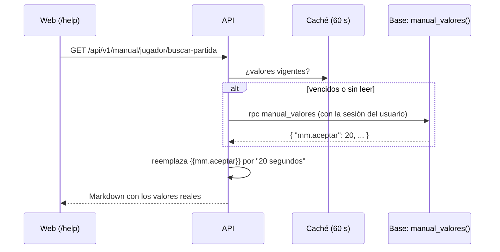

# Plan: valores reales de la base en el manual de usuario

> Planeación original. Estado: **aprobado por Daniel el 2026-11-03** ("usa marcadores de texto para que use los valores reales de la bd").

El manual ([`2026-11-02-manual-usuario`](../2026-11-02-manual-usuario/PLAN.md)) tiene números escritos a mano que un admin cambia desde la web: el tamaño del grupo, los segundos para aceptar, la escalera de sanciones, los clips por partida. Si el admin los cambia, el manual queda mintiendo. Ya pasa en staging: el tiempo para aceptar está en 20 s y la página dice 15.

Con este cambio, la página lleva un **marcador** (`{{mm.aceptar}}`) y la API lo reemplaza por el valor vigente de la base al servir la página (`20 segundos`).

## Decisiones tomadas

| Tema | Decisión | Por qué |
|---|---|---|
| Sintaxis | `{{grupo.nombre}}`, en minúsculas, con punto y guion bajo | No choca con Markdown ni con los comandos del chat (`!claim`) |
| Dónde se reemplaza | En la API, en `GET /api/v1/manual/{seccion}/{tarea}` | La web no cambia y el navegador recibe el texto final |
| Dónde se permiten | Solo en el cuerpo de la página. En `titulo` y `resumen`, no | El índice y el buscador usan esos campos: no hace falta leer la base para armar el índice |
| De dónde salen | Una función nueva, `manual_valores()` (replanteo `65`), que devuelve solo los valores que muestra el manual | `mm_config` no la puede leer un usuario común (solo `mm_admin_config`, para el admin). La función no expone nada más |
| Formato | Cada marcador tiene su formato en un catálogo de la API: cantidad con unidad ("1 minuto", "5 minutos"), porcentaje ("35 %") o lista de duraciones ("5 minutos, 15 minutos, 1 hora y 24 horas") | El texto queda natural, con el singular y el plural bien |
| Caché | Los valores se guardan en memoria 60 segundos | Son los mismos para todos y cambian muy de vez en cuando |
| Si la base falla | Se usan los últimos valores leídos; si nunca se leyeron, los de por defecto del catálogo, y se anota en el log | La página no se rompe por un corte de la base |
| Validación | El build de la API (y la carga del manual al arrancar) falla con un marcador que no está en el catálogo, o con uno en `titulo` o `resumen` | Igual que con los links rotos |
| Qué queda escrito a mano | Lo que no se configura desde la web: los 7 días de una invitación, la semana para bajar un escalón, los 90 días de las demos, la configuración de los servidores (pausas, `!gg`) | No cambian sin un replanteo o un cambio de cfg, y ese cambio ya obliga a actualizar el manual (regla de la bitácora) |

## 1. El flujo

## 2. El catálogo de marcadores

| Marcador | Valor en la base | Formato | Ejemplo |
|---|---|---|---|
| `mm.grupo_max` | `mm_config.max_party_size` | número | 2 |
| `mm.grupo_dif_elo` | `mm_config.party_max_elo_gap` | número | 500 |
| `mm.aceptar` | `mm_config.accept_seconds` | segundos | 20 segundos |
| `mm.veto` | `mm_config.veto_seconds` | segundos | 15 segundos |
| `mm.conectar` | `mm_config.connect_minutes` | minutos | 5 minutos |
| `mm.espera_servidor` | `mm_config.server_wait_minutes` | minutos | 3 minutos |
| `mm.volver` | `mm_config.reconnect_minutes` | minutos | 3 minutos |
| `mm.sanciones` | `mm_config.penalty_ladder` | lista de duraciones | 5 minutos, 15 minutos, 1 hora y 24 horas |
| `mm.sancion_min` | el primero de la escalera | duración | 5 minutos |
| `mm.sancion_max` | el último de la escalera | duración | 24 horas |
| `equipo.max_miembros` | `team_config.max_members` | número | 10 |
| `equipo.capitan_max` | `team_config.max_led` | equipos | 1 equipo |
| `clips.por_partida` | `clip_config.per_match` | número | 10 |
| `clips.por_jugador` | `clip_config.per_player` | número | 2 |
| `elo.min_pct` | `elo_config.min_pct` | porcentaje | 35 % |
| `elo.full_pct` | `elo_config.full_pct` | porcentaje | 90 % |

Sumar un marcador nuevo es sumar la clave en `manual_valores()` (un replanteo) y la entrada en el catálogo.

## 3. La base (replanteo `65`)

- `manual_valores() returns jsonb`, `stable security definer`, con las claves de la tabla de arriba (la escalera como arreglo).
- `execute` para `authenticated`, no para `anon` ni `public`.
- Inversa: `drop function`. Pruebas SQL: las claves, los tipos y que `anon` no la pueda llamar.
- El archivo va en `supabase/replanteo/` de las dos ramas (`feat/mm-claim-en-sala` y `feat/frontend-fase-1`) para que la numeración no se cruce.

## 4. La API (rama `feat/mm-claim-en-sala`)

| Pieza | Cambio |
|---|---|
| `src/lib/manual.ts` | `MARCADORES` (el catálogo con formato y valor por defecto), `formatearValor`, `aplicarMarcadores(markdown, valores)` y la validación en `armarManual` |
| `src/routes/manual.ts` | La página se sirve con los marcadores reemplazados; los valores vienen de `manual_valores()` con caché de 60 s |
| `test/unit/manual.test.ts` | Formatos (singular, plural, horas, lista), reemplazo, marcador desconocido, marcador en el resumen y la caída de la base |

## 5. El manual (rama `feat/frontend-fase-1`)

Se cambian por marcadores los números configurables de `jugador/buscar-partida`, `jugador/baneos-y-sanciones`, `jugador/equipo`, `jugador/clips-y-demos`, `jugador/elo-y-estadisticas` y `moderador/sanciones-matchmaking`. La tabla de sanciones de `buscar-partida` pasa a ser una frase, porque la cantidad de escalones también se configura. `docs/manual/README.md` suma la sección "Valores de la configuración" con la lista de marcadores.

## 6. Requisitos

- Aplicar la `65` en staging antes de probar la API local contra staging. Es una función de solo lectura y no toca datos.
- Sin dependencias nuevas.

## 7. Orden

1. Replanteo `65`, inversa y pruebas (probadas en staging dentro de una transacción que se deshace).
2. La API y sus pruebas.
3. Las páginas y el README del manual.
4. Aplicar la `65` en staging, con el visto bueno de Daniel, y probar con la API local.
