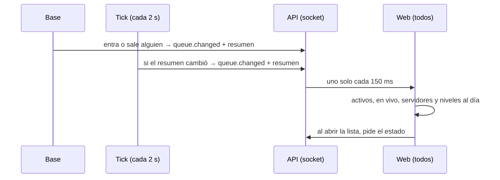

# El resumen del matchmaking al día por el socket: documentación

## Qué hace

La barra de Jugar muestra a todos cuántos buscan, los jugadores activos, las partidas en vivo, los servidores libres, los niveles y la lista de quiénes buscan. Antes, por el socket solo llegaba el tamaño de la cola: lo demás quedaba viejo hasta volver a pedir el estado, que sin estar buscando solo pasaba al volver a la pestaña.

Ahora el aviso `queue.changed` trae todo el resumen. Sale cuando alguien entra o sale de la cola, y también desde el tick (cada 2 s) cuando cambia algo que no pasa por la cola: una sala que se arma, termina o se cancela, una reserva de torneo o PCW, o un servidor que deja de responder. La lista de quiénes buscan se pide al abrirla.

Además, "servidores libres" usa la misma definición con la que se elige el servidor (`server_is_free`). Antes contaba como libres los reservados para un torneo o una PCW y los marcados como no disponibles, y ese número decide si se habilita "Buscar".

## El resumen (`mm_summary()`)

| Campo | Qué es |
|---|---|
| `size`, `by_mode` | Cuántos buscan, total y por modo (lo de antes) |
| `active_players` | Cuentas en la cola o en una sala abierta |
| `live_matches` | Salas en vivo |
| `servers.total`, `servers.free` | Servidores del matchmaking, y los libres según `server_is_free(id, 'mm')` |
| `levels` | Cuántos buscan por rango de nivel (1 a 3, 4 a 7, 8 a 10) |

- No lleva la lista de quiénes buscan: con 50 jugadores pasaría el límite de 8000 bytes de `pg_notify`.
- El tick guarda el último que mandó en `mm_summary_last` (una fila, solo la escribe él) y manda uno nuevo solo si cambió. El trigger de la cola no escribe nada: varios entrando a la vez no se bloquean entre sí.
- La API agrupa los `queue.changed` (150 ms, del requerimiento anterior): aunque lleguen el del trigger y el del tick juntos, sale uno.

## Web

- `patchQueueSizes` aplica todo lo que traiga el aviso y deja como está lo que no trae, así que también funciona con el aviso viejo.
- Abrir la lista de quiénes buscan (el círculo con la i) pide el estado.
- Sin socket, el estado se pide cada 30 s aunque no estés buscando.

## Qué cambia para cada rol

| Rol | Qué cambia | Página del manual |
|---|---|---|
| Jugador | Los números de la barra de Jugar (activos, en vivo, servidores libres, niveles) y la lista de quiénes buscan están al día. "Buscar" ya no se habilita con un servidor que está reservado | Ninguna: el manual no describe esos números |

## Términos y privacidad

Sin cambios: no se guarda ni se publica nada nuevo. La lista de quiénes buscan (nick, nivel y modo) ya la veían todos los que tienen sesión, y sigue igual.

## Dónde está cada cosa

| Qué | Archivo / ubicación |
|---|---|
| Replanteo e inversa | `supabase/replanteo/66_mm_resumen_en_vivo.sql` y `docs/bitacora/2026-10-14-replanteo-modelo-datos/reversas/66_mm_resumen_en_vivo.sql` |
| Pruebas SQL | `pruebas/66_mm_resumen_en_vivo.sql` y `pruebas/correr_local.sh` |
| Web | `web/frontend/src/features/matchmaking/queries.ts` (`patchQueueSizes`, `mmStateOptions`) y `PlayBar.tsx` (la lista) |
| Pruebas de la web | `web/frontend/src/features/matchmaking/queries.test.tsx` |
