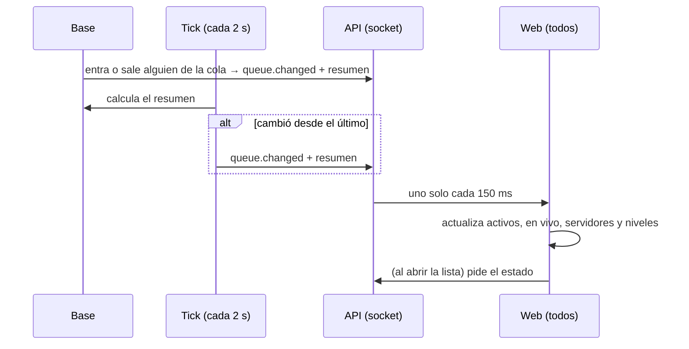

# Plan: el resumen del matchmaking al día por el socket

> Planeación original. Estado: **en curso**, por el reporte de Daniel del 2026-11-03 ("Jugadores activos" no se actualiza, ni su lista, y quizá tampoco los servidores). Daniel pidió no esperar confirmación para implementar lo del matchmaking y el socket.

## Qué pasa hoy

Lo que muestra la barra de Jugar a todos (jugadores activos, partidas en vivo, servidores libres, los niveles y la lista de quiénes buscan) viene del estado liviano (`mm_my_live`). Por el socket solo llega `queue.changed`, con el tamaño de la cola (`mm_queue_sizes`: total y por modo).

| Dato | Se actualiza por el socket | Cuándo cambia |
|---|---|---|
| Cuántos buscan, total y por modo | Sí | Alguien entra o sale de la cola |
| Jugadores activos (en la cola o en una sala abierta) | **No** | Se arma, termina o se cancela una sala |
| Partidas en vivo | **No** | Una sala pasa a en vivo o termina |
| Servidores libres | **No** | Una sala o una reserva ocupa o libera uno, o un servidor deja de responder |
| Niveles de los que buscan | **No** | Alguien entra o sale de la cola |
| Lista de quiénes buscan | **No** | Alguien entra o sale de la cola |

El estado liviano se vuelve a pedir solo si estás buscando o en una sala, cada 30 s. Si no, solo al volver a la pestaña o recargar.

Además, `servers.free` de `mm_my_live` no usa la definición de "servidor libre" del replanteo `56` (`server_is_free`): no descuenta las reservas de torneo y PCW, ni los servidores marcados como no disponibles (`unavailable_until`). Ese número es el que habilita o no "Buscar".

## Decisiones tomadas

| Tema | Decisión | Por qué |
|---|---|---|
| Qué viaja por el socket | `queue.changed` lleva el resumen completo (`mm_summary()`): `size`, `by_mode`, `active_players`, `live_matches`, `servers` (`total` y `free`) y `levels` | El mismo aviso, agrupado en la API (150 ms), sin un tipo nuevo. La web vieja sigue leyendo `size` y `by_mode` |
| La lista de quiénes buscan | No viaja: se pide el estado al abrirla | Con 50 jugadores pasaría el límite de 8000 bytes de `pg_notify`. Solo la ve quien la abre |
| Cambios que no vienen de la cola | El tick (cada 2 s) calcula el resumen y, si cambió desde el último que mandó, lo manda | Cubre las salas que se arman, terminan o se cancelan, las reservas y los servidores que dejan de responder, sin un trigger en cada tabla |
| Dónde se guarda el último | `mm_summary_last`, de una fila, que solo escribe el tick | El trigger de la cola no escribe nada: varios entrando a la vez no se bloquean entre sí |
| Servidores libres | `count(*) … where server_is_free(id, 'mm')`, en `mm_my_live` y en `mm_summary` | La misma definición con la que se elige el servidor |
| Sin socket | El estado liviano se pide cada 30 s aunque no estés buscando | Si el socket no conecta, nada más lo actualiza |

## 1. El flujo

## 2. Base (replanteo `66`; el `65` lo usa `65_manual_valores.sql`, sin commit en `v34frag-mmclaim`)

- `mm_summary()`: el resumen. `stable` y `security definer`, sin permisos para los jugadores.
- `mm_trg_notify`: `queue.changed` con `mm_summary()` en lugar de `mm_queue_sizes()`.
- `mm_summary_last (id = 1, summary jsonb)`: el último que mandó el tick.
- `mm_tick`: al final, si `mm_summary()` es distinto de `mm_summary_last`, lo guarda y manda `queue.changed`.
- `mm_my_live`: `servers.free` con `server_is_free`.
- Pruebas SQL:
  - el resumen con una sala abierta, una en vivo y un servidor reservado;
  - el aviso de la cola trae el resumen;
  - el tick avisa una vez cuando algo cambia y no vuelve a avisar si nada cambió;
  - `servers.free` descuenta las reservas y los no disponibles;
  - la inversa.

## 3. Web

- `patchQueueSizes` aplica todo lo que traiga el resumen.
- Abrir la lista de quiénes buscan pide el estado.
- `mmStateOptions`: sin socket, 30 s aunque no estés buscando.
- Pruebas de las tres cosas.

## 4. API

Sin cambios.

## 5. Orden

1. Replanteo `66` y sus pruebas.
2. Web y sus pruebas.
3. Commits en las dos ramas (la base) y en `feat/frontend-fase-1` (la base y la web), y staging, cuando Daniel lo pida.
