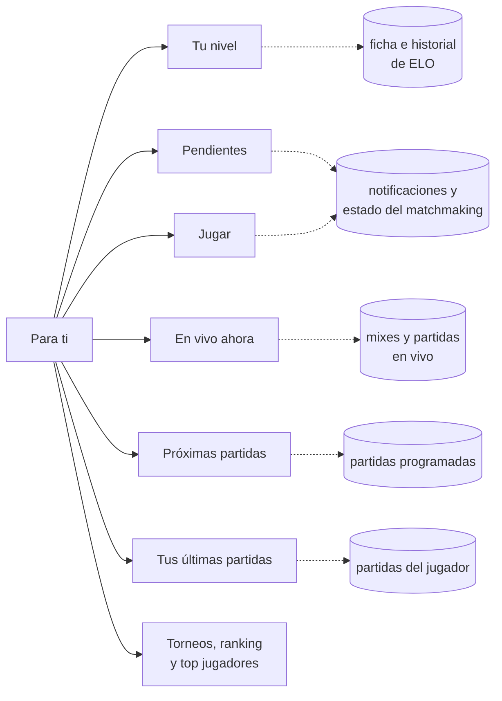
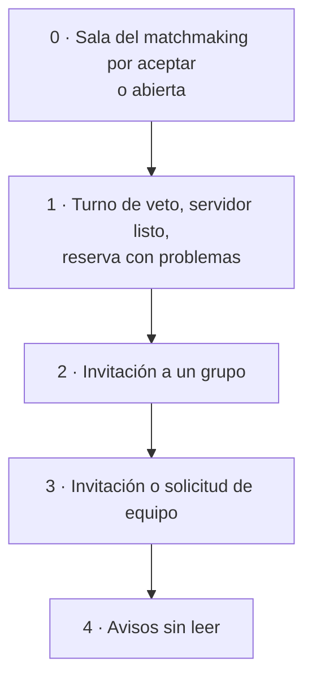

# Para ti: documentación

## Qué hace

`/home` ("Para ti" en el menú) es la página de inicio con sesión. Responde a una pregunta: qué le toca hacer ahora al jugador.

- **Arriba:** su nivel y la lista de pendientes.
- **Columna principal:** la tarjeta para jugar, lo que está en vivo, las próximas partidas y sus últimas partidas.
- **Costado:** los torneos activos y los rankings.

Cada bloque pide sus datos por separado, con su propio skeleton y su estado vacío. No hay un endpoint propio de la página.

## Los bloques

| Bloque | Qué muestra | Cuándo no aparece |
|---|---|---|
| Cabecera | Saludo según la hora ("Buenos días" de 5 a 12, "Buenas tardes" de 12 a 20 y "Buenas noches" el resto), la fecha y los botones **Partidas** y **Jugar** | — |
| Aviso de perfil | El `ProfileBanner` de siempre | Con el perfil completo |
| Tu nivel | Insignia, ELO, cambio de los últimos 7 días y últimos 5 resultados. Gráfica de las últimas 12 partidas con tooltip (ELO, cambio, fecha y mapa), barra hasta el próximo nivel, y rating, K/D y % de victorias | Sin jugador vinculado: muestra "Todavía no tienes nivel" con **Vincular** |
| Pendientes | Hasta 5 tareas por urgencia, con su acción ahí mismo (ver abajo) | Sin pendientes: "Todo al día" con **Buscar partida** |
| Jugar | El estado del matchmaking: en cola, en juego y servidores libres; en cola, con el tiempo y el puesto; partida abierta; exclusión; sanción; o el motivo por el que no puede jugar | — |
| En vivo ahora | Torneos y PCW primero, después los mixes y el matchmaking. Marcador, **TV** en los mixes y el link a la sala o la serie | Sin nada en vivo |
| Próximas partidas | Las 4 más cercanas, con las de los equipos del jugador en color primario | Sin partidas programadas |
| Tus últimas partidas | Las 5 más nuevas: tipo, mapa, bandos, marcador, rating y Δ ELO | Sin jugador vinculado |
| Torneos activos | En curso (barra de partidas jugadas) y con inscripciones abiertas (barra de cupos) | Sin ninguno |
| Ranking de equipos | Top 5, con el equipo del jugador resaltado | — |
| Top jugadores | Top 5 por ELO | — |

## Orden de Pendientes

- **Del matchmaking (0 y 2):** la sala y las invitaciones salen del estado del matchmaking. "Aceptar", "Unirme" y "Rechazar" llaman a la misma fuente que la página **Jugar**.
- **De las notificaciones (1, 3 y 4):** `pendingNotifications` en `lib/home.ts`.
  - Las de equipo se aceptan o rechazan ahí mismo (`useResolveRequest`).
  - El resto abre su link y queda leído; "Listo" las marca sin abrir nada.
  - Las leídas sin nada pendiente no aparecen.
- **Desempate:** dentro de cada nivel va primero la más nueva. El chip cuenta todas, aunque se muestren 5.

## Datos

- **Tu nivel:**
  - El jugador sale de `/me/profile`.
  - La ficha (`/players/{nick}`) trae el ELO, el nivel, el rating, el K/D y las victorias y derrotas.
  - El historial de ELO trae las últimas 50 partidas. La gráfica usa las 12 más nuevas y el cambio semanal se suma en el navegador, porque el historial no filtra por fecha.
  - Los umbrales de nivel son `LEVEL_FLOORS`.
- **En vivo:** `GET /mixes?status=live` (que incluye el matchmaking) y `GET /matches?status=live`.
- **Próximas:** `GET /matches?status=upcoming&sort=starts_at&order=asc`.
- **Torneos activos:** `GET /events` con `in_progress` y con `registration`.
- **Ranking:** `GET /ranking/teams` y `GET /players?sort=elo`.

## Qué cambia para cada rol

| Rol | Qué cambia |
|---|---|
| Jugador | La página de inicio pasa de un saludo a la vista completa: nivel, pendientes con acción, jugar, en vivo, próximas, últimas partidas y rankings |
| Capitán o líder | Las solicitudes para entrar a su equipo aparecen en Pendientes y se aceptan desde ahí |
| Organizador, moderador y admin | Lo mismo que un jugador. Los avisos de Administración que no leyeron entran en Pendientes como avisos |

Manual: [`docs/manual/jugador/para-ti.md`](../../manual/jugador/para-ti.md) (nuevo).

## Términos y privacidad

Sin cambios: la página muestra los datos que ya se veían en el perfil, la campana, Jugar y los rankings. No guarda ni publica nada nuevo.

## Dónde está cada cosa

| Qué | Archivo |
|---|---|
| Página | `web/frontend/src/features/home/pages/HomePage.tsx` (ruta `src/routes/_app/home.tsx`) |
| Bloques | `web/frontend/src/features/home/components/` (`LevelCard`, `EloChart`, `PendingCard`, `PlayCard`, `LiveCard`, `MatchLists`, `SideCards`, `Box`) |
| Consultas nuevas | `web/frontend/src/features/home/api/queries.ts` |
| Saludo, cambio semanal, nivel y orden de pendientes | `web/frontend/src/features/home/lib/home.ts` |
| Estado del matchmaking | `web/frontend/src/features/home/lib/useMmState.ts` |
| Manual | `docs/manual/jugador/para-ti.md` |
