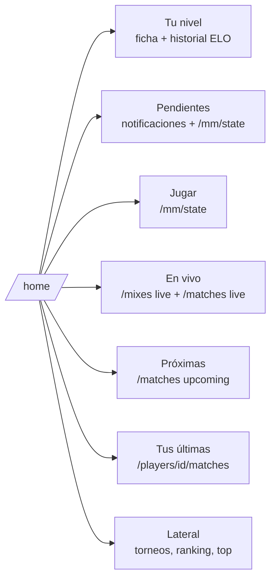

# Plan: Para ti (`/home`)

> Planeación original. Estado: **aprobado** por Esteban el 2026-11-03 sobre el [artifact](https://claude.ai/artifact/3DutAaCbsU7SzTe8o21gNg).

`/home` hoy muestra solo el saludo y el aviso de perfil incompleto. Este plan arma la página completa a partir del handoff `desings/handoff_para_ti`, actualizado con lo que la web tiene hoy: matchmaking, salas de mix y de serie, torneos y notificaciones.

## Decisiones tomadas

| Tema | Decisión | Por qué |
|---|---|---|
| Botones de la cabecera | "Partidas" y "Jugar" | Mixes ya está dentro de Partidas y PCW sigue en "Próximamente" |
| Tarjeta "Jugar" | Nueva, con el estado del matchmaking | Es la acción más frecuente del jugador y no existía cuando se hizo el handoff |
| Tarjeta de tareas | Se llama "Pendientes" | "Para ti" ya es el nombre de la página y del menú |
| Fuente de Pendientes | Notificaciones y estado del matchmaking | Ya existen y tienen acción; no hace falta un endpoint nuevo |
| En vivo | Mixes, matchmaking, torneos y PCW juntos | El handoff solo tenía torneos |
| Últimos mixes | Pasa a "Tus últimas partidas", con rating y Δ ELO | Las de todos ya están en Partidas, y la lista del jugador no trae MVP |
| Bloque de visitante | No va | Sin sesión se ve la landing |
| `GET /api/home` | No se pide | Todos los bloques tienen endpoint |

## 1. El flujo

Cada bloque carga por su cuenta, con su skeleton y su estado vacío.

## 2. La página

- **Cabecera:** el saludo según la hora, la fecha y un resumen de lo próximo. A la derecha, los botones "Partidas" y "Jugar".
- **Aviso de perfil incompleto:** el `ProfileBanner` de hoy.
- **Fila superior:**
  - **Tu nivel:** insignia, ELO, el cambio de los últimos 7 días y los últimos 5 resultados. Debajo, la gráfica de ELO de las últimas 12 partidas con tooltip, la barra hasta el próximo nivel y tres cifras: rating, K/D y % de victorias. Sin jugador vinculado, un estado que invita a vincular.
  - **Pendientes** (ocupa dos columnas), en este orden:
    1. una sala del matchmaking para aceptar;
    2. veto y servidor listo;
    3. invitaciones a un grupo;
    4. invitaciones y solicitudes de equipo;
    5. los demás avisos sin leer.

    Hasta 5. Sin pendientes: "Todo al día".
- **Columna principal:**
  - **Jugar:** según el estado del matchmaking: cola, en juego y servidores libres; en cola; sala abierta; sanción; o el motivo por el que no puede jugar.
  - **En vivo ahora:** se oculta si no hay nada.
  - **Próximas partidas:** las de tu equipo resaltadas. Se oculta si no hay ninguna.
  - **Tus últimas partidas.**
- **Columna lateral:**
  - **Torneos activos:** los que están en curso y los que tienen inscripciones abiertas.
  - **Ranking de equipos:** top 5.
  - **Top jugadores:** top 5.

## 3. Archivos

- Un módulo nuevo, `src/features/home/`, con `api/queries.ts` (consultas nuevas: en vivo de torneos, próximas, torneos en curso y top 5 de equipos), `lib/` (saludo, cambio semanal, orden de pendientes) y `components/` (una pieza por bloque).
- `src/routes/_app/home.tsx` monta la página.
- Se reutilizan:
  - `myProfileOptions`, `playerOptions`, `eloHistoryOptions` y `recentMatchesOptions`;
  - `LEVEL_FLOORS` y `nextLevelText`;
  - `notificationsOptions`, `describe`, `isPending`, `useResolveRequest` y `useMarkRead`;
  - `mmStateOptions`, `useMmAction` y `useMmMutation`;
  - `liveMixesOptions`, `topPlayersOptions`, `LevelBadge`, `TeamCrest`, `StatTile` y `EmptyState`.

## 4. Pruebas

- **Unitarias:** el saludo, el cambio semanal, el orden de los pendientes y la página con MSW (bloques con datos, vacíos y sin jugador).
- **e2e:** `/home` muestra los bloques con la base local.

## 5. Orden de implementación

1. Consultas y helpers (`lib/`), con sus pruebas.
2. Componentes por bloque y la página.
3. Pruebas de la página y e2e.
4. Manual de usuario (la página "Para ti"), `DOCUMENTACION.md`, `GUIA_IMPLEMENTACION.md` y la fila en el índice.
