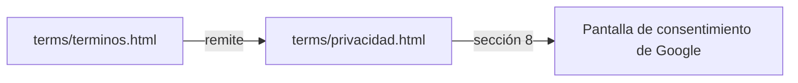

# Política de privacidad: documentación

## Qué es

`terms/privacidad.html` es la política de privacidad de CMLeague, reescrita el 2026-11-03. Cubre la web, los servidores, el Discord, el anticheat y «CMLeague clips». Se rige por la **Ley 25.326** (Argentina) y trae las dos leyendas obligatorias de la AAIP (Disposición 10/2008). **Es un borrador:** falta la revisión de un abogado. Desde el 2026-11-03 está en la carpeta `terms/`, junto a los términos.

## Inventario de datos

| Origen | Datos | Quién los ve | Plazo |
|---|---|---|---|
| Cuenta | Correo, contraseña cifrada, tag, perfil, última visita | Perfil según la privacidad elegida; el correo, solo el staff | Mientras exista la cuenta |
| Servidor | SteamID, nicks, estadísticas, demo | Público | Estadísticas sin plazo; demos 90 días |
| Servidor | IP, fecha, servidor y nick de cada conexión | Solo admins | 90 días (`player_connections`, `connect_attempts`); `player_ips` sin plazo |
| Contenido | Chat de partidas, capturas de reportes, configs | Chat público; el resto según la función | Mientras exista |
| VIP y tienda | Períodos de VIP, nota, puntos y compras | El dueño y los admins (que es VIP, público) | Mientras exista la cuenta |
| Anticheat | Procesos, capturas y latidos, solo en sesión | Solo el staff | 30 días (`ac_config.retention_days`) |

## Proveedores nombrados

Supabase, Cloudflare, OVH (VPS), Resend, Google Drive, Discord y el hosting de la web. No hay analítica ni publicidad (se buscó `gtag`, `analytics`, `sentry`, `posthog` y `plausible`: no hay ninguno).

## Cosas a tener en cuenta

- **URL de Google:** la pantalla de consentimiento de «CMLeague clips» apunta a `https://csstv.gamer.gd/privacidad.html` (la versión del 2026-10-23, en `htdocs/`). Al publicar la nueva desde `terms/`, o se sube también a `htdocs/privacidad.html`, o se cambia la URL en la consola de Google Cloud (Pantalla de consentimiento › Desarrollo de la marca). Si se borra la vieja sin hacer ninguna de las dos, Google puede desactivar la aplicación.

- **La sección 8 (Google Drive) no cambió de contenido.** Es la que revisa Google para «CMLeague clips». Si se toca, puede hacer falta volver a verificar la aplicación.
- **`player_ips` no tiene plazo en el código.** La página dice "mientras sea necesaria para detectar evasión de baneos". Conviene ponerle un plazo real, porque la Ley 25.326 pide no guardar datos más de lo necesario.
- **Plazos de respuesta:** 10 días corridos para el acceso y 5 días hábiles para la corrección o el borrado (artículos 14 y 16 de la Ley 25.326). Alguien tiene que leer la casilla de soporte.
- **Borrado de cuenta:** se hace a mano. No hay un botón.
