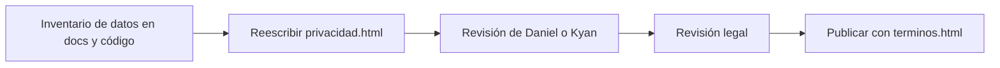

# Plan: política de privacidad completa

> Planeación original. Estado: **propuesta**, pedida por Kyan el 2026-11-03. Falta que la aprueben Daniel o Kyan y una revisión legal antes de publicarla.

`privacidad.html` (2026-10-23) solo explica la aplicación de clips con Google Drive y los datos básicos de la web. Los [términos y condiciones](../2026-11-03-terminos-y-condiciones/) remiten a ella, así que tiene que cubrir todo lo que guarda la plataforma, incluido lo que todavía no está desplegado.

## Decisiones tomadas

| Tema | Decisión | Por qué |
|---|---|---|
| Archivo | Se reescribe `privacidad.html`, con el mismo estilo y la misma URL | La URL ya está cargada en la pantalla de consentimiento de Google de «CMLeague clips» |
| Sección de Google Drive | Se conserva con el mismo contenido (`drive.file`, sin acceso a otros archivos, sin uso para publicidad) | Google la pide para verificar la aplicación |
| Inventario | Una tabla por origen: cuenta, servidores, IP, partidas, contenido subido, VIP y tienda, anticheat | Que cada jugador encuentre lo suyo |
| Plazos | Los del código: demos 90 días, conexiones 90 días, `player_ips` sin plazo, anticheat 30 días, clips mientras exista la jugada | No prometer plazos que el sistema no cumple |
| Proveedores | Supabase, Cloudflare, Google Drive, Discord, Resend, el VPS de OVH y el hosting de la web | Los que aparecen en el `.env` y la bitácora. No hay analítica ni publicidad |
| Lo que no está decidido | Responsable, país, edad mínima, medio de pago del VIP y correo quedan **[A DEFINIR]** | No inventar datos legales |
| Lo no desplegado | Anticheat, tienda, configs, matchmaking y VIP con "cuando esté disponible" o "en preparación" | Igual que en los términos |

## 1. El flujo completo

## 2. Contenido

Responsable, qué datos (por origen), para qué, qué es público, con quién se comparte, cuánto se guarda, seguridad, menores, derechos y cómo ejercerlos, almacenamiento local del navegador, la aplicación «CMLeague clips» con Google Drive, cambios y contacto.

## 3. Requisitos antes de publicar

- Aprobación de Daniel o Kyan y revisión legal.
- Completar los **[A DEFINIR]**.
- Confirmar con Daniel la región de Supabase y del VPS para la sección de transferencias.

## 4. Orden de implementación

1. Reescribir `privacidad.html`.
2. Revisarla en el navegador, en escritorio y en celular.
3. Documentación, guía, fila en el README y punto en `docs/PENDIENTES.md`.
