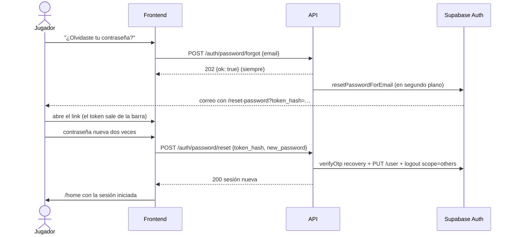
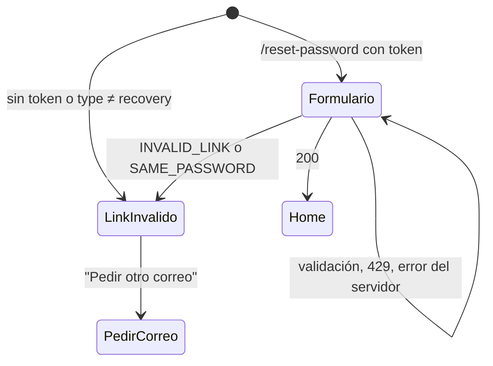

# Recuperar la contraseña en la web nueva: documentación

## Qué hace

Quien se olvida la contraseña la recupera solo desde `cmleague.lat`, sin que un admin le ponga una temporal. En el login hay un link "¿Olvidaste tu contraseña?" que lleva a `/forgot-password`. Ahí se escribe el email y la API le pide a Supabase que mande el correo de recuperación (por Resend).

El correo trae un link a `/reset-password?token_hash=…&type=recovery`. Abrir el link no gasta nada: el token se usa recién cuando el jugador escribe la contraseña nueva y la guarda. En ese momento la API verifica el token con `verifyOtp`, pone la contraseña, cierra todas las demás sesiones de la cuenta y devuelve una sesión nueva. El frontend la guarda y entra a `/home`.

La API nunca dice si un email tiene cuenta: pedir el correo responde siempre lo mismo, y el pedido a Supabase sale en segundo plano.

## Endpoints de la API

| Endpoint | Body | Respuestas | Límite |
|---|---|---|---|
| `POST /auth/password/forgot` | `{ email }` | `202 { ok: true }` siempre; `400` si el email no es válido; `429` | Regla `recovery`: 5 por minuto por IP (binding `RL_RECOVERY`), con su propio contador. Supabase además manda como mucho un correo por minuto a cada dirección y 30 por hora en todo el proyecto. |
| `POST /auth/password/reset` | `{ token_hash, new_password }` (6 a 72 caracteres) | `200 Session`; `400 INVALID_LINK`; `400 SAME_PASSWORD`; `400 VALIDATION_ERROR`; `429` | Regla `auth` (10 por minuto por IP, la misma del login). |

- **`INVALID_LINK`**: el token venció (una hora, `otp_expiry`), ya se usó, se pidió un correo más nuevo o está mal copiado. Sale de los códigos `otp_expired`, `otp_disabled`, `invalid_credentials` y `validation_failed` de `verifyOtp`, o de un `403`/`404`.
- **`SAME_PASSWORD`**: la nueva es igual a la anterior. Como el token ya se usó al verificarlo, ese link no sirve más y hay que pedir otro correo.
- Los errores de Supabase al pedir el correo (límite por dirección, Supabase caído) quedan en el log como `correo de recuperación: …` y no cambian la respuesta.
- El cambio de contraseña (`POST /api/v1/me/password`) y la recuperación comparten el helper `setPassword` de `src/routes/auth.ts`: `PUT /auth/v1/user`, traducción de `same_password` y `weak_password`, y `logout?scope=others`.

## Pantallas

| Ruta | Archivo | Qué muestra |
|---|---|---|
| `/login` | `features/auth/pages/LoginForm.tsx` | Link "¿Olvidaste tu contraseña?" debajo del campo de contraseña. |
| `/forgot-password` | `routes/_auth/forgot-password.tsx` + `features/auth/pages/ForgotPasswordForm.tsx` | Campo de email. Al enviar, "Revisa tu correo" con el mismo texto haya o no cuenta. Con `429`, cuenta regresiva y botón deshabilitado. Con `?aviso=enlace-viejo`, avisa que el link que usó ya no sirve. Solo sin sesión (layout `_auth`). |
| `/reset-password` | `routes/reset-password.tsx` + `features/auth/pages/ResetPasswordForm.tsx` | "Contraseña nueva" y "Repite la contraseña" (mínimo 8 en el frontend, como el registro). Con `INVALID_LINK` o `SAME_PASSWORD`, aviso y botón "Pedir otro correo". Funciona también con otra sesión abierta: no está dentro de `_auth`. |

El aviso rojo o verde de estas pantallas es `AuthNotice` (`features/auth/components/ui.tsx`), con el mismo aspecto que el de "cuenta confirmada" del login.

## Cuidado del token

- `/reset-password` guarda el `token_hash` en memoria y lo saca de la barra y del historial (`navigate` con `replace`) antes de usarlo.
- `consumeAuthCallback` (`src/auth/callback.ts`), que corre antes del router:
  - Con `#access_token=…&type=recovery` (plantilla vieja, o el botón "Send password recovery" del panel antes de cargar la nueva) descarta los tokens sin usarlos y lleva a `/forgot-password?aviso=enlace-viejo`.
  - Con `/?token_hash=…&type=recovery` en la raíz (correo armado con el Site URL pelado) lleva a `/reset-password` con el mismo token.
  - El resto sigue igual: confirmación del registro → `/login?aviso=cuenta-confirmada`, error → `/login?aviso=enlace-invalido`.

## Plantilla del correo

`deploy/auth/plantillas/recuperacion.html`: el botón y el link de texto van a `{{ .SiteURL }}/reset-password?token_hash={{ .TokenHash }}&type=recovery`. Se carga con `node deploy/auth/configurar-auth.mjs <VARIABLE_CON_LA_URL> --aplicar`. El `redirectTo` que manda la API (`FRONTEND_URL/reset-password`) solo lo usaría la plantilla vieja (`{{ .ConfirmationURL }}`).

## Dónde está cada cosa

| Qué | Archivo / ubicación |
|---|---|
| Rutas de la API | `web/backend/src/routes/auth.ts` (`forgotPassword`, `resetPassword`, `setPassword`) |
| Esquemas | `web/backend/src/schemas/auth.ts` (`ForgotPasswordBody`, `ForgotPasswordResult`, `ResetPasswordBody`) |
| Regla de límite | `web/backend/src/lib/ratelimit.ts` (`recovery`) y `web/backend/wrangler.toml` (`RL_RECOVERY`, namespaces `1005` y `1006`) |
| Código de error | `INVALID_LINK` en `web/backend/src/lib/errors.ts` y `web/frontend/src/api/errors.ts` |
| Llamadas del frontend | `web/frontend/src/auth/queries.ts` (`useForgotPassword`, `useResetPassword`) y `src/auth/schemas.ts` |
| Pantallas | `web/frontend/src/features/auth/pages/ForgotPasswordForm.tsx`, `ResetPasswordForm.tsx`, `src/routes/_auth/forgot-password.tsx`, `src/routes/reset-password.tsx` |
| Links que llegan al sitio | `web/frontend/src/auth/callback.ts` |
| Plantilla del correo | `deploy/auth/plantillas/recuperacion.html` |
