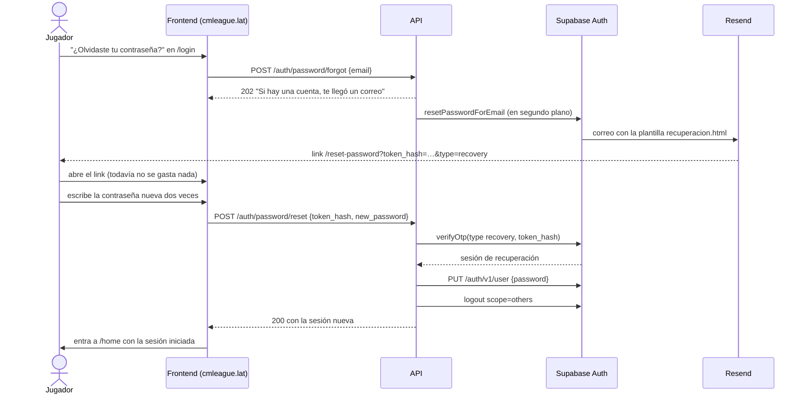
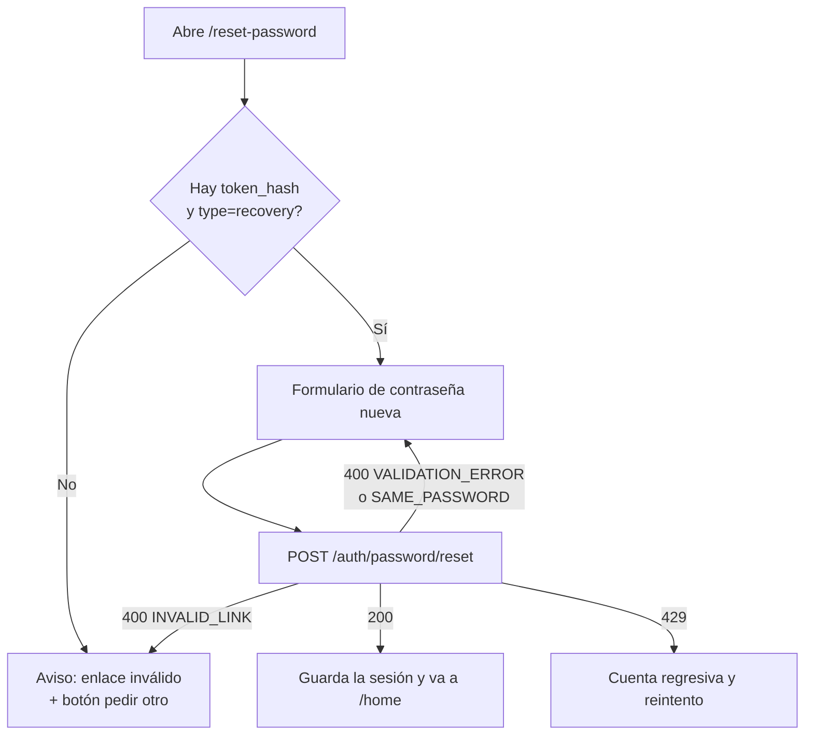

# Plan: recuperar la contraseña en la web nueva

> Planeación original. Estado: **propuesta**, pendiente de aprobación.

Pedido por Kyan el 2026-11-03. Desde el corte a producción de ese día, quien se olvida la contraseña no tiene cómo recuperarla: la web nueva (`cmleague.lat`) no tiene la pantalla, la API no tiene los endpoints y el correo de recuperación de Supabase llevaba a la web vieja (`csstv.gamer.gd`), que ya no está. Mientras tanto, un admin le pone una contraseña temporal a quien la pida.

## Decisiones tomadas

| Tema | Decisión | Por qué |
|---|---|---|
| Quién habla con Supabase | La API, con dos endpoints nuevos. El frontend no usa el cliente de Supabase. | Es como funcionan el login, el registro y el cambio de contraseña. El frontend solo conoce la API. |
| Formato del link del correo | `{{ .SiteURL }}/reset-password?token_hash={{ .TokenHash }}&type=recovery`, en lugar de `{{ .ConfirmationURL }}`. | Con `token_hash` la verificación (`verifyOtp`) la hace la API. Los tokens de sesión no pasan por la URL ni por el historial del navegador. |
| Cuándo se usa el token | Al enviar la contraseña nueva, no al abrir la página. | Los antivirus y los clientes de correo abren los links para revisarlos. Si el token se usara al abrir la página, ese "clic" automático lo gastaría. Abrir la página no consume nada. |
| No revelar si la cuenta existe | `POST /auth/password/forgot` responde siempre `202` con el mismo texto. Supabase recibe el pedido en segundo plano (`inBackground`), y sus errores se registran en el log pero no llegan al cliente. | La respuesta y el tiempo que tarda son iguales con o sin cuenta. Si un error de Supabase llegara al cliente (por ejemplo, el límite por correo), dejaría ver qué correos tienen cuenta. |
| Límite de intentos | Regla nueva `recovery`: 5 pedidos por minuto por IP (binding `RL_RECOVERY`). Se suman los límites que ya tiene Supabase: 1 correo por minuto por dirección y 30 correos por hora en todo el proyecto (`rate_limit_email_sent`). | Frena a quien llena de correos una casilla ajena o gasta el cupo de Resend. No usa el contador de `auth`, para que pedir el correo no le cuente intentos al login. |
| Límite al poner la contraseña nueva | La regla `auth` que ya existe (10 por minuto por IP). | El `token_hash` es largo y aleatorio, así que no se puede adivinar. Con el límite general alcanza. |
| Después de cambiarla | Se cierran todas las demás sesiones (`logout?scope=others`), la API devuelve una sesión nueva y el frontend entra directo a `/home`. | Es lo mismo que hace `POST /api/v1/me/password`. Quien recupera la cuenta porque se la robaron deja afuera al intruso. |
| Links viejos | Si llega un link con `#access_token=…&type=recovery` (lo manda la plantilla vieja o el botón "Send password recovery" del panel antes de cargar la nueva), `callback.ts` sigue sin usar los tokens. Lleva a `/forgot-password?aviso=enlace-viejo`, donde se pide otro correo. | No se reabre la puerta de iniciar sesión con tokens en el fragmento, que se cerró a propósito. |
| Nombres de las rutas | `/forgot-password` y `/reset-password`, dentro del layout `_auth`. | Las demás rutas del frontend están en inglés (`/login`, `/register`). |

## 1. El flujo completo

Si el link venció (dura una hora, `otp_expiry`) o ya se usó, la API responde `400 INVALID_LINK`. La página lo explica y ofrece pedir otro correo.

## 2. API (`web/backend`): le toca a Daniel revisarla

### `POST /auth/password/forgot`

- Body `ForgotPasswordBody`: `{ email }`, con el mismo esquema de email que el login.
- Middleware: `rateLimit(RATE_RULES.recovery)`.
- Llama a `anonClient(cfg).auth.resetPasswordForEmail(email, { redirectTo: `${cfg.FRONTEND_URL}/reset-password` })` dentro de `inBackground`. El `redirectTo` se manda igual aunque la plantilla nueva arme el link con `{{ .SiteURL }}`, porque lo usa `{{ .ConfirmationURL }}` mientras siga cargada la plantilla vieja.
- Respuesta: `202 { ok: true }`, sea cual sea el resultado. Errores posibles: `400` (body inválido) y `429` (límite por IP).

### `POST /auth/password/reset`

- Body `ResetPasswordBody`: `{ token_hash, new_password }`. `token_hash` es un string de 1 a 256 caracteres y `new_password` tiene las mismas reglas del registro (6 a 72).
- Middleware: `rateLimit(RATE_RULES.auth)`.
- Pasos:
  1. `verifyOtp({ type: 'recovery', token_hash })`. Si devuelve `otp_expired`, `otp_disabled`, `invalid_credentials` o `validation_failed`, la API responde `400 INVALID_LINK` ("El enlace no es válido o venció. Pide otro.").
  2. Con el access_token de esa sesión, `PUT /auth/v1/user { password }`. Los errores se traducen igual que en `changePassword`: `same_password` → `400 SAME_PASSWORD` y `weak_password` → `400 VALIDATION_ERROR`.
  3. `logout?scope=others`. Si falla, se registra y la respuesta sigue igual.
  4. `200` con `Session` (`toSession`).
- **Límite conocido:** el token se gasta en el paso 1. Si el paso 2 falla, el mismo link ya no sirve para reintentar. El largo de la contraseña se valida antes (en el frontend y en el esquema), así que el único caso real es que la nueva sea igual a la anterior. Ahí la API responde `400 SAME_PASSWORD` y la página dice "usa una distinta y pide otro correo". Guardar la sesión de recuperación para reintentar con el mismo link complica mucho el endpoint para un caso raro, así que no se hace.

### Otros cambios

| Archivo | Cambio |
|---|---|
| `src/routes/auth.ts` | Las dos rutas, con su descripción para OpenAPI. |
| `src/schemas/auth.ts` | `ForgotPasswordBody`, `ResetPasswordBody` y `ForgotPasswordResult`. |
| `src/lib/ratelimit.ts` | Regla `recovery` (5 por 60 s, binding `RL_RECOVERY`). |
| `src/lib/errors.ts` | Código `INVALID_LINK` en el mapa de errores, si hace falta declararlo. |
| `wrangler.toml` | `[[ratelimits]]` `RL_RECOVERY` (namespaces `1005` y `1006` en `preview`). En el VPS se usa el contador en memoria, así que no hay nada que configurar. |
| `supabase/config.toml` | Nada. La Supabase local ya tiene recuperación por correo (Mailpit). |

## 3. Frontend (`web/frontend`): el diseño le toca a Killuaz (Esteban)

Las pantallas se arman con las piezas que ya existen (`AuthShell`, `AuthField`, `useRetryCountdown`, el aviso de `login.tsx`) para que se vean como el login. **El layout final lo revisa y ajusta Esteban**, y en la guía va a quedar anotado que los textos y el diseño son provisorios hasta que él los apruebe.

| Archivo | Cambio |
|---|---|
| `src/features/auth/pages/LoginForm.tsx` | Link "¿Olvidaste tu contraseña?" debajo del campo de contraseña, que lleva a `/forgot-password` con el email ya escrito (si hay uno). |
| `src/routes/_auth/forgot-password.tsx` + `features/auth/pages/ForgotPasswordForm.tsx` | Campo de email. Al enviar, siempre muestra el mismo mensaje ("Si hay una cuenta con ese correo, te mandamos un enlace. Revisa también el spam."), y con `429` muestra la cuenta regresiva. Avisos por `?aviso=`: `enlace-viejo` y `enlace-invalido`. |
| `src/routes/_auth/reset-password.tsx` + `features/auth/pages/ResetPasswordForm.tsx` | Lee `token_hash` y `type` de la URL. Antes de mostrar nada borra el token de la barra con `replaceState` y lo deja guardado en memoria. Muestra "contraseña nueva" y "repítela". Con `200`, guarda la sesión (como el login) y va a `/home`. Con `INVALID_LINK`, muestra el aviso y un botón para pedir otro correo. |
| `src/auth/callback.ts` | `type=recovery` en el fragmento → `/forgot-password?aviso=enlace-viejo`, sin usar los tokens. Si alguien llega a la raíz con `?token_hash=…&type=recovery`, lo manda a `/reset-password` con el mismo token (cubre un correo armado con el Site URL pelado). |
| `src/features/auth/api/` | Las dos llamadas a la API, con los tipos del OpenAPI, como las demás. |

## 4. Plantilla del correo (`deploy/auth`): le toca a Kyan

- `plantillas/recuperacion.html`: el botón y el link de texto pasan de `{{ .ConfirmationURL }}` a `{{ .SiteURL }}/reset-password?token_hash={{ .TokenHash }}&type=recovery`. El resto del texto no cambia.
- La plantilla se carga en producción con `node deploy/auth/configurar-auth.mjs <VARIABLE> --aplicar`. Hace falta `SUPABASE_ACCESS_TOKEN`, que tiene Kyan.
- **Se carga después de desplegar la API y el frontend.** Si se carga antes, los correos llevan a una página que todavía no existe.

## 5. Pruebas

| Tipo | Archivo | Qué prueba |
|---|---|---|
| Unitaria (GoTrue simulado) | `web/backend/test/unit/auth-routes.test.ts` | `forgot`: `202` igual con cuenta, sin cuenta y con un error de Supabase (`over_email_send_rate_limit`, `500`); `redirectTo` correcto; `429` al pasar el límite por IP; `400` con un email inválido. `reset`: `otp_expired` → `INVALID_LINK`, `same_password` → `SAME_PASSWORD`, `weak_password` → `VALIDATION_ERROR` y que llame a `logout?scope=others`. |
| Unitaria | `web/backend/test/unit/ratelimit.test.ts` | La regla `recovery` no comparte contador con `auth`. |
| Integración (Supabase local) | `web/backend/test/integration/auth.test.ts` | `forgot` responde lo mismo con un correo con cuenta y sin cuenta. Con `admin.generateLink({ type: 'recovery' })` se obtiene el `hashed_token` y `reset` devuelve una sesión válida. Después, el login funciona con la contraseña nueva y no con la vieja, el refresh_token de la sesión anterior deja de servir, el mismo `token_hash` usado otra vez da `INVALID_LINK` y `password_changed_at` se actualiza. |
| Frontend (Vitest + Testing Library) | `ForgotPasswordForm.test.tsx`, `ResetPasswordForm.test.tsx`, `callback.test.ts`, `LoginForm.test.tsx` | El mensaje es siempre el mismo, la cuenta regresiva aparece con `429`, la URL queda limpia, la sesión se guarda y se va a `/home`, aparece el aviso de link inválido, los casos nuevos de `callback` y el link del login. |
| Manual (staging) | — | Correo real con Resend, link del correo, cambio y entrada a `/home`. Se hace con una cuenta de prueba, no con la del jugador. |

## 6. Requisitos antes de empezar

1. **En qué rama se implementa (lo decide Kyan).** El código de la web vive en `origin/feat/frontend-fase-1`, y `kyan/pruebas` tiene su propia copia de `web/`, que difiere en algunos archivos de auth (`AuthShell`, `LoginForm`). La propuesta es implementar en `kyan/pruebas`, sobre lo que ya hay ahí, y que Daniel y Esteban lo pasen a `feat/frontend-fase-1`. Si Kyan prefiere otra rama, hace falta su sí explícito.
2. Supabase local corriendo (`pnpm db:start`) para las pruebas de integración, y dependencias instaladas con `pnpm install --frozen-lockfile`.
3. `SUPABASE_ACCESS_TOKEN` de producción (lo tiene Kyan) para cargar la plantilla.
4. Que se confirme que Kyan ya corrió `configurar-auth.mjs` contra producción con `site_url = https://cmleague.lat` y `uri_allow_list` con `https://cmleague.lat/**` (está en curso).

## 7. Orden de implementación

1. API: esquemas, regla `recovery`, las dos rutas y el binding en `wrangler.toml`.
2. Pruebas de la API, unitarias y de integración, contra la Supabase local.
3. Frontend: llamadas a la API, `callback.ts`, las dos páginas y el link del login.
4. Pruebas del frontend (`pnpm test`, `pnpm typecheck`, `pnpm lint`) y prueba a mano en local con Mailpit.
5. Plantilla `recuperacion.html` con el link nuevo.
6. `DOCUMENTACION.md`, `GUIA_IMPLEMENTACION.md` (con lo que les toca revisar a Daniel y a Esteban), `CHANGELOG_DISCORD.txt` y la fila en `docs/bitacora/README.md`.
7. Fuera de esta tarea, y cuando Kyan lo pida: pasar el cambio a la rama que se despliega, desplegar la API y el frontend y, al final, cargar la plantilla en producción y probarla en staging.
