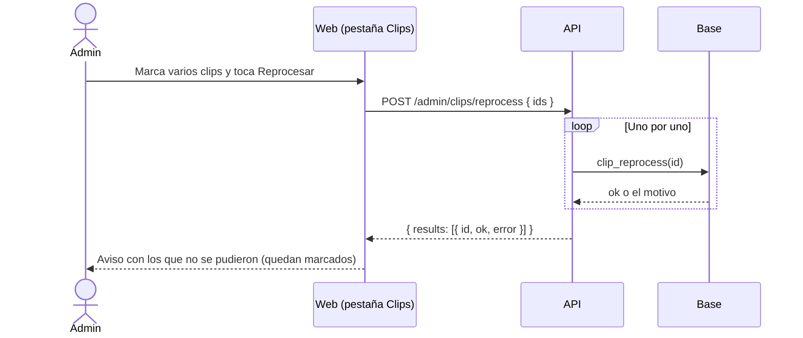
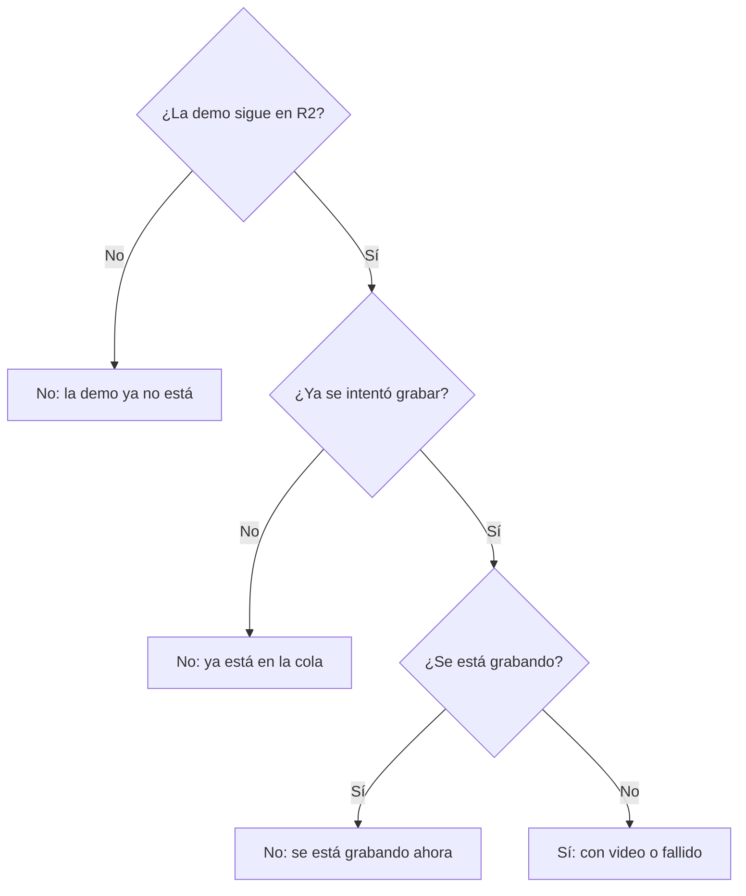
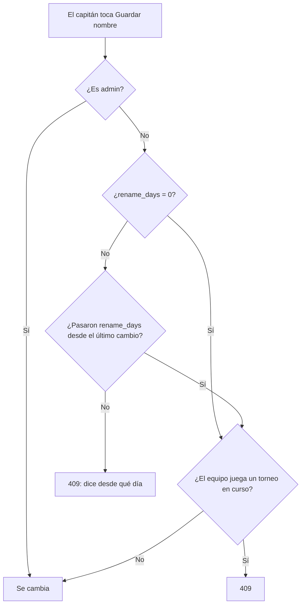

# Reportes solo para el admin, lista de clips para reprocesar y nombre del equipo: documentación

## Qué hace

Tres cambios que salieron al escribir el manual de usuario:

1. **Reportes del matchmaking:** los ve y los resuelve solo un admin. La regla vale en la web, en la API y en la base.
2. **Lista de clips:** Administración › Clips tiene una pestaña nueva, **Clips**, con todas las jugadas que se muestran. El admin elige varias y las manda a grabar de nuevo con un solo botón.
3. **Nombre y sigla del equipo:** el capitán los cambia desde **Editar equipo**, una vez cada X días. El admin elige X en Administración › Equipos › Configuración equipo (30 por defecto, 0 = sin espera). El logo se cambia siempre.

## Reportes del matchmaking

| Capa | Regla |
|---|---|
| Base | `mm_admin_resolve_report` y `mm_admin_lists('reports')` piden `is_admin()` (antes, `is_moderator()`). Las demás listas de `mm_admin_lists` (sanciones, baneos) siguen siendo de moderadores |
| API | `GET /api/v1/admin/mm/reports` y `POST /api/v1/admin/mm/reports/{id}/resolve` con `requireAdmin` (403 para el moderador) |
| Web | Sin cambios: la pestaña **Reportes** ya se mostraba solo al admin |

## Lista de clips

### La pestaña

Administración › Clips › **Clips** (la primera pestaña). Muestra las jugadas de `match_clip_list`, de la más nueva a la más vieja, de a 25.

| Columna | Qué dice |
|---|---|
| Casilla | Elegir la fila. Apagada, con el motivo al pasar el mouse, si no se puede reprocesar |
| Jugada | Tipo, ronda y si es VIP |
| Jugador | Alias de la ficha o nick en el juego |
| Partida | Mapa y fecha, con link a la partida |
| Video | Estado (**Con video**, **Falló**, **Grabándose**, **En cola**, **Sin demo**), **Para revisar** si espera el "Bien", y link para verlo |
| Historial | Si salió en Discord y cuántas veces se reprocesó |

Filtros: estado del video, tipo de jugada y nick del jugador. La casilla del encabezado elige todas las de la página que se pueden reprocesar. Con algo elegido aparece abajo la barra "N clips elegidos · Quitar selección · Reprocesar", con un tope de 50 y confirmación.

Después de reprocesar, los que fallaron quedan elegidos y la web muestra un aviso con cada uno y su motivo. Los demás pasan a **Para revisar**, como con el reprocesar de una sola jugada ([`2026-10-28-clips-vip-y-reprocesar`](../2026-10-28-clips-vip-y-reprocesar/)).

### Cuándo se puede reprocesar

La API calcula `can_reprocess` y `blocked_reason` con las mismas reglas de `clip_reprocess` (`reprocessBlock` en `routes/clips.ts`). La base vuelve a comprobarlas en cada pedido.

### API

| Ruta | Qué hace |
|---|---|
| `GET /api/v1/admin/clips` | Admin. `status` (`done`, `failed`, `processing`, `queued`, `no_demo`), `type`, `q` (nick), paginada. Cada fila: `clip`, `match` (id, mapa, fecha), `reprocess_count`, `discord_posted`, `can_reprocess`, `blocked_reason` |
| `POST /api/v1/admin/clips/reprocess` | Admin. `{ ids }` de 1 a 50 (los repetidos se cuentan una vez). Llama a `clip_reprocess` uno por uno y devuelve `{ results: [{ id, ok, error }] }`: uno que falla no frena a los demás |

## Nombre y sigla del equipo

- **Base:** `team_config.rename_days smallint not null default 30`, de 0 a 365. `team_rename` la usa en lugar de los 30 días fijos; el mensaje dice los días ("una vez cada 7 días"). `set_team_config(p_max_members, p_max_led, p_rename_days)` la guarda (solo admin).
- **API:** `GET` y `PUT /api/v1/admin/teams/config` con `rename_days`. El detalle del equipo calcula `next_name_change_at` con `rename_days` (null con 0 o si ya se puede).
- **Web, Editar equipo:** los campos **Nombre** y **Sigla** con **Guardar nombre**. Mientras falta para el próximo cambio, los campos están apagados y dice "Podrás cambiar el nombre y la sigla el …". El admin no tiene espera. El logo sigue igual: se cambia o se quita cuando quiera.
- **Web, Configuración equipo:** campo "Días entre cambios de nombre" (0 a 365).
- **Manual:** marcador `{{equipo.dias_nombre}}` ("30 días"), de `manual_valores()`.

## Qué cambia para cada rol

| Rol | Qué cambia | Página del manual |
|---|---|---|
| Jugador | Los reportes los revisa un admin, no "la moderación" | [`jugador/baneos-y-sanciones`](../../manual/jugador/baneos-y-sanciones.md) |
| Capitán | Cambia el nombre y la sigla desde **Editar equipo**, una vez cada `{{equipo.dias_nombre}}` | [`capitan/armar-plantel`](../../manual/capitan/armar-plantel.md) |
| Organizador | Nada | — |
| Moderador | Ya no resuelve reportes del matchmaking (no veía la pestaña; ahora la API y la base también se lo niegan) | [`moderador/sanciones-matchmaking`](../../manual/moderador/sanciones-matchmaking.md) |
| Admin | Único que resuelve reportes. Pestaña **Clips** para reprocesar varios. "Días entre cambios de nombre" en Configuración equipo | [`admin/reportes-matchmaking`](../../manual/admin/reportes-matchmaking.md), [`admin/clips`](../../manual/admin/clips.md), [`admin/equipos`](../../manual/admin/equipos.md) |
| Streamer | Nada | — |
| Dueño de un servidor externo | Nada | — |

## Términos y privacidad

Sin cambios. No se guarda ni se publica ningún dato nuevo. Los términos y la privacidad hablan del "staff" al referirse a los reportes y la evidencia, y el admin es parte del staff. La espera del nombre del equipo no figura en los términos.

## Dónde está cada cosa

| Qué | Archivo / ubicación |
|---|---|
| Replanteo | `supabase/replanteo/68_reportes_admin_nombre_equipo.sql` (en las dos ramas) |
| Inversa | `docs/bitacora/2026-10-14-replanteo-modelo-datos/reversas/68_reportes_admin_nombre_equipo.sql` |
| Pruebas SQL | `pruebas/68_reportes_admin_nombre_equipo.sql`, `pruebas/inversa_ok.sql`, `pruebas/correr.sh` |
| Reportes (API) | `web/backend/src/routes/mm.ts` |
| Lista y reprocesar varios (API) | `web/backend/src/routes/clips.ts`, `web/backend/src/schemas/clips.ts` |
| Espera del nombre (API) | `web/backend/src/routes/admin-teams.ts`, `web/backend/src/routes/teams.ts`, `web/backend/src/schemas/teams.ts` |
| Marcador del manual | `web/backend/src/lib/manual.ts` (`equipo.dias_nombre`) |
| Pestaña Clips | `web/frontend/src/features/admin/clips/components/ListTab.tsx` |
| Editar equipo | `web/frontend/src/features/teams/components/TeamLogo.tsx` (`EditTeamSheet` y `RenameFields`) |
| Configuración equipo | `web/frontend/src/features/admin/teams/components/TeamConfigTab.tsx` |
