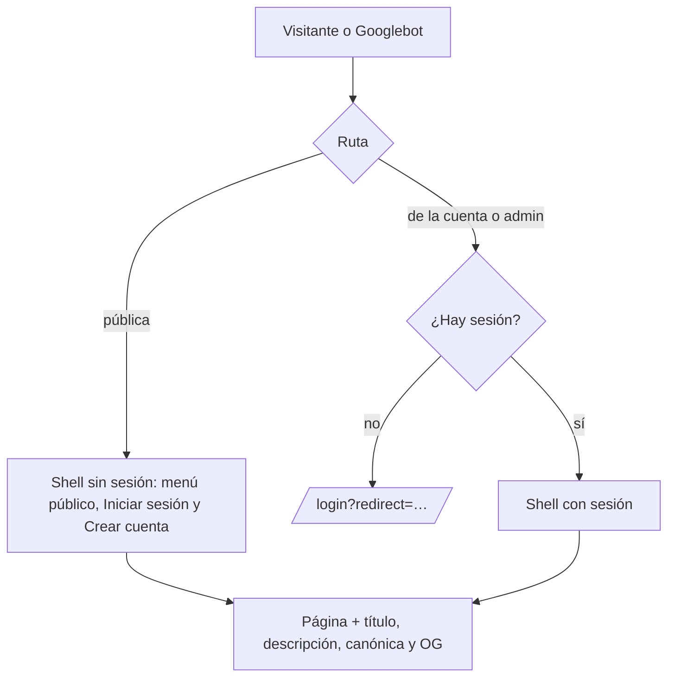

# SEO de la web nueva (cmleague.lat): documentación

## Qué hace

La web nueva era una SPA en la que casi todo pedía sesión: Google solo podía ver la portada, los términos y la privacidad, y todas las páginas tenían el mismo título. Ahora las páginas con contenido público (ranking, perfiles de jugador, equipos, partidas, torneos y el comparador) se ven sin cuenta, con el mismo sidebar y topbar de siempre. Las páginas de la cuenta y de Administración siguen pidiendo sesión.

Cada página pone su título, su descripción, su URL canónica y las etiquetas Open Graph y Twitter. Así Google muestra un resultado propio por página, y Discord y WhatsApp arman la tarjeta al compartir un link. Además hay `robots.txt`, `sitemap.xml`, una imagen para compartir (`og.png`) y datos estructurados (JSON-LD) de la organización y del sitio.

## Páginas públicas y privadas

| Pública (sin sesión) | Con sesión |
|---|---|
| `/` (portada), `/ranking`, `/ranking/teams`, `/players`, `/players/compare`, `/player/$nick`, `/teams/$id`, `/matches`, `/match/$id`, `/events`, `/events/$id`, `/terminos`, `/privacidad` | `/home`, `/play`, `/myteam`, `/pcw`, `/profile/*`, `/admin/*`, `/mixes/live/$uid`, `/help/*`, `/welcome` |

- El layout `_app` usa `loadSession` (`src/auth/guards.ts`): carga el usuario si hay sesión y si no, pasa `user: null` sin redirigir. Un error de red se relanza como antes.
- Cada ruta privada lleva su propio `beforeLoad: requireAuth`. En `admin.tsx` se encadena con `requireAdminSection`.
- **Ayuda** sigue con sesión porque `GET /api/v1/manual` responde 401 a un visitante (pendiente del backend).

## Shell sin sesión

- **Sidebar** (`AppSidebar`): muestra solo los ítems públicos (Partidas, Torneos y Ranking). Lo decide `canSeeNavItem` (`features/shell/lib/nav.ts`): los ítems con `auth: true` piden sesión y los de Administración, además, el rol. Al pie aparecen "Crear cuenta" e "Iniciar sesión" (con el menú plegado no se muestran, y se entra desde la topbar). El logo lleva a `/` en vez de a `/home`.
- **Topbar**: en lugar de las notificaciones aparece el botón "Iniciar sesión".
- **Búsqueda (⌘K)**: sin "Mi perfil" ni "Cerrar sesión".
- **Aviso de reconexión** del matchmaking: solo con sesión.
- **Consultas de la cuenta**: `GET /me/profile` (`myProfileOptions`), `GET /me/teams` (`myTeamsOptions`) y `GET /mm/mvp-image` no se piden sin sesión (`enabled`). Las páginas públicas las usaban para saber "¿es mi perfil?" o "¿es mi equipo?", y sin sesión respondían 401.

## Metadatos

- `src/lib/seo.ts`:
  - `usePageMeta({ title, description, noindex })`: escribe `document.title` ("Ranking · CM League"), `description`, `og:title`, `og:description`, `twitter:title` y `twitter:description`. Al salir de la página deja los de `index.html`.
  - `noindex` agrega `<meta name="robots" content="noindex">` (login y registro).
  - `useCanonical(pathname)`: `<link rel="canonical">` y `og:url` con `https://cmleague.lat` + la ruta, **sin parámetros** (`?tab=`, `?page=` son la misma página) y sin la barra final. Lo llama la raíz (`__root.tsx`) en cada navegación.
- Títulos dinámicos: el perfil usa el nick de la URL, y el equipo y el torneo usan el nombre de la misma consulta que ya hace la página (sale de la caché, sin un pedido extra).
- `index.html`: canónica, `theme-color`, Open Graph (`og:type`, `og:site_name`, `og:locale` `es_LA`, `og:url`, `og:title`, `og:description`, `og:image` de 1200×630 con su `alt`), Twitter Card `summary_large_image` y JSON-LD `Organization` + `WebSite`. Es lo que leen los bots que no ejecutan JavaScript, como Discord.
- `public/og.png`: la imagen para compartir (lockup, titular de la portada y fondo del hero).

## robots.txt y sitemap.xml

- `public/robots.txt`: bloquea las rutas privadas (`/admin`, `/profile`, `/home`, `/play`, `/myteam`, `/pcw`, `/help`, `/welcome`, `/login`, `/register`, `/demo`, `/mixes/live/`) y apunta al sitemap.
- `public/sitemap.xml`: solo las páginas fijas (portada, ranking, ranking de equipos, partidas, torneos, comparador, términos y privacidad). Los perfiles, equipos y torneos los tiene que agregar un sitemap dinámico de la API (pendiente del backend).

## Google Search Console

La propiedad de dominio `cmleague.lat` quedó verificada el 2026-11-03 en la cuenta de Google de Kyan. Google la verificó solo a través del proveedor del dominio, así que no hizo falta agregar un TXT en Namecheap. El sitemap se envía cuando esté desplegado.

## Qué cambia para cada rol

| Rol | Qué cambia | Página del manual |
|---|---|---|
| Visitante (sin cuenta) | Puede ver el ranking, los perfiles, los equipos, las partidas y los torneos sin crear cuenta, y entrar o registrarse desde el menú | — (el manual es para usuarios con cuenta) |
| Jugador | El link de su perfil, su equipo o una partida se abre sin pedir sesión y en Discord muestra una tarjeta | — (no cambia cómo se usa la web) |
| Capitán, organizador, moderador, admin, streamer, dueño de un servidor externo | Nada | — |

## Términos y privacidad

Sin cambios. La política ya dice que el tag, los nicks, el SteamID, las estadísticas, el ELO, las partidas, los clips, el equipo y el chat de partidas son "públicos para cualquiera", y que el resto del perfil se muestra según el nivel de privacidad. Ese filtro lo aplica la API, que ya respondía sin sesión: la web solo deja de esconder lo que la API ya publicaba.

## Dónde está cada cosa

| Qué | Archivo / ubicación |
|---|---|
| Guarda opcional y privadas | `web/frontend/src/auth/guards.ts` (`loadSession`), `src/routes/_app.tsx`, `src/routes/_app/{home,play,myteam,pcw,profile,admin,mixes.live.$uid,help.*}.tsx` |
| Menú sin sesión | `src/features/shell/lib/nav.ts` (`auth`, `canSeeNavItem`), `components/AppSidebar.tsx`, `Topbar.tsx`, `CommandMenu.tsx`, `api/queries.ts` |
| Metadatos | `src/lib/seo.ts`, `src/routes/__root.tsx`, cada ruta pública, `web/frontend/index.html` |
| Archivos estáticos | `web/frontend/public/robots.txt`, `sitemap.xml`, `og.png` |
| Pruebas | `src/lib/seo.test.ts`, `src/features/shell/lib/nav.test.ts`, `src/test/render.tsx` (`withSession`), `src/features/mixes/components/MixHighlights.test.tsx` |
