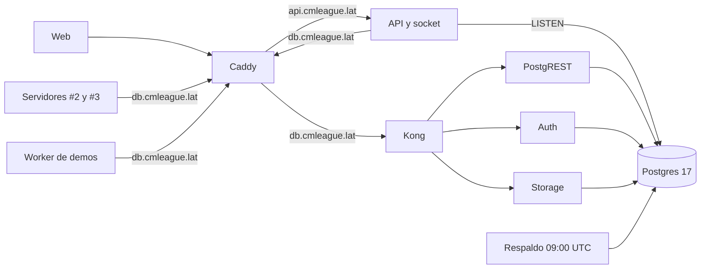

# Supabase en el VPS: documentación

## Qué hace

Desde el 2026-11-03 (20:50 UTC), la base de datos de producción, las cuentas y los archivos están en el VPS de OVH (Beauharnois, Canadá) y ya no en el plan gratis de Supabase en la nube (Oregón).

Es el mismo software, Supabase, que es de código abierto, instalado con Docker. Usa la CPU, la memoria y el disco del VPS. Si hace falta más potencia, se sube el plan del VPS en OVH.

Se pasó porque, con 10 jugadores en la cola del 5v5, la API REST del plan gratis quedó `UNHEALTHY`: 2 a 12 s por llamada. Los servidores no llegaban a reportarse a tiempo y las salas no se armaban. En el VPS esas mismas llamadas tardan de 8 a 75 ms.

## Qué corre en el VPS

| Servicio | Para qué | Memoria máxima |
|---|---|---|
| Postgres 17.6 | La base. Solo en `127.0.0.1:5432` | 1,2 GB |
| PostgREST | `/rest/v1`: la API, el plugin, el Worker y el render | 256 MB |
| GoTrue (Auth) | `/auth/v1`: registro, inicio de sesión y sesiones | 128 MB |
| Storage | `/storage/v1`: fotos, avatares, sonidos, capturas y evidencia del anticheat | 256 MB |
| Kong | Puerta de entrada, en `127.0.0.1:8000`; cambia las claves opacas por las legacy | 512 MB |

- Juntos usan ~730 MB de los 3,7 GB del VPS, medido con un mix en curso.
- postgres-meta y Studio están apagados: se prenden juntos cuando hace falta el panel.
- Desde afuera solo se llega por Caddy a `https://db.cmleague.lat`, y solo a `/rest/v1/`, `/auth/v1/` y `/storage/v1/`. Lo demás da 404.

## Claves y sesiones

| Clave | Quién la usa | En el VPS |
|---|---|---|
| Opacas (`sb_publishable_…`, `sb_secret_…`) | La API del VPS y el `.env` de la raíz | Valen: Kong las cambia por la legacy |
| Legacy (`eyJ…`, HS256) | Worker de demos, render de clips y cfg de los servidores | Valen: el JWT secret es el mismo de la nube |
| Token de cada servidor (`csstv_server_token`) | Plugin | Valen: `token_hash` vino con los datos |

- Las sesiones que firmó la nube (ES256) no valen en el VPS. La API responde 401 y la web la renueva con el refresh token, que se migró con los datos: **nadie tiene que volver a iniciar sesión**.
- Las sesiones nuevas se firman con HS256.

## Respaldos

- **Cuándo:** `cmleague-respaldo.timer`, todos los días a las 09:00 UTC (06:00 en Argentina).
- **Qué:** `pg_dump -Fc` de toda la base y un `tar` de los archivos de Storage, con sus sumas SHA-256.
- **Dónde:** quedan los últimos 7 en `/srv/supabase/respaldos/`. Con `/etc/cmleague/respaldo.env` completo, también se suben a R2.
- **Si falla:** avisa por Discord (opcional).
- **Restaurar:** `deploy/supabase/README.md`. Probado el 2026-11-03 con 0 errores y el mismo ELO.

## La nube

- El proyecto `wmzfwsizashpszxlvpeb` no se borra: es la vuelta atrás hasta el 2026-12-03, como mucho.
- Ya no recibe datos, así que **no hay que escribirle**.
- Sus credenciales están en el `.env` de la raíz como `NUBE_*`.

## Qué cambia para cada rol

Nada para los usuarios. La web, el matchmaking y los servidores funcionan igual, más rápido. Quien tenía la sesión abierta sigue con ella, porque se renueva sola.

## Términos y privacidad

`/privacidad` y `terms/privacidad.html`, en la sección 5:
- Supabase deja de ser un proveedor que guarda los datos.
- OVH guarda la base, las cuentas y los archivos, en Canadá.
- Se aclara que Supabase conserva la copia del 2026-11-03 hasta borrarla, como mucho el 2026-12-03.

`/terminos` no cambia.

## Dónde está cada cosa

| Qué | Archivo / ubicación |
|---|---|
| Instalación, migración y respaldos | `deploy/supabase/` (ver su `README.md`) |
| Compose oficial (commit `cdba349d`) y datos | `/srv/supabase/oficial/docker/` (base en `volumes/db/data`, archivos en `volumes/storage`) |
| Ajustes y comando | `/srv/supabase/cmleague.yml`, `/usr/local/bin/sb` |
| Variables | `/etc/cmleague/supabase.env` y `respaldo.env` (root, 600) |
| Respaldos y volcados de la migración | `/srv/supabase/respaldos/`, `/srv/supabase/migracion/` |
| Caddy | `db.cmleague.lat` en `deploy/vps/Caddyfile` |
| Los `.env` de la API, temporadas, demos y HUD | `/etc/cmleague/*.env` y `hud.json` (los de la nube, como `.nube`) |
