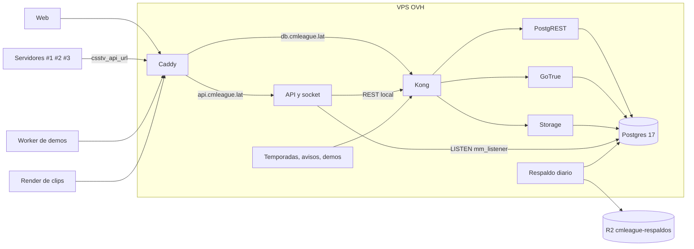

# Plan: Supabase en el VPS

> Planeación original. Estado: **aprobado por Daniel el 2026-11-03** ("arma el plan y empieza a implementar"). El corte (sección 7) espera fecha y el registro DNS.

Producción está en el plan **gratis** de Supabase (instancia Nano, ~0,5 GB de RAM y CPU compartida, en Oregón). El 2026-11-03, con 10 jugadores probando el matchmaking 5v5, la API REST (PostgREST) quedó `UNHEALTHY` en el chequeo de salud de Supabase: los pedidos tardaban de 2 a 12 s y algunos daban 500, mientras la base contestaba en menos de 1 ms. Al servidor flow (#2) se le cortaban la licencia, las IPs y el poll del matchmaking a los 15 s, y la sala no se armaba porque flow no llegaba a reportarse cada 30 s.

El VPS de OVH (Beauharnois, Canadá) tiene 2 núcleos, 3,7 GB de RAM (2,9 GB libres), 33 GB de disco libres y una carga de 0,1. Producción pesa 22 MB de base y 18 MB de Storage (62 archivos), con 62 cuentas. Si hace falta más potencia, el plan del VPS se puede subir en OVH (Daniel, 2026-11-03).

Este requerimiento pasa la base de producción a un **Supabase instalado en el VPS** (el mismo software, de código abierto, en Docker), con los recursos del VPS.

## Decisiones tomadas

| Tema | Decisión | Por qué |
|---|---|---|
| Qué se instala | Supabase con Docker Compose: **Postgres, PostgREST, GoTrue (Auth), Storage, Kong y postgres-meta**. Studio se deja instalado pero solo accesible por túnel SSH | Es lo que usa la plataforma: REST (API, plugin, Workers y render), Auth (inicio de sesión) y Storage (fotos, avatares, sonidos, pruebas y evidencia del anticheat) |
| Qué no se instala | Realtime, Edge Functions, Analytics (Logflare) y Vector, Supavisor e imgproxy | No se usan: el socket del matchmaking es de la API del VPS y escucha la base con `LISTEN` directo. Analytics sola pide ~1 GB de RAM |
| Versión de Postgres | La **17**, igual que producción (17.11). Imagen `supabase/postgres` 17 | Un `pg_dump` de 17 no siempre se restaura en 15. Si la imagen 17 no arranca con el compose, se anota en la guía y se decide con Daniel |
| Claves | El **mismo JWT secret** de producción (se lee por la API de gestión) y las **mismas** `anon` y `service_role` | La API, los Workers, el render y los relays siguen con sus claves; las sesiones abiertas siguen valiendo; solo cambia la URL |
| Dirección pública | `https://db.cmleague.lat`, con Caddy delante de Kong (`127.0.0.1:8000`) | Caddy ya da los certificados de `cmleague.lat`, `api` y `hud`. El registro DNS (A y AAAA en Namecheap) lo crea Daniel |
| Qué se expone | Solo `/rest/v1/`, `/auth/v1/` y `/storage/v1/`. El resto (Studio, `pg-meta`) responde 404 desde afuera | Menos superficie. Studio y `psql` se usan por túnel SSH |
| Puerto de Postgres | Solo en `127.0.0.1:5432`, nunca abierto en `ufw` | La API del VPS (`MM_LISTEN_URL`) se conecta local. Daniel y Kyan entran por túnel SSH |
| Memoria | Límite por contenedor (Postgres 1,2 GB; el resto 128 a 256 MB cada uno) | Que la base no le quite memoria a la API, al socket ni al relay del HUD |
| Respaldos | `pg_dump` diario de la base completa y `tar` de Storage, a un bucket de R2 (`cmleague-respaldos`), 14 días | Hoy el plan gratis no tiene respaldos. Afuera del VPS, para sobrevivir a un disco roto |
| Datos | `pg_dump` de producción (roles, esquemas y datos de `public`, `auth` y `storage`) restaurado en el VPS. Los archivos de Storage se copian por la API de Storage | Es el método de la guía de migración de Supabase. Son 22 MB: tarda segundos |
| URLs guardadas | Se reemplaza `https://wmzfwsizashpszxlvpeb.supabase.co` por `https://db.cmleague.lat` en todas las columnas de texto que la tengan (fotos, `mm_config.mvp_image_url`, etc.) | Las URLs públicas de Storage quedan guardadas en las filas |
| Ensayo | Primero en el VPS con una copia de producción, sin cambiar nada de lo que está en uso | Encuentra lo que falla sin cortar nada. El ensayo se borra o queda como base del corte |
| Corte | Con la web en mantenimiento, un último volcado de producción, la restauración y el cambio de URL en todo, en la misma tanda | Que no se escriba en las dos bases a la vez |
| Supabase en la nube | No se borra. Queda pausado de hecho (sin uso) como vuelta atrás por al menos 30 días | Si algo falla, se vuelve a la nube con un volcado del VPS |
| Servidores de juego | El cambio de `csstv_api_url` va a #1, #2 y #3 en la misma tanda (regla de `CLAUDE.md`). En el #2 (flow) por la API de su panel | El build licenciado de flow no tiene la URL adentro: está en el cfg |

## 1. El flujo completo

Hoy todo eso apunta a `wmzfwsizashpszxlvpeb.supabase.co`. Después del corte apunta a `db.cmleague.lat`, y lo que corre en el VPS llama a Kong por `127.0.0.1:8000`, sin salir a internet.

## 2. Archivos nuevos en el repo: `deploy/supabase/`

| Archivo | Qué es |
|---|---|
| `docker-compose.yml` | Los seis servicios, con las imágenes fijadas a una versión, los límites de memoria y los puertos solo en `127.0.0.1` |
| `kong.yml` | Las rutas de Kong para `rest`, `auth`, `storage` y `pg-meta`, con las claves por variable |
| `volumes/db/*.sql` | Los scripts de arranque del compose oficial que hacen falta (roles, JWT) |
| `supabase.env.example` | Variables sin valores: `POSTGRES_PASSWORD`, `JWT_SECRET`, `ANON_KEY`, `SERVICE_ROLE_KEY`, `SITE_URL`, SMTP, etc. En el VPS: `/etc/cmleague/supabase.env` (root, 600) |
| `instalar.sh` | Instala Docker (repositorio oficial de Docker para Ubuntu), crea `/srv/supabase` y levanta el compose |
| `migrar.sh` | Volcado de producción, restauración, reemplazo de URLs y copia de Storage. Lo usan el ensayo y el corte |
| `respaldar.sh` y `cmleague-respaldo.service`/`.timer` | El respaldo diario a R2 |
| `Caddyfile` (bloque `db.cmleague.lat`) | En `deploy/vps/Caddyfile`, solo las tres rutas públicas |
| `README.md` | Cómo instalar, migrar, respaldar, restaurar un respaldo y volver a la nube |

## 3. Auth

- Se configura igual que producción: correo y contraseña, sin proveedores externos, `jwt_exp` 3600.
- Las decisiones del corte anterior siguen en pie: SMTP de Resend, confirmar el correo con un link, `SITE_URL` `https://cmleague.lat` y las plantillas de `deploy/auth/plantillas/`. Si en la nube todavía no se hizo, se deja hecho en el VPS.
- `API_EXTERNAL_URL` es `https://db.cmleague.lat`: los links de los correos apuntan ahí y GoTrue redirige a la web.

## 4. Lo que cambia de URL en el corte

| Qué | Dónde | Valor nuevo |
|---|---|---|
| API (`SUPABASE_URL`) | `/etc/cmleague/api.env` | `http://127.0.0.1:8000` |
| Socket del matchmaking (`MM_LISTEN_URL`) | `/etc/cmleague/api.env` | `postgres://mm_listener:…@127.0.0.1:5432/postgres` |
| Temporadas y avisos | `/etc/cmleague/season.env` | `http://127.0.0.1:8000` |
| Demos por SFTP | `/etc/cmleague/demos.env` | `http://127.0.0.1:8000` |
| Relay del HUD | `/etc/cmleague/hud.json` | `http://127.0.0.1:8000` |
| Worker de demos | `cloudflare/demo-worker/wrangler.toml` (`SUPABASE_URL`) y despliegue | `https://db.cmleague.lat` |
| Render de clips | `.env` de la portátil (`RENDER_SUPABASE_URL`) | `https://db.cmleague.lat` |
| Servidores #1, #2 y #3 | `csstv_reporter.cfg` (`csstv_api_url`) | `https://db.cmleague.lat/rest/v1/rpc/ingest_server_chunk` |
| `.env` de la raíz | `PG_HOST`, `PG_PORT` y las URLs | Túnel SSH y `db.cmleague.lat` |
| Filas con URLs de Storage | La base | `https://db.cmleague.lat/storage/v1/object/public/...` |

## 5. Respaldos

- `respaldar.sh`, todos los días a las 09:00 UTC (06:00 en Argentina, sin partidas):
  - `pg_dump -Fc` de la base completa.
  - `tar` del volumen de Storage.
  - Los sube a R2 con su fecha y borra los de más de 14 días.
- La guía explica cómo restaurar uno, y en el ensayo se prueba restaurarlo.

## 6. Ensayo en el VPS (sin tocar lo que está en uso)

1. Instalar Docker y levantar el compose con los puertos solo en `127.0.0.1`. Caddy no cambia.
2. `migrar.sh` con producción como origen.
3. Comprobar:
   - La cantidad de filas de las tablas principales es igual a la de la nube.
   - El ELO es idéntico.
   - `csstv_mm_poll` contesta con un token de prueba.
   - Iniciar sesión con una cuenta de prueba por `/auth/v1/token`.
   - Las fotos se descargan por `/storage/v1/object/public/...`.
4. Medir la memoria con todo corriendo (`docker stats` y `free`).
5. Medir la latencia de `csstv_mm_poll` y de `mm_my_live`, comparada con la nube.
6. Probar un respaldo y su restauración en una base aparte.

## 7. Corte (con fecha que elige Daniel)

1. Daniel crea `db.cmleague.lat` (A `148.113.148.184` y AAAA) en Namecheap y se suma el bloque a Caddy.
2. Aviso en Discord y web en mantenimiento: se paran `cmleague-api`, `cmleague-mm` y los timers.
   - Los servidores guardan lo que no pueden mandar en `data/csstv/queue/` y lo mandan después.
   - Se espera que no haya ninguna partida en curso.
3. `migrar.sh` final.
4. Se cambian los `.env` del VPS, se levantan los servicios y se comprueba `/api/health`.
5. `csstv_api_url` en #1, #2 y #3, en la misma tanda. Se carga en el próximo cambio de mapa: no se recarga el plugin con partida en curso.
6. Worker de demos, render de clips y `.env` de la raíz.
7. Prueba completa:
   - Iniciar sesión y entrar a la cola.
   - Un servidor reportándose en `mm_server_state`.
   - Una ingesta y una foto.
8. Se activa el respaldo diario.

## 8. Términos y privacidad

La política de privacidad dice que la base está en Supabase, en el oeste de Estados Unidos (Oregón), y el VPS en OVH, en Beauharnois (Canadá). Después del corte, la base y los archivos quedan en OVH, en Canadá, y Supabase deja de ser un proveedor que guarda datos. Se actualizan la página de la web (`web/frontend/src/features/legal/pages/`) y `terms/privacidad.html` en el mismo commit del corte. Hasta el corte, el cambio queda con la marca "En preparación".

## 9. Requisitos antes de empezar

- Acceso SSH al VPS (`ubuntu`, con la llave de Daniel en el agente de Windows).
- `SUPABASE_ACCESS_TOKEN_PROD`, para leer el JWT secret, y las claves de producción, que ya están en el `.env`.
- Para el corte:
  - El registro DNS (Daniel).
  - Un bucket de R2 para los respaldos con su clave (Daniel o con `CF_R2_ACCESS_API_TOKEN`).
  - Fecha y aviso a los jugadores.

## 10. Orden de implementación

1. Este plan y la fila en `docs/bitacora/README.md`.
2. `deploy/supabase/` (compose, Kong, env de ejemplo y scripts).
3. Docker en el VPS y el compose levantado en `127.0.0.1`.
4. Ensayo: `migrar.sh` y las comprobaciones de la sección 6.
5. Respaldo diario a R2 y la prueba de restauración.
6. Corte (sección 7), con Daniel.
7. `DOCUMENTACION.md`, `GUIA_IMPLEMENTACION.md`, `docs/PENDIENTES.md`, la privacidad y `CLAUDE.md` (dónde está la base).
