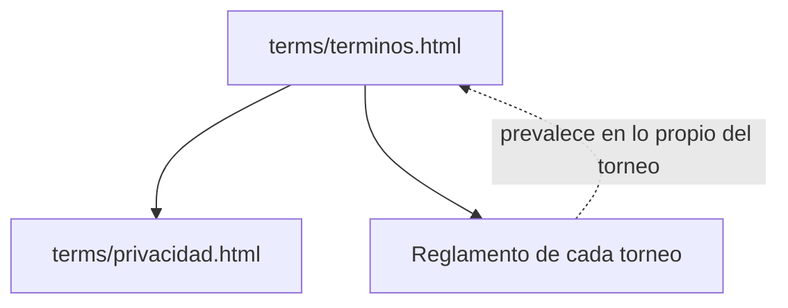

# Términos y condiciones: documentación

## Qué es

`terms/terminos.html` es la página de términos y condiciones de CMLeague. Tiene el mismo estilo que `terms/privacidad.html` y cubre toda la plataforma, también lo que todavía no está disponible. **Es un borrador:** falta la revisión legal y completar los datos marcados **[A DEFINIR]**, que la página muestra en naranja.

## Secciones y de dónde sale cada una

| Sección | Se basa en | Estado de la función |
|---|---|---|
| 2. Tu cuenta | Registro, tag y privacidad del perfil (`FUNCIONALIDADES.md`) | Hecho |
| 3. SteamID y fichas | `!claim`, verificaciones, fichas con varios SteamID | Hecho |
| 4–5. Conducta y juego limpio | `!calladmin`, `sv_pure`, anti-wallhack, configs | Hecho; configs en prototipo |
| 6. CMLeague Anticheat | Bitácoras `2026-10-30-anticheat-*` | **Sin desplegar**; la página lo dice |
| 7. Moderación y baneos | `2026-10-25-baneos-web`, `2026-10-29-ips-jugadores`, sanciones del matchmaking | Baneos sin plugin `csstv_bans` todavía |
| 8. Mixes, matchmaking y ELO | ELO, temporadas, `2026-10-28-matchmaking` | Matchmaking apagado; la página dice "en prueba" |
| 9. Torneos, PCW y premios | Torneos, reporte de resultados, PCW | Hecho |
| 10. Lo que subes | Avatar, chat, capturas, configs | Configs en prototipo |
| 11. Demos, clips y transmisiones | Demos (90 días), clips en Discord y Drive, HUD, widget | Widget sin desplegar |
| 12. VIP | `2026-10-28-vip-fase-0`, `2026-10-29-hacete-vip` | Fase 0; ventajas en prototipo |
| 13. Puntos, tienda y misiones | `2026-10-29-tienda-puntos-backend`, misiones | Sin desplegar; la página dice "en preparación" |
| 14. Servidores de terceros | `2026-10-13-licencia-servidores`, flow y MVZG | Hecho |

## Datos del proyecto (dados por Kyan el 2026-11-03)

| Dato | Valor | Sección |
|---|---|---|
| Provincia (domicilio y tribunales) | Provincia de Buenos Aires (no la Ciudad Autónoma) | 1 y 21 |
| Edad mínima | 13 años | 2 |
| Precios del VIP | 1 mes $3.000, 3 meses $8.100 y 6 meses $15.300 (pesos argentinos) | 12 |
| Correo de soporte | `cmleaguev34@gmail.com` | 22 |
| Discord | `https://dsc.gg/v34frag` | 22 |

El medio de pago sigue siendo acordarlo con el staff, hasta que la web cobre sola.

La ley aplicable (Argentina), la jurisdicción, el arrepentimiento de 10 días del VIP y la limitación de responsabilidad ya están escritos (secciones 12, 16, 17, 20, 21 y 22).

## Cosas a tener en cuenta

- **`terms/privacidad.html`** se reescribió el mismo día: [`2026-11-03-politica-privacidad`](../2026-11-03-politica-privacidad/).
- **Lo "gratuito" y el VIP:** el texto dice que el uso es gratuito y que el VIP es opcional. Desde que se cobra el VIP, hay una relación de consumo y aplica la Ley 24.240 aunque el resto sea gratis: las cláusulas de responsabilidad no la pueden anular.
- **Promesas que el código tiene que cumplir:** la evidencia del anticheat se borra a los 30 días y solo se recopila en sesión; las demos duran 90 días; los puntos no se compran con plata; el VIP no da ventaja en la partida. Si alguna cambia, hay que cambiar la página.
- **Cierre de cuenta:** la página dice que se borran los datos personales y quedan las estadísticas. Hoy no hay un botón para eso: se hace a mano.
