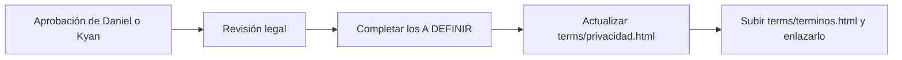

# Términos y condiciones: guía de implementación

## Archivos

| Archivo | Cambio |
|---|---|
| `terms/terminos.html` | Nuevo. Página estática, sin JavaScript |
| `docs/bitacora/2026-11-03-terminos-y-condiciones/` | Plan, documentación y esta guía |
| `docs/bitacora/README.md` | Fila nueva |
| `docs/PENDIENTES.md` | Punto con lo que falta para publicar |

No toca la base, la API, el plugin ni los servidores, así que no hay despliegue a los servidores de juego (ni a `aurav34`, flow ni MVZG).

## Antes de publicar

1. Que Daniel o Kyan aprueben el texto.
2. Revisión legal, sobre todo del anticheat (sección 6), del VIP pago y los reembolsos (12) y de la ley aplicable (20).
3. Reemplazar cada **[A DEFINIR]** (buscar `class="pending"` en el archivo) y quitar los avisos de "en preparación" de lo que ya esté disponible.
4. Actualizar `terms/privacidad.html` con las IP, el anticheat, el VIP y la tienda.
5. Subir `terms/terminos.html` junto a `terms/privacidad.html` y enlazarlo desde el pie de la web vieja y desde el registro.
6. **Frontend nuevo (Esteban):** ruta `/terminos` con este texto, link en el pie y casilla "Acepto los términos y la política de privacidad" en el registro.

## Cómo se probó

- Se abrió `terms/terminos.html` en el navegador, a lo ancho de escritorio y de celular (375 px): el índice pasa a una columna y no hay scroll horizontal.

## Cómo revertir

Borrar `terms/terminos.html` y los links que se le hayan agregado.

## En qué se apartó del plan

- **Carpeta `terms/`** (Kyan, 2026-11-03): la página está en `terms/terminos.html`, no en la raíz como decía el plan, junto a `terms/privacidad.html`.

- **Argentina (pedido de Kyan, 2026-11-03):** ley argentina (CCyC, Ley 24.240 y Ley 25.326); tribunales de `[provincia]`, salvo que el consumidor elija los de su domicilio (artículo 36 de la Ley 24.240); contacto por correo y Discord, sin razón social; sección 16 "tal cual está" y sección 17 con la limitación de responsabilidad (con el tope del VIP pagado en 6 meses y sin excluir el dolo ni la culpa grave). En el VIP se sumó el derecho de arrepentimiento de 10 días (artículo 34 de la Ley 24.240 y artículo 1110 del CCyC). Quedan `[provincia]`, `[correo@tudominio.com]` y `[enlace de invitación al Discord]`.
- Se usa tuteo, como en el resto de la web, aunque el pedido decía voseo "si es necesario".
