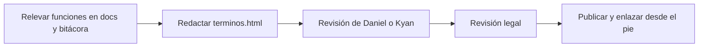

# Plan: términos y condiciones de CMLeague

> Planeación original. Estado: **propuesta**, pedida por Kyan el 2026-11-03. Falta que la aprueben Daniel o Kyan y una revisión legal antes de publicarla.

Kyan pidió unos términos y condiciones que cubran toda la plataforma, incluidas las funciones que todavía no están implementadas o desplegadas. Hoy solo existe `privacidad.html` (clips y datos básicos de la web).

## Decisiones tomadas

| Tema | Decisión | Por qué |
|---|---|---|
| Formato | Página estática `terminos.html` en la raíz, con el mismo estilo que `privacidad.html` | Se publica junto a la web vieja sin depender del frontend nuevo. En el frontend nuevo la ruta `/terminos` la arma Esteban |
| Alcance | Web vieja y nueva, servidores (nuestro y externos), plugins, matchmaking, torneos, PCW, ELO, VIP, tienda, misiones, configs, clips, demos, HUD, widget, anticheat, baneos y licencias de servidores | Lo pidió así Kyan: también lo que no está implementado |
| Funciones sin terminar | Se describen con una cláusula general ("algunas funciones pueden no estar disponibles todavía") y cada sección dice "cuando esté disponible" donde aplica | No prometer algo que hoy no existe |
| Idioma | Español con tuteo, como `privacidad.html` y los changelogs | Coherencia con lo publicado |
| Datos que no están decididos | País, jurisdicción, edad mínima, precios y medio de pago quedan como **[A DEFINIR]** | No inventar datos legales |
| Privacidad | Los términos remiten a `privacidad.html` y se anota que esa página quedó desactualizada (IPs, anticheat, VIP) | Es otro documento; se actualiza aparte |
| Anticheat | Va con consentimiento explícito, sin conclusiones automáticas y con revisión humana, como lo diseñó la bitácora del anticheat | `GUIA_ANTICHEAT.md` pide revisión legal antes de usarlo con jugadores |

## 1. El flujo completo

## 2. Contenido

Secciones: aceptación, quiénes somos, cuentas, SteamID y fichas, conducta, juego limpio y anticheat, baneos y moderación, mixes, matchmaking y ELO, torneos, PCW y premios, contenido de los usuarios (avatar, chat, configs, reportes), clips y demos, VIP, puntos y tienda, servidores externos y licencias, propiedad intelectual, disponibilidad, responsabilidad, cambios, cierre de cuenta, ley aplicable y contacto.

## 3. Requisitos antes de publicar

- Aprobación de Daniel o Kyan.
- Revisión legal, sobre todo del anticheat y del VIP pago.
- Completar los **[A DEFINIR]**.

## 4. Orden de implementación

1. Escribir `terminos.html`.
2. Documentación, guía y fila en el README de la bitácora.
3. Anotar en `docs/PENDIENTES.md` lo que falta para publicarla.
