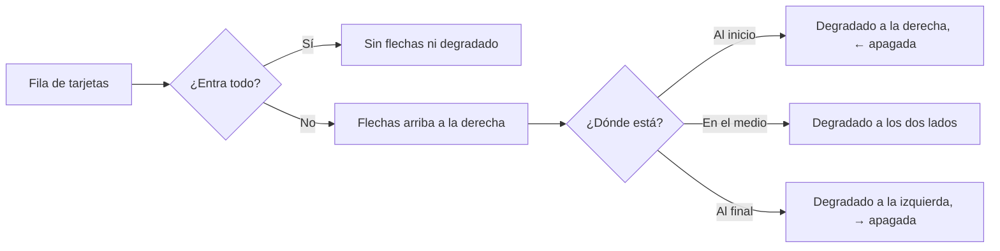

# Un carrusel único para la web: documentación

## Qué hace

Las filas de tarjetas que se desplazan de lado usan un solo componente, `Carousel`. Son tres: "Lo más destacado de la partida" (sala del matchmaking y página del mix), "Jugadas destacadas" de la sala de la serie y "Torneos en los que participó" de la página del equipo.

- **Flechas:** arriba a la derecha, solo si el contenido no entra. Se apagan en cada punta.
- **Degradado:** el borde se desvanece del lado donde hay más.
- **Barra:** fina, del color del tema.
- **Clip elegido:** borde naranja por dentro, que ya no se recorta.
- **Tarjeta de clip:** la misma en las dos salas (`ClipCard`), con la foto del mapa del catálogo (Administración › Mapas), el tipo de jugada, la duración, quién la hizo, el mapa y la ronda. Sin foto, el degradado naranja.

Además, el tema oscuro declara `color-scheme: dark`. Sin eso el navegador dibujaba claras las barras de desplazamiento y los controles nativos en toda la web: de ahí venía la barra blanca de la captura.

## Componentes

| Pieza | Qué hace |
|---|---|
| `useCarousel()` | Mide la fila (desplazamiento, cambio de tamaño y tarjetas nuevas) y da `overflow`, `atStart`, `atEnd` y `scroll(±1)`, que avanza el 85 % del ancho (mínimo 200 px) |
| `CarouselArrows` | "Anteriores" y "Siguientes". No se dibujan si todo entra |
| `CarouselTrack` | La fila (`div`, `ul` u `ol`): encaje al soltar, barra `scrollbar-thin`, `data-more` para el degradado, ← y → con foco, 3 px de aire para el borde del elegido |
| `Carousel` | Título, flechas y fila juntos |
| `ClipCard` | Tarjeta de clip: `kind`, `who`, `detail`, `image`, `seconds`, `state` (`ready`, `recording` o `none`), `featured`, `selected` |
| `ClipCardPending` | "Procesando clips…" |
| `scrollbar-thin` y `[data-carousel-track][data-more]` | En `src/index.css` |

El suavizado del desplazamiento es la clase `scroll-smooth`, que se apaga con `prefers-reduced-motion`.

## Qué cambia para cada rol

| Rol | Qué cambia | Página del manual |
|---|---|---|
| Jugador, capitán y los demás | Las filas de clips y de torneos se ven distinto y tienen flechas. Las barras de desplazamiento del tema oscuro ya no son blancas. Lo que se puede hacer es lo mismo | Ninguna: el manual no describe estas filas |

## Términos y privacidad

Sin cambios. Solo cambia cómo se ve. No se guarda ni se publica ningún dato nuevo.

## Dónde está cada cosa

| Qué | Archivo / ubicación |
|---|---|
| Carrusel | `web/frontend/src/components/brand/Carousel.tsx` |
| Tarjeta de clip | `web/frontend/src/components/brand/ClipCard.tsx` |
| Barra, degradado y `color-scheme` | `web/frontend/src/index.css` |
| Sala del matchmaking y mix | `web/frontend/src/features/matchmaking/room/Highlights.tsx`, `web/frontend/src/features/mixes/components/MixHighlights.tsx` |
| Sala de la serie | `web/frontend/src/features/series/pages/SeriesRoom.tsx` |
| Página del equipo | `web/frontend/src/features/teams/components/TournamentHistory.tsx` |
| Propuesta aprobada | https://claude.ai/artifact/KpvUHqPvGyRuYHn7jjvS5M |
