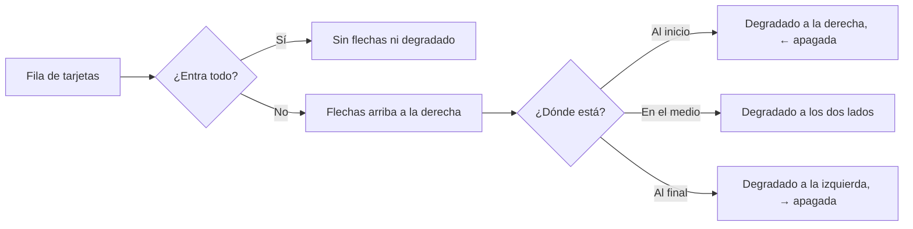

# Plan: un carrusel único para la web

> Planeación original. Estado: **aprobado** por Daniel el 2026-11-04, sobre la propuesta interactiva (https://claude.ai/artifact/KpvUHqPvGyRuYHn7jjvS5M).

Reporte de Daniel (captura `slider.png`, página de un mix): la fila de clips de "Lo más destacado de la partida" tiene una barra blanca en el tema oscuro, el borde del elegido cortado, tarjetas sin imagen y nada que avise que hay más. Pidió un carrusel integrado con la página y el mismo en toda la web.

## Decisiones tomadas

| Tema | Decisión | Por qué |
|---|---|---|
| Un solo componente | `components/brand/Carousel.tsx` para las tres filas de tarjetas: la sala del matchmaking y el mix (`Highlights`), la sala de la serie y los torneos del equipo | Hoy cada una está armada distinto |
| Flechas | Arriba a la derecha, junto al título (Daniel) | Como ya estaba en la serie |
| Cuándo hay flechas | Solo si el contenido no entra. Se apagan en cada punta | No ocupar lugar si no hacen falta |
| Degradado | En el borde del lado donde hay más | Que se note que sigue |
| Barra | Fina, del color del texto con poca opacidad | Integrada con el tema |
| Tema oscuro | `color-scheme: dark` en `.dark` (y `light` en `:root`) | Es la causa de la barra blanca: sin eso el navegador dibuja barras y controles claros en toda la web |
| Elegido | Borde por dentro (`inset`) y 3 px de aire en la fila | El `ring` de afuera lo recortaba el desplazamiento |
| Tarjeta | `components/brand/ClipCard.tsx`, la misma en las dos salas: miniatura, tipo de jugada, duración, quién, mapa y ronda | Hoy son dos tarjetas distintas |
| Miniatura | La foto del mapa del catálogo (Administración › Mapas). Sin foto, el degradado naranja de la serie (Daniel) | No hace falta guardar un fotograma por clip |
| Mix | `MixHighlights` pasa la foto del mapa (hoy manda `poster={null}`) | Por eso la captura no tenía imagen |
| Teclado | La fila toma foco y se mueve con ← y →. Sin animación con `prefers-reduced-motion` | Accesibilidad |
| Rama | `main` (Daniel) | Es lo que está en producción |

## 1. El flujo

## 2. Componentes

- `useCarousel()`: la referencia de la fila, si desborda, si está al inicio o al final, y `scroll(±1)` (85 % del ancho).
- `CarouselArrows` y `CarouselTrack`, para cuando las flechas van en otro lado (el `aside` del `Panel` del equipo).
- `Carousel`: título, flechas y fila juntos.
- `ClipCard` y `ClipCardPending` ("Procesando clips…").

## 3. Dónde se aplica

| Lugar | Archivo |
|---|---|
| Sala del matchmaking y página del mix | `features/matchmaking/room/Highlights.tsx`, `features/mixes/components/MixHighlights.tsx` |
| Sala de la serie | `features/series/pages/SeriesRoom.tsx` |
| Página del equipo | `features/teams/components/TournamentHistory.tsx` |
| Barra fina y `color-scheme` | `src/index.css` |

## 4. Requisitos antes de empezar

Ninguno. Solo cambia `web/frontend`.

## 5. Orden de implementación

1. `index.css`: `color-scheme` y la utilidad de la barra.
2. `Carousel` y `ClipCard`, con pruebas.
3. Las tres pantallas.
4. Pruebas, typecheck, lint y build.
5. Documentación, manual (si cambia algo para algún rol) y commit en `main`. El despliegue de la web, cuando Daniel lo pida.
