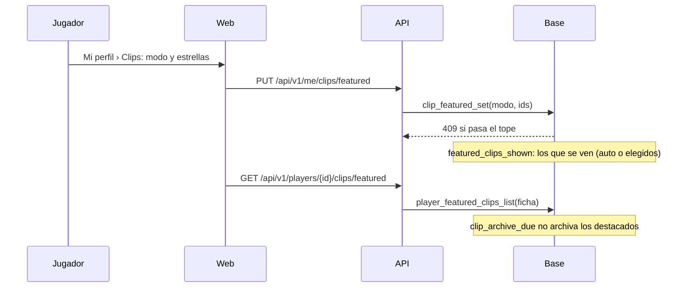
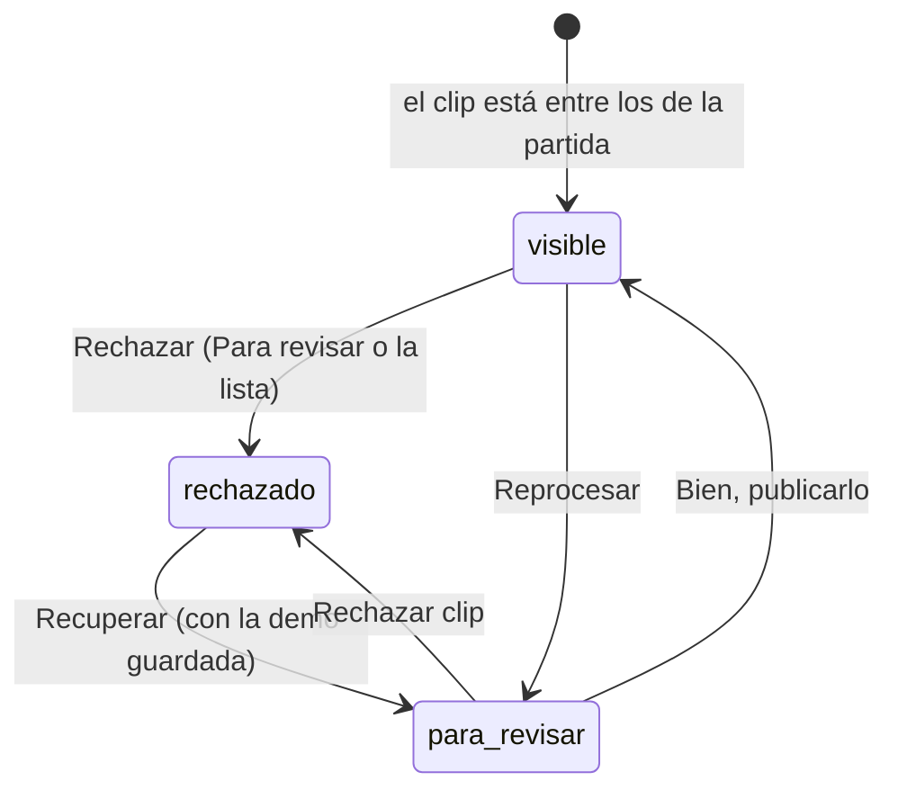

# Clips destacados en el perfil y rechazar un clip: documentación

## Qué hace

**Clips destacados.** La ficha pública de cada jugador tiene una pestaña **Clips** con sus mejores jugadas: el primero en grande, con su video, y los demás en un carrusel con la foto del mapa. El jugador elige en **Mi perfil › Clips** cómo se arman:

- **Automático** (el de entrada): los mejores clips con video, según la escala de Administración › Clips (ace, clutch 1v5/1v4, 4k, 1v3, 3k…) y, a igual tipo, el más nuevo.
- **Elijo yo:** los que marca con la estrella, en el orden que elige.

El tope es `clip_config.featured_max` (3) o `featured_max_vip` (10) con VIP, y se cambia en Administración › Clips › Reglas. Sin destacados, la pestaña no aparece.

**Rechazar un clip.** Un clip que sigue saliendo mal por más que se vuelva a grabar se rechaza desde **Para revisar** o desde la lista de clips. Deja de verse en toda la web, no sale en Discord y no se vuelve a grabar, y su video se borra en la vuelta de la noche del render. Se recupera con el filtro **Rechazados** → **Recuperar**, mientras la demo siga guardada.

Diseño aprobado: https://claude.ai/artifact/JtGZqvaTqnKzmSRxy7bgjA

## Reglas

| Regla | Dónde |
|---|---|
| Solo se destacan clips propios (de la ficha de la cuenta), con video y que no esperen revisión. Sin repetidos y hasta el tope (`V3901`, 409, con `details.max`) | `clip_featured_set` |
| Los elegidos se guardan aunque se pase a automático, para cuando vuelva a "Elijo yo" | `player_featured_clips` |
| Sin VIP otra vez: no se borra nada, se ven los primeros `featured_max` | `featured_clips_shown` |
| Un clip que se ve como destacado no sale de R2 a los 15 días. Uno que ya salió se ve con el reproductor de Drive, como todo clip viejo | `clip_archive_due` |
| Rechazar: solo admins, no mientras se graba, ni dos veces. El video va a `clip_video_trash` y deja de ser destacado | `clip_reject` |
| El ranking de la partida cuenta al rechazado (`match_clip_ranked`): no entra otro clip en su lugar | Vistas |
| Recuperar: solo con la demo guardada (`uploaded`). Vuelve a la cola del render como reprocesado y pasa por Para revisar | `clip_unreject` |
| Un mensaje que ya salió en Discord queda | — |
| Rechazar no avisa nada al jugador (`tg_notify_match_clips` solo avisa con el video listo o aprobado) | Sin cambios |

## Datos

- **`clip_config`:** `featured_max` (3) y `featured_max_vip` (10), de 1 a 50. Se cambian con `clip_set_featured(max, max_vip)`; la API la llama desde el `PATCH` de la configuración.
- **`player_clip_prefs`:** `user_id`, `featured_mode` (`auto` o `manual`), `updated_at`.
- **`player_featured_clips`:** `user_id`, `clip_id`, `position`. Las dos tablas, sin acceso directo.
- **`match_clips`:** `video_review` admite `rejected`; `video_rejected_at`, `video_rejected_by` y `video_reject_reason` (hasta 300).
- **Vistas:** `match_clip_ranked` (la de siempre, con los rechazados; solo `authenticated`) y `match_clip_list` (la misma sin los rechazados, con las mismas columnas: la usan la web, el render y Discord sin cambios). `featured_clips_shown` (`player_id`, `clip_id`, `position`): los destacados que se ven, en los dos modos.
- **Manual:** `clips.destacados` y `clips.destacados_vip` en `manual_valores`.

## API

| Ruta | Qué |
|---|---|
| `GET /api/v1/me/clips` | Modo, VIP, tope, el tope con VIP, los elegidos, los que se ven y mis clips con video (con su partida), del más nuevo al más viejo |
| `PUT /api/v1/me/clips/featured` | `{ mode, ids }`. 409 si pasa el tope |
| `GET /api/v1/players/{id}/clips/featured` | Público. Los destacados de la ficha en orden (`{ items: [{ clip, match }] }`). Por id, no por nick |
| `POST /api/v1/admin/clips/{id}/reject` | Con `{ reason? }` |
| `POST /api/v1/admin/clips/reject` / `restore` | `{ ids, reason? }` / `{ ids }`: uno por uno, con el resultado de cada uno |
| `GET /api/v1/admin/clips?status=rejected` | Los rechazados, con `rejected: { at, by, reason, can_restore }` |
| `PATCH /api/v1/admin/clips/config` | Acepta `featured_max` y `featured_max_vip` |

## Web

- **Mi perfil › Clips** (`/profile/clips`, `ClipsSection`): los dos modos, el contador ("2 de 3"), el aviso de VIP, la lista en orden (subir, bajar y quitar) y la grilla de mis clips con la estrella. **Guardar** y **Ver mi ficha**.
- **Ficha pública › Clips** (`ClipsTab`): la pestaña aparece con al menos un destacado.
- **Administración › Clips:** **Rechazar clip** en Para revisar (con confirmación y motivo, y el aviso "sigue saliendo mal" desde 3 reprocesos); en la lista, **Rechazar** junto a Reprocesar, el filtro **Rechazados** con quién, cuándo y el motivo, y **Recuperar**. En Reglas, los dos topes nuevos.

## Qué cambia para cada rol

| Rol | Qué cambia | Página del manual |
|---|---|---|
| Jugador | Elige sus clips destacados (o los deja en automático) y los ve en su ficha; ve los de los demás. Un clip rechazado deja de verse | [Clips, demos y lo más destacado](../../manual/jugador/clips-y-demos.md) y [Crear tu cuenta](../../manual/jugador/crear-cuenta.md) |
| Admin | Rechaza y recupera clips, y fija los topes de destacados | [Clips](../../manual/admin/clips.md) |

## Términos y privacidad

- **Términos (sección 11):** la ficha pública muestra los clips destacados (elegidos o los mejores, hasta el tope, más con VIP) y la liga puede rechazar un clip que salió mal (deja de verse, no se publica y su video se borra). En `/terminos` y `terms/terminos.html`.
- **Privacidad:** sin cambios. Los destacados son clips que ya eran públicos, y la política no habla de los 15 días en R2.

## Dónde está cada cosa

| Qué | Archivo / ubicación |
|---|---|
| Base | `supabase/replanteo/76_clips_destacados_y_rechazo.sql` y su inversa en `docs/bitacora/2026-10-14-replanteo-modelo-datos/reversas/` |
| Pruebas de la base | `pruebas/probar_76.sh` (con `prueba_76.sql`) |
| API | `web/backend/src/routes/clips.ts`, `src/schemas/clips.ts`, `src/db/types.ts` (a mano), `src/lib/manual.ts` |
| Pruebas de la API | `web/backend/test/unit/clips-featured.test.ts` |
| Web | `features/profile/pages/ClipsSection.tsx` (y su prueba), `routes/_app/profile.clips.tsx`, `ProfileLayout.tsx`, `features/profile/api/queries.ts`; `features/player/components/tabs/ClipsTab.tsx`, `PlayerTabs.tsx`, `lib/search.ts`, `api/queries.ts`; `features/admin/clips/` (`ReviewTab`, `ListTab` y su prueba, `api/queries.ts`, `lib/clips.ts`, `types`) |
| Manual | `docs/manual/jugador/clips-y-demos.md`, `jugador/crear-cuenta.md`, `admin/clips.md` |
| Términos | `web/frontend/src/features/legal/pages/TermsPage.tsx` y `terms/terminos.html` |
