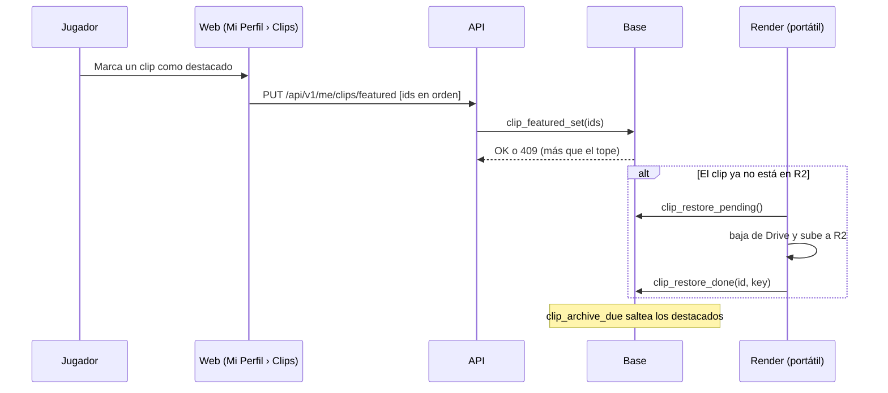

# Plan: clips destacados en el perfil

> Planeación original. Pedido por Daniel el 2026-11-04 (punto 3 de 3). **Aprobado el 2026-11-05**, con el modo automático y el rechazo de clips (sección "Lo que se sumó el 2026-11-05"). Diseño: https://claude.ai/artifact/JtGZqvaTqnKzmSRxy7bgjA

## Qué se pide

Una pestaña de clips destacados en **Mi Perfil**. Cada jugador elige hasta 3 de sus clips, y un VIP hasta 10. Los dos topes se configuran.

## Decisiones tomadas

| Tema | Decisión propuesta |
|---|---|
| Dónde se eligen | En la sección nueva **Mi Perfil › Clips** (`/profile/clips`) |
| Dónde se ven | En la ficha pública del jugador, en una pestaña **Clips** al lado de las que ya tiene (Resumen, Partidas, Mapas…). Sin destacados, la pestaña no aparece |
| Qué clips se pueden elegir | Los propios (del SteamID vinculado a la cuenta), con video (`video_status = 'done'`) y no ocultos por un admin |
| Topes | `clip_config.featured_max` (3) y `featured_max_vip` (10), en Administración › Clips |
| Orden | El jugador los ordena (subir/bajar). El primero va arriba en la ficha |
| Si deja de ser VIP | No se borra nada. En la ficha se ven solo los primeros `featured_max`, y no puede sumar más hasta estar debajo del tope |
| Video | Hoy el video está en R2 15 días y después solo en Drive. **Los destacados no se archivan:** `clip_archive_due` los saltea mientras estén destacados. Si se quita uno con más de 15 días, entra en el archivo de la noche siguiente |
| Destacado viejo ya archivado | Si el clip ya salió de R2, se sube de nuevo desde Drive al destacarlo (lo hace la máquina de render en su vuelta). Mientras tanto, la ficha muestra "Preparando el video" |

## Lo que se sumó el 2026-11-05 (Daniel, con el diseño aprobado)

### Modo automático

- **Automático** (el de entrada): si el jugador no elige, su ficha muestra sola sus mejores clips con video, hasta el tope, en el orden de la escala de Administración › Clips (ACE, después el clutch 1v5/1v4, 4K, 1v3, 3K…) y, a igual tipo, el más nuevo primero.
- **Elijo yo:** marca con la estrella y ordena. Si no eligió ninguno, la pestaña no aparece.
- Se guarda en `player_clip_prefs.featured_mode` (`auto` o `manual`). Los destacados que se ven, en los dos modos, salen de una sola vista (`featured_clips_shown`), que usan la ficha, Mi Perfil y el archivo de la noche.

### Rechazar un clip (pedido de Daniel: "si el clip sigue saliendo mal eternamente no le puedo dar a Rechazar clip")

| Tema | Decisión |
|---|---|
| Dónde | Botón **Rechazar clip** en cada tarjeta de Para revisar, y en la lista de clips (elegir varios → Rechazar). Pide confirmar, con un motivo opcional |
| Qué hace | `match_clips.video_review = 'rejected'`, con quién, cuándo y el motivo. Deja de verse en toda la web (partida, sala, perfil, destacados), no sale en Discord y no se vuelve a grabar. El video va a la papelera (`clip_video_trash`), que se vacía en la vuelta de la noche del render |
| Sin rellenar el hueco | El ranking de la partida se calcula con el rechazado incluido (vista nueva `match_clip_ranked`) y `match_clip_list` lo saca al final: no entra otro clip en su lugar (lo mandaría a grabar y a Discord días después) |
| Recuperar | En la lista, filtro **Rechazados** → **Recuperar**. Lo vuelve a grabar y pasa por Para revisar. Solo mientras la demo siga guardada (90 días) |
| Un mensaje ya publicado en Discord | Queda (el render no guarda cómo borrarlo) |

### Simplificación

- **Sin la vuelta a R2 desde Drive:** un clip que ya salió de R2 se ve con el reproductor de Drive, como cualquier clip viejo. Solo se deja de archivar mientras esté destacado. No hay cambios en `render/`.
- La privacidad no cambia: no menciona los 15 días en R2. Cambian los términos (sección 11): los destacados y que la liga puede rechazar un clip.
- El replanteo es el `76` (la `75` es la de los reemplazos, sin commit).

## 1. El flujo

## 2. Base de datos (replanteo nuevo)

- Tabla `player_featured_clips`: `user_id`, `clip_id`, `position`, `created_at`, con clave `(user_id, clip_id)`. Lectura pública, y escritura solo por la función.
- `clip_config`: `featured_max smallint default 3` y `featured_max_vip smallint default 10` (entre 1 y 50), en `clip_set_config` o en una función propia.
- `clip_featured_set(p_clips uuid[])`: reemplaza la lista del usuario. Valida que los clips sean suyos y tengan video, y el tope con `is_vip()`.
- `player_featured_clips_list(p_player uuid)`: los destacados visibles de un jugador, con el tope que le toca hoy, y el video y los datos de `match_clip_list`.
- `clip_archive_due`: excluye los destacados.
- `clip_restore_pending()`/`clip_restore_done()`: para la vuelta a R2 de un destacado archivado.

## 3. API

- `GET /api/v1/me/clips`: mis clips con video, con cuáles están destacados y el tope que me toca.
- `PUT /api/v1/me/clips/featured`: la lista en orden. `409` si pasa el tope y `400` si un clip no es mío o no tiene video.
- `GET /api/v1/players/{id}/clips/featured`: público, para la ficha.
- Esquemas, tipos y pruebas.

## 4. Web

- `features/profile/pages/ClipsSection.tsx`: la grilla de mis clips (miniatura, tipo, mapa, fecha). Una estrella para destacar, el contador "2 de 3" (o "de 10" con VIP), el orden de los elegidos y, si no es VIP, un aviso de que con VIP llega a 10.
- `ProfileLayout`: la sección nueva en el menú.
- `features/player/components/tabs/ClipsTab.tsx`: los destacados en la ficha pública, con el mismo reproductor de los clips de una partida.
- Administración › Clips: los dos topes.

## 5. Render

- `render/procesar.py`, en `daily`: los destacados no aparecen en `clip_archive_due` (lo resuelve la base). La vuelta a R2 de un destacado archivado baja el archivo de Drive (`drive.download`, ya existe) y lo sube con `r2.py`.

## 6. Manual, términos y privacidad

- Manual: una página nueva, `jugador/clips-destacados.md`, y una línea en `jugador/crear-cuenta.md` (la tabla de Mi Perfil). En el manual del VIP, que llega a 10. En `admin/`, los topes.
- **Privacidad: cambia un plazo.** Hoy dice que los videos están 15 días en R2 y después solo en Drive. Los destacados quedan en R2 mientras sigan destacados. Se actualiza `/privacidad` y `terms/privacidad.html`.
- Términos: si la página del VIP enumera sus beneficios, se suma "hasta 10 clips destacados".

## 7. Requisitos antes de empezar

- Que Daniel apruebe dónde se ven (la ficha pública) y lo de mantener los destacados en R2. El costo es chico: 10 clips de unos 20 MB son 200 MB por VIP, y el plan gratis de R2 tiene 10 GB.

## 8. Orden de implementación

1. Replanteo con su inversa y pruebas SQL.
2. API y pruebas.
3. Web (Mi Perfil, ficha y admin).
4. Render (vuelta a R2 de los archivados).
5. Documentación, manual, privacidad y changelog.
6. Desplegar: base, API, web y `render/` en el portátil.
