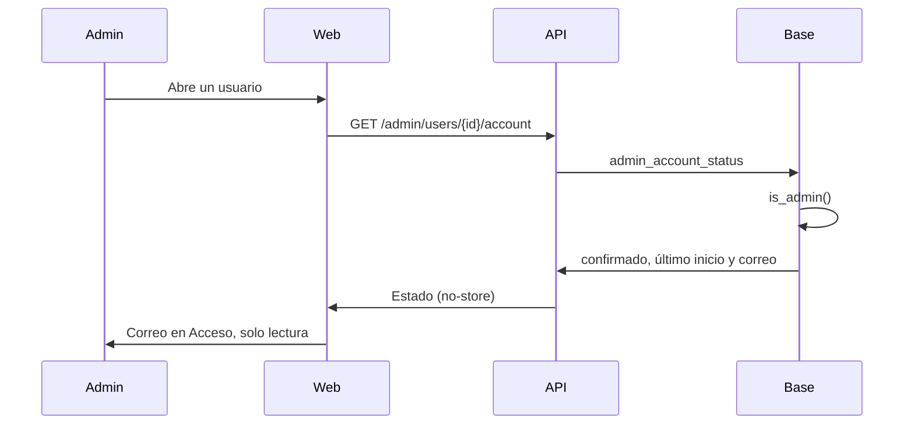

# El correo de la cuenta en Usuarios: documentación

## Qué hace

Al abrir una cuenta en **Administración › Usuarios**, la sección **Acceso** muestra el correo con el que se registró, además de si lo confirmó y su último inicio de sesión. Es solo para consultarlo: no hay campo para cambiarlo. El texto se puede seleccionar para copiarlo.

Lo ven solo los admins, como el resto del panel. La lista de usuarios no lo muestra: aparece solo cuando se abre una cuenta.

## Datos

| Pieza | Qué devuelve |
|---|---|
| `admin_account_status(p_user)` (replanteo `73`) | `{ confirmed, last_sign_in_at, email }`. Solo admins (`42501` para los demás). `P0002` si la cuenta no existe |
| `GET /api/v1/admin/users/{id}/account` | Lo mismo, con `Cache-Control: no-store`. `requireAdmin` |
| `AdminAccountStatus` | `email: string \| null` |

El correo sale de `auth.users.email`. No hace falta la clave de administrador de GoTrue.

## Qué cambia para cada rol

| Rol | Qué cambia | Página del manual |
|---|---|---|
| Admin | Ve el correo de cada cuenta en la sección Acceso, solo para consultarlo | [Usuarios y fichas](../../manual/admin/usuarios-y-fichas.md) |
| Los demás | Nada | — |

## Términos y privacidad

Sin cambios. `/privacidad` (sección "Qué es público") ya dice que el correo lo ven "solo tú y el staff", y este cambio lo muestra solo a los admins.

## Dónde está cada cosa

| Qué | Archivo / ubicación |
|---|---|
| Migración | `supabase/replanteo/73_correo_en_usuarios.sql` |
| Inversa y pruebas SQL | `docs/bitacora/2026-11-04-correo-en-usuarios/pruebas/` |
| Ruta y esquema | `web/backend/src/routes/admin-players.ts`, `web/backend/src/schemas/admin.ts` |
| Sección Acceso | `web/frontend/src/features/admin/users/components/AccountSection.tsx` |
| Manual | `docs/manual/admin/usuarios-y-fichas.md` |
