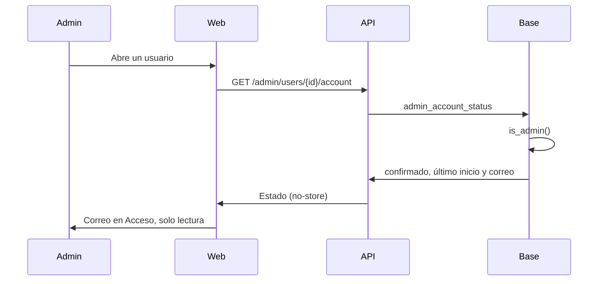

# Plan: el correo de la cuenta en Administración › Usuarios

> Planeación original. Estado: **aprobado** por Daniel el 2026-11-04 ("me gustaría que se pueda ver el correo del usuario en el panel de Usuarios, no para cambiarlo pero sí de manera informativa").

## Decisiones tomadas

| Tema | Decisión | Por qué |
|---|---|---|
| Dónde se ve | En la sección **Acceso** de la cuenta, al abrir un usuario. No en la lista | Es un dato personal: se muestra solo cuando el admin abre esa cuenta, no en una lista que se recorre o se captura |
| Quién lo ve | Solo el rol `admin`, como el resto de la sección | El panel de Usuarios ya es solo para admins (`requireAdmin` e `is_admin()`) |
| Editarlo | No se puede: solo lectura, con el texto seleccionable para copiarlo | Lo pidió así Daniel |
| De dónde sale | `admin_account_status` devuelve también `email` (replanteo `73`) | Ya es la consulta de esa sección y ya comprueba `is_admin()`. No hace falta la clave de administrador |
| Caché | `Cache-Control: no-store` en `GET /api/v1/admin/users/{id}/account` | Que el correo no quede en cachés intermedias |
| Términos y privacidad | Sin cambios | `/privacidad` ya dice que el correo lo ven "solo tú y el staff" |

## 1. El flujo completo

## 2. Base

Replanteo `73_correo_en_usuarios.sql`: `create or replace` de `admin_account_status` con `email` en el `jsonb`. Inversa que la deja como en el `72`. Va después de la `72`.

## 3. API

- `AdminAccountStatus` con `email` (texto o `null`).
- `no-store` en la ruta.
- Prueba unitaria.

## 4. Web

- `AccountSection`: una línea "Correo" con el valor, seleccionable, sin campo editable.
- `pnpm gen:api` (o editar el tipo generado si la API local no está) y prueba del componente.
- Solo en `feat/frontend-fase-1`.

## 5. Manual

`docs/manual/admin/usuarios-y-fichas.md`: la sección Acceso nombra el correo.

## 6. Requisitos antes de empezar

Ninguno. Para desplegar: túnel a la base del VPS y el despliegue de la API y de la web.

## 7. Orden de implementación

1. Migración `73` e inversa, probadas en la base local.
2. API y su prueba.
3. Web y su prueba.
4. Manual, documentación y guía.
5. Despliegue (con el visto bueno de Daniel): base del VPS, API y web.
