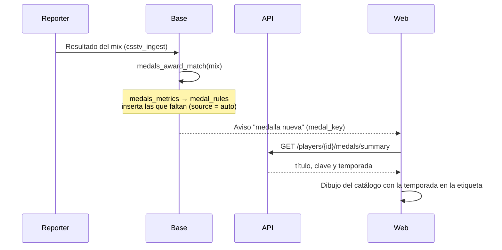

# Medallas automáticas: documentación

## Qué hace

Las medallas que salen de los datos del juego se dan solas: al guardar cada mix, la base suma los números de cada jugador de ese mix, los compara con las reglas y le da las que le faltan. Al cerrar una temporada se dan las de temporada. Las que no salen del juego (torneos, staff, eventos…) se dan a mano desde **Administración › Medallas**, que también sirve para corregir y para ajustar las reglas.

Cada medalla guarda la clave del catálogo de dibujos (`medal_key`, el SVG de `web/frontend/public/medallas/`). El perfil muestra ese dibujo en Logros; las medallas viejas, sin clave, siguen con su emoji.

## Automáticas y manuales

| Tipo | Cuándo | Cuáles |
|---|---|---|
| Automáticas de carrera | Al guardar cada mix, para sus jugadores | Las 136 de `medal_rules`: mixes, victorias, rachas, kills, daño, HS %, KDA, ADR, entry, 4K, aces, plantadas, defuses, explotadas, MVP del mix, ELO máximo, clutchs, armas, pistolas, rondas por lado, ecos, sobreviviente, mapas, veterano, fundador, pionero, primer mix y primera victoria |
| De temporada | Al cerrar la temporada (`season_close_run`) | Las de puesto que ya daba la base (1 a 3 = `podio_puesto_N`, 4 a 10 = `top10_temporada`) y además MVP (mejor rating), top fragger, rey del HS, mejor AWP y más mejorado (mayor subida de ELO) |
| Manuales | Desde Administración › Medallas | Campeón, finalista, beta tester, staff, caster, fair play, reclutador, supporter, eventos, aniversario, prestigio, Premium y VIP (hasta que exista la suscripción) y las de misiones (hasta que existan) |

Reglas:

- **Nunca se quitan solas.** Si el número baja (por ejemplo, el KD), la medalla queda.
- **No se dan dos veces:** una automática por jugador; una de temporada por jugador y temporada.
- **Mínimo de mixes:** HS %, KDA y ADR piden 20 mixes. Los premios de temporada, el mínimo de la temporada.
- **Mismo criterio que el perfil:** cuentan las partidas terminadas con la ficha del jugador (la vista `player_stats`), de cualquier tipo.
- **Datos del reporter 2.7.0:** armas, clutchs, rondas por lado, pistolas, ecos, sobrevivientes y bombas explotadas solo existen en los mixes desde el 2026-10-30.
- **Avisos:** cada medalla nueva manda el aviso "medalla nueva" (ahora con `medal_key`). La corrida para todos (`medals_award_all`) no avisa.
- **Quitar una automática:** vuelve en el próximo mix si el jugador sigue cumpliendo la regla. Para que no vuelva, se desactiva la regla.

## Datos

| Qué | Dónde |
|---|---|
| Clave del dibujo y origen | `player_medals.medal_key` y `player_medals.source` (`admin`, `auto`, `temporada`) |
| Reglas | `medal_rules (medal_key, metric, threshold, title, min_matches, icon, active)`. Todos la leen; el admin la cambia |
| Métricas de un jugador | `medals_metrics(jugadores)`: una fila por jugador y métrica, con sus partidas |
| Dar las que faltan | `medals_award(jugadores)`, `medals_award_match(mix)` (desde `csstv_ingest`), `medals_award_all()` y `admin_medals_recalculate()` (admin) |
| Temporada | `medals_award_season(temporada)` (desde `season_close_run`) |

La restricción `player_medals_temporada` ahora deja que una medalla dada a mano tenga temporada sin puesto; el puesto y el tramo siguen siendo solo de las de temporada.

## API

| Ruta | Qué hace |
|---|---|
| `GET /api/v1/players/{id}/medals` y `/medals/summary` | Suman `medal_key`, `source` (detalle) y la temporada (resumen) |
| `POST /api/v1/admin/players/{id}/medals` | Acepta `medal_key` y `season_id` |
| `GET /api/v1/admin/medals` | Otorgadas, con filtros por temporada (`none` = de carrera), clave, origen y alias |
| `POST /api/v1/admin/medals` | Da una medalla a hasta 500 jugadores; saltea a los que ya la tienen en esa temporada |
| `PATCH /api/v1/admin/medals/{id}` | Título o temporada, solo de las dadas a mano |
| `POST /api/v1/admin/medals/delete` | Quita varias |
| `GET /api/v1/admin/medal-rules`, `PATCH /api/v1/admin/medal-rules/{key}` | Reglas: umbral, mínimo de mixes, título y si está activa |
| `POST /api/v1/admin/medal-rules/recalculate` | Da las que falten a todos, sin avisos |

## Web

- **Perfil › Logros:** dibujo de la medalla si tiene clave, con la temporada en la etiqueta ("BETA" o "S<número>"); si no, el emoji.
- **Administración › Medallas** (`/admin/medals`), con tres pestañas:
  - **Dar medallas:** medalla (por defecto solo las manuales; "Todas" para corregir), temporada, título y jugadores (buscar, pegar una lista de alias o el top 10 de la temporada).
  - **Otorgadas:** filtros por alias, temporada y origen; cambiar la temporada de las manuales y quitar, de a una o varias.
  - **Automáticas:** las reglas editables y "Dar las que falten a todos".
- Las piezas comunes están en `src/lib/medals.ts` (catálogo y etiqueta de temporada), `src/lib/medalSeasonLabel.ts` (cambia el "S1" del SVG) y `src/components/brand/MedalImage.tsx`.

## Dónde está cada cosa

| Qué | Archivo / ubicación |
|---|---|
| Migración | `supabase/replanteo/72_medallas_automaticas.sql` |
| Prueba de la migración | `docs/bitacora/2026-11-04-medallas-automaticas/pruebas/prueba_72.sql` |
| Rutas del admin | `web/backend/src/routes/admin-medals.ts`, `web/backend/src/schemas/medals.ts` |
| Pruebas de la API | `web/backend/test/integration/medals.test.ts` |
| Página del admin | `web/frontend/src/features/admin/medals/`, `web/frontend/src/routes/_app/admin.medals.tsx` |
| Logros del perfil | `web/frontend/src/features/player/components/tabs/SummaryTab.tsx` |
| Dibujos y catálogo | `web/frontend/public/medallas/` |
