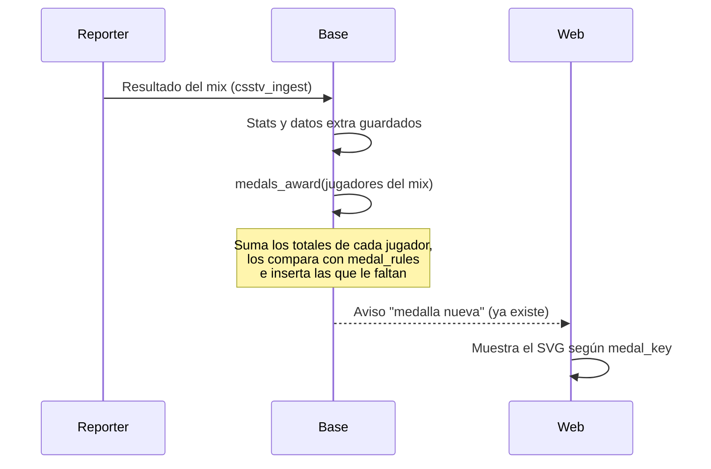

# Plan: medallas automáticas

> Planeación original. Estado: **propuesta**, pendiente de aprobación. Pedido por Kyan el 2026-11-04: "automatizá las medallas que deben ser automáticas (KD, mixes jugados, etc.); las que hay que dar a mano, que sean manuales".

## Decisiones tomadas

| Tema | Decisión | Por qué |
|---|---|---|
| Qué es automático | Toda medalla que sale de datos que ya guarda la base: stats de los mixes (`match_player_stats`), los datos extra del reporter 2.7 (`match_player_extra`), el ELO (`player_elo`) y el cierre de temporada | No depende de nadie y no se olvida |
| Qué es manual | Lo que no sale del juego: torneos, staff, caster, beta tester, fair play, supporter, eventos, aniversario. Se dan desde Administración › Medallas | No hay datos para calcularlas |
| Cuándo se calcula | Al guardar cada mix, para los jugadores de ese mix; al cerrar una temporada; y una vez para todos (para los mixes ya jugados) | El jugador ve la medalla apenas termina el mix |
| Se quitan solas | **No.** Una medalla ganada queda aunque el número baje (por ejemplo, el KD) | Es lo que se espera de un logro; el admin puede quitarla a mano |
| Mínimo de mixes para los promedios (HS %, KDA, ADR) | 20 mixes | Que un mix con suerte no alcance |
| Umbrales | En una tabla (`medal_rules`), no en el código | Se pueden ajustar sin una migración |
| Qué dibujo se muestra | Columna nueva `player_medals.medal_key` con la clave del catálogo (`kda_1_5`, `awp_500`…) | Hoy solo hay título y emoji |
| Medallas de equipo | Segunda etapa | Los mixes arman equipos al azar; primero hay que definir qué partidas cuentan (PCW y oficiales) |

## 1. El flujo completo

## 2. Automáticas y manuales

### Automáticas, al guardar cada mix (jugador)

| Medallas (clave del catálogo) | Regla | De dónde sale |
|---|---|---|
| `progresion_*_mixes` (10 a 1000) | Mixes jugados | `match_player_stats` de mixes terminados |
| `primer_mix` | 1 mix jugado | ídem |
| `victorias_*` (10 a 500), `primera_victoria` | Mixes ganados | `match_player_stats.team` = `matches.winner` |
| `racha_*` (5, 10, 15) | Racha más larga de victorias seguidas | ídem, por fecha |
| `kills_*`, `dano_*` | Kills y daño totales | `kills`, `damage` |
| `hs_*` (35, 45, 55 %) | `headshots / kills`, con 20 mixes o más | `headshots`, `kills` |
| `kda_*` (1.2, 1.5, 2.0) | `(kills + assists) / deaths`, con 20 mixes o más | `kills`, `assists`, `deaths` |
| `adr_*` (70, 85, 100) | `damage / rounds`, con 20 mixes o más | `damage`, `rounds` |
| `entry_*`, `multikill_*` (4K), `aces_*` | Totales | `first_kills`, `k4`, `k5` |
| `plantadas_*`, `desactivadas_*` | Totales | `plants`, `defuses` |
| `mvp_mix_*` | Mixes en los que tuvo el mejor rating de la partida | `rating` |
| `elo_*` (1200 a 2000) | ELO máximo alcanzado | `player_elo.peak_elo` |
| `mapa_<mapa>_*` | Mixes ganados en ese mapa | `matches.map` + victoria |
| `clutch_*` | Clutchs ganados (1v1 a 1v5) | `match_player_extra.clutch_1v*` |
| `awp_*`, `scout_*`, `deagle_*`, `cuchillo_*`, `he_*` | Kills con esa arma | `match_player_extra.weapon_kills` (`awp`, `scout`, `deagle`, `knife`, `hegrenade`) |
| `rifles_*` | Kills con AK-47 y M4A1 | `ak47` + `m4a1` |
| `smg_*`, `escopetas_*`, `eco_rifles_*`, `elites_*` | Kills con esas armas | `mp5navy`, `p90`, `ump45`, `tmp`, `mac10` / `m3`, `xm1014` / `famas`, `galil` / `elite` |
| `pistolas_*` | Rondas de pistola ganadas | `pistol_won` |
| `explotadas_*`, `lado_ct_*`, `lado_t_*`, `eco_ganado_*`, `sobreviviente_*` | Totales | `bombs_exploded`, `rounds_won_ct`, `rounds_won_t`, `eco_won`, `rounds_survived` |
| `veterano_*` (2, 3, 5) | Temporadas en las que jugó al menos un mix | `seasons` + fechas de los mixes |
| `fundador` | Jugó al menos un mix en la primera temporada | ídem |
| `pionero_primer_mix` | Jugó el primer mix guardado | el `matches` más viejo |

Los datos extra (armas, clutchs, rondas) existen desde el reporter 2.7.0 (desplegado el 2026-10-30): los mixes anteriores no los tienen y no suman para esas medallas.

### Automáticas, al cerrar una temporada

| Medallas | Regla |
|---|---|
| `podio_puesto_1/2/3` | Ya se dan hoy (con emoji): pasan a llevar `medal_key` |
| `mvp_temporada`, `top10_temporada` | Puesto 1 y top 10 del ranking de la temporada |
| `top_fragger_temporada`, `rey_hs_temporada`, `mejor_awp_temporada`, `mas_mejorado_temporada` | Más kills, mejor % HS (con el mínimo de mixes de la temporada), más kills con AWP y mayor subida de ELO en la temporada |

### Manuales (Administración › Medallas)

`campeon_torneo`, `finalista_torneo`, `beta_tester`, `staff`, `caster`, `fair_play`, `reclutador`, `supporter`, `halloween`, `navidad`, `aniversario`, `aniversario_2`, `prestigio_*` (hasta que se defina la regla) y las correcciones (dar o quitar cualquiera).

### Para más adelante

- **Premium y VIP (y sus meses):** automáticas cuando exista la suscripción. Hasta entonces, manuales.
- **Misiones:** automáticas cuando exista el sistema de misiones.
- **Equipos:** la segunda etapa de este plan.

## 3. Cambios en la base (migración nueva)

- `player_medals`:
  - columna `medal_key text` (clave del catálogo);
  - columna `source text` (`auto`, `temporada` o `admin`);
  - la restricción `player_medals_temporada` pasa a permitir `season_id` sin `rank` ni `tier` en las manuales;
  - índice único `(player_id, medal_key)` para las de carrera (sin temporada), así una automática no se da dos veces.
- Tabla `medal_rules (medal_key, metric, threshold, min_matches, active)`, cargada con la tabla de arriba.
- Función `medals_award(p_players uuid[])`: calcula las métricas de esos jugadores, las compara con `medal_rules` e inserta las que faltan. Idempotente.
- Llamada al final de `csstv_ingest` para los jugadores del mix (si falla, el resultado del mix se guarda igual, como hace `csstv_match_extra`).
- El cierre de temporada suma las medallas de temporada.
- Una corrida inicial para todos los jugadores.

## 4. Cambios en la API y la web

- La API devuelve `medal_key` en las medallas del jugador.
- Endpoints de Administración › Medallas (dar a varios con temporada, cambiar temporada, quitar varias, listar otorgadas), como en la demo `/demo/admin-medallas`.
- El perfil muestra el SVG de `public/medallas/` según `medal_key` (con la temporada en la etiqueta, como en la demo) y deja el emoji para las viejas.

## 5. Requisitos antes de empezar

- Aprobación de Kyan (y aviso a Daniel, porque es base y API, y a Esteban por el perfil).
- Base local con la copia de producción para probar la corrida inicial.

## 6. Orden de implementación

1. Migración y `medal_rules`, probadas en la base local con la copia de producción.
2. `medals_award` y la corrida inicial: comparar cuántas medallas da y revisar algunos jugadores a mano.
3. Llamada desde `csstv_ingest` y el cierre de temporada.
4. API (`medal_key` y endpoints del admin).
5. Web: perfil y Administración › Medallas.
6. Staging y, con el visto bueno, producción.
