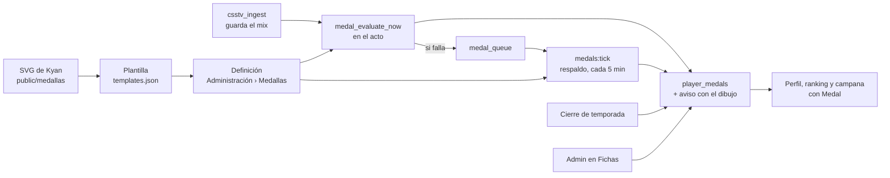
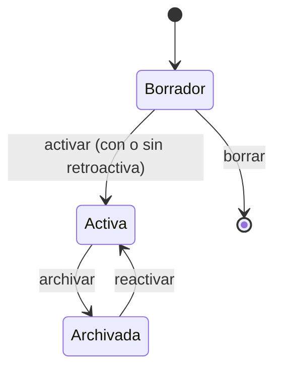

# Medallas configurables: documentación

## Qué hace

Las medallas dejan de ser un título con un emoji. Cada medalla es una **definición**: una **plantilla** (uno de los diseños de Kyan, en `badges/nuevas/brillo_solo_marco`, con su métrica) más un **objetivo** y lo que la plantilla deja cambiar del dibujo (número, etiqueta, banda, metal y color de la paleta de Kyan). El componente `<Medal>` trae el SVG de la plantilla, le aplica el diseño por los `id` de sus capas y lo dibuja igual en el perfil, el ranking, la campana y el admin.

Las de juego (59 plantillas en 7 categorías: trayectoria, habilidad, armas, rondas, mapas, temporada y comunidad) las otorga un **motor** en el momento en que se guarda el mix (no ronda a ronda). Si la evaluación falla, el mix se guarda igual y los jugadores quedan en una cola que el cron `medals:tick` revisa cada 5 minutos, de respaldo. Las de temporada las da el cierre de temporada, según el tramo de cada puesto, que ahora lleva una definición en lugar de un emoji. Las de Comunidad (staff, caster, campeón de torneo…) las da un admin desde Fichas.

**Sin las stats de la BETA** (Daniel, 2026-11-06; el plan no lo decía): las medallas del motor cuentan solo las partidas desde el inicio de la primera temporada después de la BETA (`medal_stats_since()`, la temporada número 2). Mientras dure la BETA no se da ninguna, ni siquiera con la retroactiva. El ELO máximo pasa a ser el `elo_after` más alto de esas partidas, no el pico histórico. Fundador (jugó la temporada 1) y Pionero (jugó el primer mix) siguen saliendo de la BETA, pero también esperan a la temporada 2: al crearse, todos los que jugaron entran a la cola y el cron se las da. Las de puesto al cerrar la BETA sí se dan.

Por lo mismo, la web ya no muestra "Cuenta desde el 2026-10-29" en las medallas del reporter 2.7.0 (armas, clutchs, rondas…), ni en Logros ni en Administración › Medallas: la temporada 2 empieza con ese plugin ya instalado. `data_since` sigue en la base y en la API, sin uso en la web.

El perfil público suma la pestaña **Logros**: vitrina, contadores y, por categoría, las obtenidas y la próxima de cada serie con su progreso. El emoji de medalla ya no se ve en ningún lado.

## Plantillas

Viven en `web/frontend/src/features/medals/templates.json`, que arma `pruebas/armar_manifiesto.py` leyendo los SVG de Kyan y las paletas de su generador. La API importa el mismo archivo para validar (pregunta 2 del plan). Cada plantilla trae:

| Campo | Qué es |
|---|---|
| `svg` | El SVG de un escalón cualquiera de la familia (`perfil/hs_35.svg`) |
| `metric`, `aggregation`, `filters` | La «misión base»: qué se cuenta, cómo y con qué filtro (arma, mapa, mínimo de mixes, temporada) |
| `editable` | Qué se puede cambiar: número, etiqueta, banda, metal y acento |
| `defaults`, `steps`, `titleFmt` | Etiqueta, banda y formato del número por defecto; los escalones de Kyan; el formato del título |
| `accent`, `metal` | La paleta original del SVG, para reemplazarla |
| `dataSince` | `2026-10-29` en las que salen del reporter 2.7.0 |

| Categoría | Plantillas | Métrica |
|---|---|---|
| Trayectoria | Mixes jugados, victorias, racha, kills, daño, primer mix, primera victoria, veterano, fundador y pionero | Partidas, ELO y temporadas |
| Habilidad | % HS, KDA y ADR (con 20 mixes como mínimo), entry, 4K, aces, ELO máximo, MVP del mix y clutchs | `match_player_stats`, `player_elo`, `mix_list` y `match_player_extra` |
| Arsenal y bomba | AWP, Scout, Deagle, AK/M4, cuchillo, HE, subfusiles, escopetas, Famas/Galil, Elites, pistolas y bombas | `match_player_extra` (desde el 2026-10-29) y `match_player_stats` |
| Rondas | Ganadas de CT y de T, ecos y sobrevividas | `match_player_extra` (desde el 2026-10-29) |
| Mapas | Maestro de Dust2, Inferno, Nuke, Train, Cobblestone, Tuscan, Season, Cache y Mirage | Victorias en el mapa (sin `de_` y con sus variantes) |
| Temporada | Podio y Top | El cierre de temporada |
| Comunidad | Campeón y finalista de torneo, staff, caster, aniversario, beta tester, fair play, reclutador, supporter, Halloween y Navidad | Las da un admin |

Un ícono nuevo (otro mapa, otra arma) necesita un SVG de Kyan y una línea en el script del manifiesto.

## Cómo se dibuja (`<Medal>`)

`features/medals/svg.ts` (`applyDesign`) parsea el SVG y:

- cambia los colores del metal en las capas del marco (`metal`, `pasador`, `resplandor-marco`, `filete-claro`, `laureles`) y los del acento en el resto. En el podio y en "mixes jugados", que no tienen acento propio, el metal colorea toda la medalla;
- enciende los rombos de `puntos-nivel` según el metal (bronce 1 a diamante 5);
- cambia `numero` con la regla del generador (74, 66, 58, 50 o 42 según el largo), la píldora de `etiqueta` (ancho por largo) o `temporada`, y `texto-banda`;
- la versión bloqueada usa la paleta gris del generador, apaga los rombos y pone el ícono al 60 %;
- prefija todos los `id` (y sus `url(#…)`) con un id único por instancia, porque los SVG repiten `metal`, `recorte-forma`…;
- saca scripts, `foreignObject` y atributos de eventos antes de insertarlo.

El SVG se trae una vez (`staleTime: Infinity`) y se inserta con el DOM, sin `dangerouslySetInnerHTML`. La ruta `/demo/medallas` (solo en `pnpm dev`) muestra las 59 plantillas.

## Definiciones y estados

- **Clave:** la plantilla y el objetivo (`hs_pct_45`, `kda_1_5`); las de una vez y las manuales, la plantilla. Una sola por clave.
- **Activa:** se cambian el dibujo, el título y la descripción. La plantilla, la condición y el objetivo no (lo impide la base): se archiva y se crea otra (pregunta 13).
- **Archivada:** deja de otorgarse; quien la tiene la conserva. No se archiva una que use un tramo de temporada.
- **Retroactiva:** al activarla se le da a todos los que ya la cumplen, con aviso. Sin ella, cada uno la recibe después de su próximo mix.
- **Series:** los escalones de una familia (`series`, `series_order`) para mostrar "siguiente" en Logros.
- Una medalla automática nunca se quita sola (pregunta 11); un admin la puede quitar desde Fichas.

## Base de datos (replanteo `79`)

| Objeto | Qué es |
|---|---|
| `medal_definitions` | `key`, `template`, `scope`, `title`, `description`, `design` (`{number, label, band, metal, accent}`), `metric`, `aggregation`, `filters`, `target`, `series`, `series_order`, `status`, `retroactive`, `data_since`. RLS: todos ven las no borrador; el admin gestiona |
| `player_medals.definition_id`, `source` | La definición y quién la dio (`auto`, `season` o `admin`). Índice único por jugador y definición en las `auto`; las manuales se repiten (dos torneos) |
| `medal_holders` | Vista: cuántos tienen cada medalla |
| `medal_stats_since()` | Desde cuándo cuentan las stats: el inicio de la temporada 2; `null` durante la BETA (2026-11-06) |
| `medal_metric_values(métrica, agregación, filtros, jugadores)` | El catálogo de métricas, desde `medal_stats_since()` (sin nada durante la BETA) |
| `seasons_medal_stats_start` (trigger en `seasons`) | Al crearse la primera temporada después de la BETA, anota en la cola a todos los que jugaron (Fundador y Pionero) |
| `medals_award`, `medals_evaluate_pending` (el motor, solo `service_role`), `medals_evaluate_all` (la retroactiva) | Otorgan; nunca repiten |
| `medal_queue`, `medal_evaluate_now` y sus triggers | En `match_player_stats` (alta y cambio) y al pasar una partida a terminada: anotan a los jugadores y, si el mix está terminado, les dan las medallas en el acto. Si la evaluación falla, el mix se guarda igual y quedan en la cola |
| `medal_activate`, `medal_archive`, `medal_preview` | Admin (`is_admin()`) |
| `medal_progress(jugador)` | El valor actual en cada medalla activa del motor |
| `medal_design(definición, puesto, temporada)` | El dibujo de los avisos |
| `season_tiers_ok`, `season_tier_definition`, `season_close_run`, `tg_notify_season_standings` | Tramos con `definition`; el cierre guarda la definición; el aviso lleva el dibujo y no el emoji |

La migración crea las definiciones de temporada (Podio 1.º, 2.º y 3.º, Top 10 y Top 20, este con el círculo del Top 10 en bronce hasta que Kyan lo diseñe) y la manual «Campeón de torneo», y pone las de temporada en los tramos de la configuración y de la temporada activa. Las 18 medallas viejas con emoji (títulos de torneos externos) pasan a «Campeón de torneo» y conservan su título. Las demás definiciones las carga `pruebas/definiciones_iniciales.sql` (146, todas las familias con los escalones de Kyan).

## API

| Ruta | Qué hace |
|---|---|
| `GET /api/v1/medals/definitions` | Las activas, con su dibujo. Pública |
| `GET /api/v1/admin/medals/definitions` | Todas, con cuántos la tienen y desde cuándo hay datos (admin) |
| `POST /api/v1/admin/medals/definitions` | Crea un borrador desde una plantilla. La condición sale del manifiesto; el diseño se valida contra lo que la plantilla deja editar |
| `PATCH /api/v1/admin/medals/definitions/{id}` | Dibujo, título y descripción; objetivo y mínimo de mixes solo en un borrador |
| `DELETE /api/v1/admin/medals/definitions/{id}` | Borra un borrador |
| `POST /api/v1/admin/medals/definitions/{id}/activate` | `{ retroactive }`, responde `awarded` |
| `POST /api/v1/admin/medals/definitions/{id}/archive` | Archiva |
| `POST /api/v1/admin/medals/preview` | Cuántos la recibirían hoy (plantilla, objetivo y mínimo de mixes) |
| `POST /api/v1/admin/players/{id}/medals` | Ahora recibe `definition_id` (una manual) y un título opcional, sin emoji |
| `GET /api/v1/players/{id}/medals` y `/summary` | Con `design` y `source`, sin `icon` |
| `GET /api/v1/players/{id}/medals/progress` | Progreso; solo lo ven el dueño de la ficha y el admin, los demás ven solo las ganadas (2026-11-06) |
| Temporadas | El tramo lleva `definition`; la medalla de cada puesto es `{ name, design }` |

## Qué cambia para cada rol

| Rol | Qué cambia | Página del manual |
|---|---|---|
| Jugador | Medallas por victorias, kills, armas, mapas y más, que llegan solas después de cada mix; pestaña **Logros**; medallas dibujadas en el ranking, las temporadas y la campana | [`jugador/logros.md`](../../manual/jugador/logros.md) (nueva), [`jugador/elo-y-estadisticas.md`](../../manual/jugador/elo-y-estadisticas.md), [`jugador/notificaciones.md`](../../manual/jugador/notificaciones.md) |
| Admin | Administración › **Medallas**; los tramos de las temporadas eligen una medalla; en Fichas se dan medallas de Comunidad en lugar de un emoji | [`admin/medallas.md`](../../manual/admin/medallas.md) (nueva), [`admin/temporadas.md`](../../manual/admin/temporadas.md), [`admin/usuarios-y-fichas.md`](../../manual/admin/usuarios-y-fichas.md) |
| Capitán, organizador, moderador, streamer y dueño de un servidor externo | Nada | — |

## Términos y privacidad

Sin cambios. `/privacidad` ya dice que se calculan "las medallas" a partir de las partidas. No se guarda ningún dato personal nuevo. El progreso hacia las medallas bloqueadas sale de estadísticas que ya son públicas, y solo lo ve el dueño de la ficha (y el admin): a los demás no se les muestra, tenga o no el perfil privado (ajuste de Daniel del 2026-11-06; el plan, en la sección 15, lo ocultaba solo con el perfil privado). Ninguna medalla se quita sola, así que `/terminos` no necesita decirlo.

## Dónde está cada cosa

| Qué | Archivo |
|---|---|
| Base | `supabase/replanteo/79_medallas_configurables.sql` |
| Inversa, pruebas, definiciones iniciales y manifiesto | `pruebas/79_inversa.sql`, `pruebas/prueba79.sql`, `pruebas/definiciones_iniciales.py` (y `.sql`), `pruebas/armar_manifiesto.py` |
| Generadores de Kyan | `diseños/` (`generar_medallas_nuevas.py`, `aplanar.py`, `generar_planas.py` y los `LEEME`) |
| SVG | `web/frontend/public/medallas/` (los desbloqueados de `brillo_solo_marco`) |
| Manifiesto y dibujo | `web/frontend/src/features/medals/` (`templates.json`, `templates.ts`, `svg.ts`, `Medal.tsx` y sus pruebas) |
| API | `web/backend/src/routes/medals.ts`, `schemas/medals.ts`, `services/medals.ts`; cambios en `players.ts`, `admin-players.ts`, `seasons.ts` |
| Motor | `web/backend/scripts/medals-tick.mts`, `deploy/vps/cmleague-medals.service` y `.timer` |
| Web | `features/admin/medals/`, `features/player/components/tabs/AchievementsTab.tsx`, `features/admin/seasons/components/TierMedal.tsx`, `routes/demo.medallas.tsx` |
