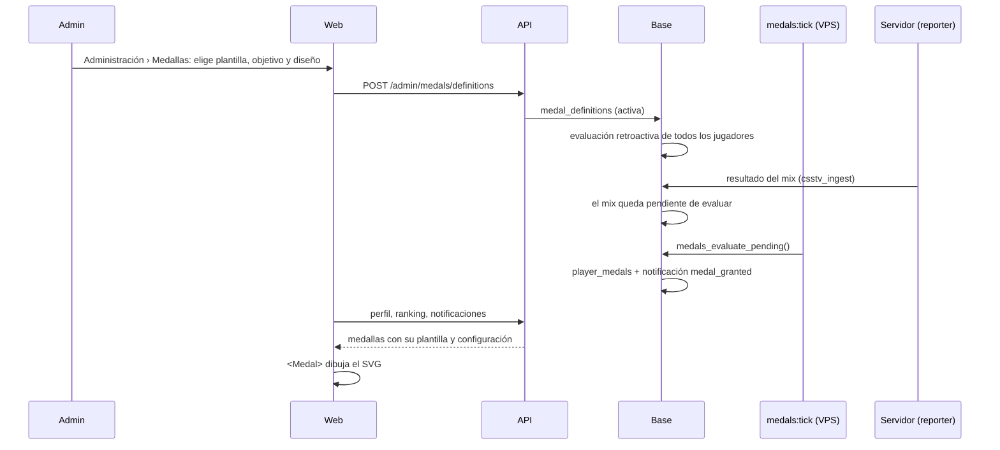

# Plan: medallas configurables

> Planeación original. Estado: **propuesta**, pendiente de aprobación. Escrito el 2026-11-04 para implementarlo en otra sesión.
> Antes de empezar, leer la sección 13: **Para quien lo implemente**.

## Contexto: qué hay hoy

- **Datos:** desde la 2.7.0, el `csstv_reporter` manda kills y HS por arma, clutchs, rondas sobrevividas, rondas ganadas de CT y de T, pistolas, ecos y bombas explotadas. La base los guarda en `match_player_extra` y `match_round_log` (migración `supabase/migrations/20261029210000_medallas_datos.sql`, bitácora [`2026-10-29-medallas-datos`](../2026-10-29-medallas-datos/)). Esos datos existen desde el 2026-10-29: los mixes anteriores no los tienen (sin fila, que no es lo mismo que cero).
- **Quién otorga medallas hoy:**
  - El cierre de temporada, `season_close_run` (`supabase/replanteo/24_temporadas.sql`, línea 429). Inserta en `player_medals` el título (`"Temporada BETA · #3"`), un **emoji** como ícono y los campos `season_id`, `rank` y `tier`.
  - Un admin a mano, desde Administración › Jugadores › Fichas (`POST /api/v1/admin/players/{id}/medals`), con título y emoji.
  - No hay motor de medallas.
- **`player_medals` hoy:** `id`, `player_id`, `title`, `icon` (emoji, por defecto `🏆`), `created_at`, `season_id`, `rank` y `tier`. No hay medallas de equipo.
- **Tramos de temporada:** viven en `season_config.tiers` y en `seasons.tiers` (`[{from, to, name, icon}]`, con el emoji en `icon`). La foto del cierre queda en `season_standings.tier` y `season_standings.icon`.
- **Fecha límite:** la Temporada BETA cierra el **2026-12-03 06:00 de Argentina**. Ese cierre otorga las primeras medallas automáticas. Si para entonces no está la fase 1, se otorgan con emoji.
- **Diseños:** `badges/nuevas/` en este worktree (`v34frag-main`), de Kyan. Ocupa 18 MB, tiene 1255 archivos y **no está versionado**. El detalle está en la sección 2.
- **Misiones semanales:** el prototipo está en `web/frontend/src/features/missions/` (rama `feat-missions-badges`, en stage y sin commit), con la bitácora [`2026-10-29-misiones-semanales`](../2026-10-29-misiones-semanales/). Usa casi las mismas métricas que las medallas.

## Decisiones tomadas

Son las que ya tomaron Daniel o Kyan. No se vuelven a discutir.

| Tema | Decisión | Por qué / quién |
|---|---|---|
| Qué es una medalla | Hay **plantillas base** (diseño + "misión base", es decir, una métrica). Para crear una medalla se elige una plantilla, se le pone un **objetivo** (por ejemplo 100 headshots) y se editan algunos detalles del diseño: el número que muestra, el color, el metal… | Kyan, transmitido por Daniel el 2026-11-04 |
| Diseños | Los de `badges/nuevas/` son la fuente de las plantillas | Kyan, 2026-11-04 |
| Estilo | **Brillo solo en el marco** (`badges/nuevas/brillo_solo_marco/`) | Elegido por Kyan el 2026-10-30 (`brillo_solo_marco/LEEME.txt`) |
| Emoji de medalla | **No se ve en ningún lado.** Lo reemplazan los diseños, también en el ranking y en las medallas de temporada | Daniel, 2026-11-04 |
| Datos del juego | Los del reporter 2.7.0, sin cambiar `"schema": 1` | Daniel, 2026-10-29 ([`2026-10-29-medallas-datos`](../2026-10-29-medallas-datos/)) |
| Commits | Conventional Commits en español, y solo cuando Daniel lo pide | `CLAUDE.md` |

## Propuestas de este plan (a confirmar por Daniel)

| Tema | Propuesta | Por qué |
|---|---|---|
| Dónde viven las plantillas | En el código, como un **manifiesto** (`medal-templates.json`) junto a los SVG. La base guarda solo las **definiciones** (plantilla + configuración + condición) | Una plantilla depende de su SVG y de qué partes del SVG se pueden editar, así que va con el código. Lo que cambia el admin va en la base |
| Qué se puede editar desde la web | Número, etiqueta, texto de la banda (temporada o año), metal (5 fijos), color de acento (de una paleta fija) y, en las de equipo, TAG y colores. **No** se cambian la forma ni el ícono (sección 2.3) | Con eso alcanza para lo que pidió Kyan sin pasar el generador de Python a TypeScript. Con una paleta fija el ícono y el texto se siguen leyendo |
| Cómo se dibuja | Un solo componente `<Medal>` que trae la plantilla, aplica la configuración y mete el SVG en la página | Un SVG dentro de un `` no ve las fuentes de la página, y los textos usan Montserrat |
| Versión bloqueada | Se arma sola a partir de la misma plantilla, con la paleta `bloqueada`. No se usan los `bloqueada_*.svg` | La paleta gris ya es parte del sistema del generador, y así no hay que mantener dos archivos |
| Motor | Una función SQL que evalúa a los jugadores de un mix y la llama un proceso del VPS cada pocos minutos (`pnpm medals:tick`, como `notify:tick`). Los mixes se marcan como pendientes al guardarse | La ingesta (`csstv_ingest`) no se toca ni se hace más lenta. Si el motor falla, el mix se guarda igual |
| Medallas retroactivas | Al activar una definición, se evalúa a todos los jugadores con lo que ya hay | Si no, los que ya cumplieron el objetivo no la reciben hasta su próximo mix |
| Escalones | Una definición = un objetivo. "HS 100 / 500 / 1000" son **tres definiciones** de la misma plantilla, con metal bronce, plata y oro. Un campo `series` las agrupa para mostrarlas como una progresión | Es más simple y es lo que pidió Kyan (cada medalla con su objetivo). El agrupamiento sirve para que el perfil muestre "siguiente: 500" |
| MVP del mix | Se usa el de `mix_list`: el jugador con mayor `rating`, y si empatan, con más kills (`supabase/replanteo/27_mixes_perfil_ranking.sql`) | Ya existe y es lo que muestra la web como MVP |
| Métricas compartidas | Un único catálogo de métricas para medallas y misiones | Son casi las mismas (sección 5). Si cada sistema tiene la suya, van a contar distinto |

## 1. El flujo completo



El cierre de temporada sigue siendo el que otorga las medallas de temporada, pero con definiciones en lugar de emojis (sección 8).

## 2. Las plantillas

### 2.1 Qué hay en `badges/nuevas/`

| Carpeta | Qué tiene |
|---|---|
| `brillo_solo_marco/` | **Estilo elegido.** `mejoradas/` (9: mixes jugados y podio 1.º a 3.º), `perfil/` (101), `equipos/` (41), `nuevas/perfil/` (89), `nuevas/equipos/` (6). Cada una con su `bloqueada_*`. Incluye `aplanar.py` |
| `planas/` | Las mismas en versión plana para 24 a 48 px, con `manifiesto.json` (224 medallas: archivo, título, categoría, nivel y si es de equipo). Le faltan las más nuevas: misiones, semanas y "Kills con Famas/Galil" con el nombre `eco_rifles` |
| `perfil/`, `equipos/` | La tanda nueva con brillo completo (la original) |
| `sin_brillo_muestra/`, `brillo_solo_marco_muestra/` | Muestras para comparar estilos |
| `niveles/` | Diseño de los niveles 1 a 10 (anillo de 10 segmentos con el número en el centro). **No es parte de este plan** |
| `generar_medallas_nuevas.py` | Generador de la tanda nueva. Formas (`SHAPES`), metales (`METAL`), acentos (`ACC`), unos 70 íconos (`ic_*`) y la regla del tamaño del número. El generador de la tanda anterior (`generar_medallas_perfil.py`) **no está en la carpeta** y hay que pedírselo a Kyan |

### 2.2 Cómo está hecho un SVG

Capas con `id` fijo, iguales en todos (verificado en `hs_35`, `victorias_10`, `equipo_campeon`, `vip_mes_03`, `top_fragger_temporada`, `podio_puesto_1` y `progresion_100_mixes`):

| Capa | Qué es | ¿Se edita? |
|---|---|---|
| `metal` (`linearGradient` en `<defs>`), `marco-metal`, `resplandor-marco`, `filete-claro`, `pasador` | Metal del marco = nivel | Sí: 5 paletas (`METAL` del generador): bronce, plata, oro, platino y diamante |
| `puntos-nivel` | 3 rombos debajo del número; se encienden según el nivel | Sí, cuántos se encienden |
| `textos-editables` › `numero` | El número u objetivo | Sí |
| `textos-editables` › `etiqueta` | Píldora con texto ("HS", "VICTORIAS") | Sí. Hay que recalcular el ancho del `rect` |
| `texto-banda`, `temporada` | "S1", "2026", "TOP FRAGGER", "CM LEAGUE" | Sí |
| `cinta`, `cara`, `icono`, `filete-acento` | Color del tipo de medalla (acento) | Sí, de la paleta `ACC`: cada acento son 4 tonos (`light`, `mid`, `dark`, `face`) |
| `forma-*`, `recorte-forma`, `borde-exterior` | Forma = categoría | No |
| `icono` › `silueta-*` | Ícono (paths) | No |
| `iniciales-equipo`, `color-equipo` (equipos) | TAG y degradado del equipo | Sí |

**Diferencia entre escalones:** `hs_35` y `hs_55` solo cambian el número, las paradas del degradado `metal`, el color del `pasador` y del `resplandor-marco`, y cuántos `puntos-nivel` se encienden. Todo lo demás es idéntico.

**Tamaño del número** (`number()` del generador): según la cantidad de caracteres, 1 → 74, 2 → 66, 3 → 58, 4 → 50 y 5 → 42. Con 6 o más no entra, así que se valida y se abrevia ("100k").

### 2.3 Hasta dónde se configura

| Nivel | Qué | En este plan |
|---|---|---|
| Fácil | Número, etiqueta, texto de banda, metal, puntos, versión bloqueada, TAG y colores de equipo | **Sí** |
| Medio | Color de acento, elegido de la paleta `ACC` (unos 50 acentos con nombre) | **Sí** |
| Difícil | Cambiar forma o ícono (combinar las 8 formas con unos 70 íconos) | **No.** Hay que pasar el generador a TypeScript. Queda como fase futura |
| Imposible sin diseño | Un ícono nuevo (un mapa o arma nuevos, un evento nuevo) | Se le pide a Kyan |

### 2.4 El manifiesto de plantillas

Se arma `web/frontend/src/features/medals/templates.json` (o `.ts`), una entrada por **familia**, no por escalón:

```json
{
  "id": "hs_pct",
  "title": "Porcentaje de HS",
  "category": "habilidad",
  "shape": "hexagono",
  "svg": "perfil/hs_35.svg",
  "scope": "player",
  "accent": "hs",
  "editable": { "number": true, "label": true, "band": false, "metal": true, "accent": true },
  "defaults": { "label": "HS", "number": "{target}%", "metal": "bronce" },
  "metric": "hs_pct",
  "aggregation": "avg_min_matches",
  "filters": []
}
```

- `svg` apunta a un escalón cualquiera de la familia: el resto se configura.
- `metric`, `aggregation` y `filters` son la "misión base" de la plantilla (sección 5).
- Es la lista de la sección 6, en datos.

## 3. Dibujar la medalla: `<Medal>`

- **Archivos:** copiar `brillo_solo_marco/{mejoradas,perfil,equipos,nuevas}` a `web/frontend/public/medallas/`, **sin** los `bloqueada_*` (se arman solos), ni PNG ni scripts. Medir cuánto pesa al final.
- **Componente** `web/frontend/src/features/medals/Medal.tsx`:
  - Props: `template`, `config` (número, etiqueta, banda, metal, acento, equipo), `locked`, `size`.
  - Trae el SVG (cacheado con TanStack Query, `staleTime: Infinity`), lo parsea con `DOMParser`, aplica la configuración por `id` y lo inserta en la página.
  - **Los `id` se repiten entre medallas** (`metal`, `recorte-forma`, `resplandor-marco`): con varias medallas en la misma página chocan. Hay que prefijar todos los `id` y sus `url(#…)` con un id único por instancia (`useId`).
  - El tamaño del número sigue la regla de 2.2. El ancho de la píldora de la etiqueta se recalcula. Se ponen límites de caracteres en la validación.
  - Accesible: `role="img"` y `aria-label` con el título y el objetivo. Si está bloqueada, también el progreso.
- **Tipografía:** cargar Montserrat 800 y 900 con `@fontsource/montserrat` (pnpm; **avisarle a Daniel antes de agregar el paquete**). Otra opción es pasar los textos a trazos, pero entonces no se pueden editar.
- **Tamaño chico (24 a 48 px):** el detalle no se lee. Pendiente de decidir si en chico se usa la versión `planas/` (pregunta 4).
- **Imagen para compartir o para Discord (fase futura):** se renderiza en el servidor (por ejemplo con `resvg`), con la misma configuración. No va en la fase 1.

## 4. Base de datos (replanteo `73`, o el próximo número libre)

Va en `supabase/replanteo/` con el formato de siempre: en una transacción, verificando el estado antes de cambiar, con la inversa en `docs/bitacora/2026-10-14-replanteo-modelo-datos/reversas/` y las pruebas SQL en `.../pruebas/`. Se aplica en la base de producción del VPS (`https://db.cmleague.lat`, Postgres por túnel), sin CR y con respaldo antes, como el `72` ([`2026-11-03-admin-cuentas-usuarios/GUIA_IMPLEMENTACION.md`](../2026-11-03-admin-cuentas-usuarios/GUIA_IMPLEMENTACION.md)). **No escribirle al proyecto de la nube** (`NUBE_*`).

### 4.1 `medal_definitions`

| Columna | Tipo | Qué es |
|---|---|---|
| `id` | `uuid` | |
| `key` | `text unique` | Clave estable (`hs_pct_45`) |
| `template` | `text` | Id de la plantilla del manifiesto |
| `scope` | `text` | `player` o `team` |
| `title`, `description` | `text` | Lo que ve el jugador ("45 % de HS", "Terminá con 45 % de HS o más en al menos 20 mixes") |
| `design` | `jsonb` | `{number, label, band, metal, accent}`. La API valida contra lo que la plantilla deja editar |
| `metric` | `text` | Métrica del catálogo (sección 5) |
| `aggregation` | `text` | `total`, `avg_min_matches`, `max`, `streak`, `once`, `season_rank`, `season_stat`, `manual` |
| `filters` | `jsonb` | `{weapon: ["awp"]}`, `{map: "de_dust2"}`, `{side: "ct"}`, `{min_matches: 20}`, `{from, to}` (eventos por fecha) |
| `target` | `numeric` | Objetivo |
| `series`, `series_order` | `text`, `int` | Agrupa escalones (`hs_pct`, 1 a 3) |
| `active` | `boolean` | Solo las activas se evalúan y se muestran bloqueadas |
| `retroactive` | `boolean` | Si al activarla se evalúa a todos |
| `data_since` | `timestamptz` | Desde cuándo hay datos de esa métrica (2026-10-29 para las de 2.7.0). Se muestra en el admin |
| `created_at`, `created_by`, `updated_at` | | |

### 4.2 Cambios en `player_medals`

- Se agrega `definition_id uuid references medal_definitions` (nullable al principio) y un `unique (player_id, definition_id)` parcial (donde `season_id is null`), para no otorgar la misma medalla dos veces.
- `icon` deja de usarse: la medalla se dibuja con la plantilla y el `design` de su definición. **Qué hacer con las filas que ya existen** (las de admin a mano, con emoji): pregunta 6. Antes de decidir, contarlas en producción.
- Las medallas de temporada: `definition_id` apunta a la definición del tramo, y `season_id`, `rank` y `tier` siguen igual. El texto de banda ("S1") sale de `seasons.number`.

### 4.3 Medallas de equipo (fase 3)

Se crea `team_medals`, con la misma forma que `player_medals` (`team_id` en lugar de `player_id`). No va en la fase 1.

### 4.4 Cola del motor

- `medal_pending (match_id, created_at)`. Un `insert` al final de `csstv_ingest`, con el mismo método de parche de `csstv_match_extra`: una línea antes del `return v_id;`, por ancla y aceptando `\r\n`. Ojo, los replanteos `04`, `06`, `07` y `15` parchan la misma función.
- Si la cola falla, el mix se guarda igual (`exception when others`, igual que `csstv_match_extra`).

### 4.5 Funciones

| Función | Qué hace |
|---|---|
| `medal_metric_value(p_player, p_def)` | Calcula el valor de la métrica del jugador según la definición. Solo partidas válidas: mixes terminados, no cancelados ni borrados (las mismas reglas que el ranking) |
| `medals_evaluate_player(p_player)` | Recorre las definiciones activas y otorga las que cumple. Devuelve las nuevas |
| `medals_evaluate_pending(p_limit)` | Procesa la cola: los jugadores de cada mix pendiente. La llama `medals:tick` |
| `medals_evaluate_all(p_def)` | Retroactiva de una definición, por lotes |
| `medal_progress(p_player)` | Valor actual contra objetivo, para mostrar las bloqueadas |

El insert en `player_medals` ya dispara la notificación `medal_granted` (`supabase/replanteo/28_notificaciones.sql`, línea 424). Hay que cambiar su payload: hoy manda `title` e `icon`, y tiene que mandar la definición y el diseño.

## 5. Métricas ("misiones base")

Un solo catálogo para medallas y misiones. Hoy está en `web/frontend/src/features/missions/catalog.ts` (`METRICS`). Se mueve a un lugar común y la base tiene su espejo en `medal_metric_value`.

> Ojo: `catalog.ts` marca `weapon_kills`, `clutches`, `rounds_survived`, `pistol_won`, `eco_won` y `bombs_exploded` como `plugin_v2` ("cuando se reversione el plugin"). **Ya existen desde la 2.7.0**, con `"schema": 1`, en `match_player_extra`. Hay que corregir la fuente a "desde el 2026-10-29".

| Métrica | De dónde sale | Agregaciones |
|---|---|---|
| `mixes_played`, `mixes_won` | `matches` + `match_player_stats` | `total`, `once` (primer mix, primera victoria) |
| `win_streak` | `matches` en orden | `streak` |
| `kills`, `damage`, `headshots`, `first_kills`, `plants`, `defuses` | `match_player_stats` | `total` |
| `k4`, `aces` (`k5`) | `match_player_stats` | `total` |
| `hs_pct`, `kda`, `adr` | `match_player_stats` | `avg_min_matches` |
| `elo_peak` | historial de ELO (`player_elo` / eventos) | `max` |
| `mvp_mixes` | `mix_list.mvp_player_id` | `total` |
| `map_wins` | `matches.map` + ganador | `total` con filtro `map` |
| `weapon_kills` | `match_player_extra.weapon_kills` | `total` con filtro `weapon` (uno o varios: AK/M4, SMG, escopetas, Famas/Galil) |
| `clutches` | `clutch_1v1` a `clutch_1v5` | `total` (pregunta 7: ¿desde 1v1?) |
| `rounds_won_ct`, `rounds_won_t`, `rounds_survived`, `pistol_won`, `eco_won`, `bombs_exploded` | `match_player_extra` | `total` |
| `seasons_played` | `season_standings` | `total` (veterano), `once` con filtro `season` (fundador S1) |
| `season_rank` | `season_standings.rank` | `season_rank` (rango de puestos) |
| `season_stat` | stats de las fechas de la temporada | top fragger, rey del HS, mejor AWPer, más mejorado (pregunta 8) |
| `first_match` | jugadores del mix con `started_at` más viejo | `once` (pionero) |
| `played_between` | mixes en un rango de fechas | `once` (Halloween, Navidad) |
| `account_age` | fecha de la cuenta | `total` en años (aniversario) |
| `vip_months` | `vip_status.days_active` | `total` (pregunta 9) |
| `role` | rol, marca de streamer | `once` (staff, caster) |
| `manual` | el admin | beta tester, fair play, reclutador y supporter, mientras no haya sistema |

## 6. Plantillas diseñadas y su condición

✅ hay datos · ⚠️ hay datos, pero solo desde el 2026-10-29 o falta definir la regla · ❌ falta un sistema. **Fase:** en qué fase entra (sección 11).

| Familia (forma) | Plantillas | Métrica | Estado | Fase |
|---|---|---|---|---|
| Trayectoria (escudo) | Victorias, racha, mixes jugados (`mejoradas/progresion_*`), kills totales, daño total, primer mix, primera victoria | `mixes_won`, `win_streak`, `mixes_played`, `kills`, `damage` | ✅ | 1 |
| Trayectoria | Veterano, fundador S1 | `seasons_played` | ✅ (por ahora solo existe la BETA) | 1 |
| Habilidad (hexágono) | % HS, KDA, ADR | `hs_pct`, `kda`, `adr` | ✅ con mínimo de mixes | 1 |
| Habilidad | Entry, 4K, aces, ELO máximo, MVP del mix | `first_kills`, `k4`, `aces`, `elo_peak`, `mvp_mixes` | ✅ | 1 |
| Habilidad | Clutchs | `clutches` | ⚠️ desde 2026-10-29 | 1 |
| Arsenal y bomba (octágono) | AWP, Scout, Deagle, AK/M4, cuchillo, HE, SMG, escopetas, Famas/Galil, Dual Elites | `weapon_kills` | ⚠️ desde 2026-10-29 | 1 |
| Arsenal y bomba | Pistolas ganadas, bombas explotadas | `pistol_won`, `bombs_exploded` | ⚠️ desde 2026-10-29 | 1 |
| Arsenal y bomba | Plantadas, defuses | `plants`, `defuses` | ✅ | 1 |
| Rondas (pentágono) | Ganadas de CT o de T, ecos, sobrevividas | `match_player_extra` | ⚠️ desde 2026-10-29 | 1 |
| Mapas (placa) | Maestro de mapa: dust2, inferno, nuke, train, cbble, tuscan, season, cache y cpl_mirage | `map_wins` | ✅. Otro mapa necesita ícono nuevo | 1 |
| Temporada (podio y círculo) | Podio 1.º a 3.º (`mejoradas/podio_*`), Top 10, MVP de la temporada | `season_rank` | ✅ | **1, antes del 2026-12-03** |
| Temporada | **Top 20 (puestos 11 a 20)** | `season_rank` | ❌ **sin diseño** | 1, si Kyan lo diseña |
| Temporada | Top fragger, rey del HS | `season_stat` | ✅ | 2 |
| Temporada | Mejor AWPer | `season_stat` + `weapon_kills` | ⚠️ la BETA empezó el 2026-10-13 y los datos de armas son del 29 | 2 |
| Temporada | Más mejorado | `season_stat` | ⚠️ falta la regla | 2 |
| Temporada | Campeón o finalista de torneo | torneos | ✅ | 3 |
| Comunidad (sello) | Pionero, aniversario, Halloween, Navidad, beta tester | `first_match`, `account_age`, `played_between`, `manual` | ✅ | 2 |
| Comunidad | Staff, caster o streamer | `role` | ✅ | 2 |
| Comunidad | VIP y VIP por meses (I a XII) | `vip_months` | ⚠️ falta la regla. Premium: no verificado si existe como plan | 2 |
| Comunidad | Fair play, reclutador, supporter | `manual` | ❌ no hay votos ni referidos | 2 (a mano) |
| Prestigio (rombo) | Prestigio I a III | — | ❌ falta la regla | 4 |
| Misiones (nuevas) | Misiones completadas, difíciles, semanas completas, semana perfecta, primeros pasos | misiones | ❌ el sistema de misiones es una demo | 4 |
| Equipos (banderín) | Partidas, victorias, racha, antigüedad, fundador | partidas de torneo y PCW (`parent_match_id`) | ✅ | 3 |
| Equipos | Campeón, finalista, semifinal, participante, bicampeón, tricampeón, invicto | torneos | ✅ | 3 |
| Equipos | Barrida, remontada, muro CT, asalto T, pistolas 2-0, overtime, química | `match_round_log` + stats del mix vinculado con `!match` | ✅ solo en mixes vinculados | 3 |
| Equipos | Top 3 y top 10, matagigantes, fortaleza por mapa, rivalidad | ranking de equipos y mapas de la serie | ✅ / ⚠️ falta la regla de rivalidad | 3 |
| Equipos | Plantel estable | historial de `team_members` | ⚠️ verificar que guarde las fechas de alta y baja (replanteo `05` dice que sí) | 3 |
| Equipos | ELO de equipo | — | ❌ no existe | — |

## 7. API (`web/backend`)

| Ruta | Quién | Qué |
|---|---|---|
| `GET /api/v1/medals/templates` | todos | El manifiesto (o se sirve estático desde el frontend; elegir uno) |
| `GET /api/v1/admin/medals/definitions` | admin | Lista con cuántos la tienen |
| `POST`, `PATCH /api/v1/admin/medals/definitions/{id}` | admin | Crear y editar. Valida `design` contra la plantilla, el largo del número y de la etiqueta, y la métrica, la agregación y los filtros contra el catálogo |
| `POST /api/v1/admin/medals/definitions/{id}/preview` | admin | Cuántos jugadores la recibirían hoy (sin otorgar) |
| `POST /api/v1/admin/medals/definitions/{id}/activate` | admin | Activa y, si es retroactiva, encola la evaluación de todos |
| `POST /api/v1/admin/players/{id}/medals` | admin | Cambia: recibe `definition_id` (definiciones `manual`) en lugar de título y emoji |
| `GET /api/v1/players/{id}/medals` y `/summary` | todos | Devuelven `definition` + `design` + `template`, sin `icon` |
| `GET /api/v1/players/{id}/medals/progress` | todos (respeta la privacidad del perfil) | Las bloqueadas con su progreso |
| Ranking y temporadas (`seasons.ts`, `ranking.ts`) | todos | `medal` pasa de `{name, icon}` a `{name, template, design}` |

Script nuevo: `pnpm medals:tick`, con su timer en el VPS (`cmleague-medals`), igual que `notify:tick` ([`2026-10-29-notificaciones-programadas`](../2026-10-29-notificaciones-programadas/)).

Se regeneran el contrato y `web/frontend/src/api/schema.d.ts`.

## 8. Temporadas sin emoji

- **Tramos:** en `season_config.tiers` y `seasons.tiers`, `icon` (emoji) pasa a ser `definition` (la `key` de una definición de temporada). `season_tiers_ok` se ajusta. Los tramos por defecto son los de hoy: 1, 2, 3, 4 a 10 y 11 a top N.
- **Definiciones de temporada iniciales:** `season_podio_1`, `season_podio_2`, `season_podio_3` (plantillas `mejoradas/podio_puesto_*`) y `season_top10` (`perfil/top10_temporada`). Para 11 a N no hay diseño (pregunta 1).
- **La BETA ya está abierta** con sus tramos copiados (con emoji). El replanteo tiene que **convertir los `tiers` de la temporada activa** y los de `season_config`, no solo los nuevos.
- `season_close_run` inserta `definition_id`. `season_standings.icon` se reemplaza por `definition_id`, o se deja y no se usa: elegir en la implementación y anotarlo en la guía.
- **Admin › Temporadas:** el editor de tramos (`SeasonFormView.tsx`) cambia el campo del emoji por un selector de definición con vista previa.

## 9. Web (`web/frontend`)

### 9.1 Administración › Medallas (página nueva, solo admin)

- Lista de definiciones por familia: activas, inactivas, cuántos la tienen y desde cuándo hay datos.
- Editor:
  1. Elegir plantilla (galería por categoría).
  2. Objetivo y filtros (arma, mapa, lado, mínimo de mixes, fechas).
  3. Diseño (número, etiqueta, banda, metal y acento) con **vista previa en vivo**, desbloqueada y bloqueada.
  4. Vista previa de cuántos la recibirían.
  5. Activar.
- Si la métrica tiene datos desde el 2026-10-29, se avisa: "solo cuenta los mixes desde el 2026-10-29".

### 9.2 Dónde hoy se ve el emoji (todos se cambian por `<Medal>`)

| Lugar | Archivo |
|---|---|
| Ranking, columna "Medalla" / "Medalla si cierra hoy" | `features/ranking/pages/PlayersRanking.tsx:369` |
| Barra de la temporada, 🏆 del campeón | `features/ranking/components/SeasonBar.tsx:74` |
| Perfil › Resumen | `features/player/components/tabs/SummaryTab.tsx:110` |
| Perfil › Bio / Vitrina | `features/player/components/tabs/BioTab.tsx:214` |
| Perfil › Temporadas | `features/player/components/tabs/SeasonsTab.tsx:101` |
| Notificaciones ("Nueva medalla: 🏅 …" y cierre de temporada) | `features/shell/notifications/lib/model.ts:441` y `:463`; mock en `lib/mock.ts:53` |
| Admin › Temporadas, vista previa del cierre | `features/admin/seasons/components/PreviewTab.tsx:48` |
| Admin › Temporadas, editor de tramos | `features/admin/seasons/components/SeasonFormView.tsx:191` |
| Admin › Jugadores › Fichas, medallas | `features/admin/players/components/FichasTab.tsx:895` y siguientes |
| Tests y fixtures con emoji | `features/ranking/test/fixtures.ts:56`, `shell/notifications/lib/model.test.ts:160` |

La web vieja (`index.html`) también tiene un formulario de medallas con emoji, pero ya no está en uso desde el corte. No se toca.

**Comprobación al terminar:** buscar `🏆|🥇|🥈|🥉|🏅|🎖` y `medal.icon` / `m.icon` en `web/frontend/src` y en `web/backend/src`. No tiene que quedar ninguno.

### 9.3 Perfil del jugador

- **Logros:** medallas obtenidas agrupadas por familia, y la próxima de cada serie bloqueada, con su progreso ("312 / 500 kills con AWP").
- **Vitrina:** las destacadas, en tamaño grande. Elegir cuáles destaca el jugador queda para después.
- Las bloqueadas respetan la privacidad del perfil: con el perfil privado, solo las obtenidas.

## 10. Assets y repo

- `badges/` (18 MB) **no se commitea entero.**
  - A `web/frontend/public/medallas/` van solo los SVG desbloqueados de `brillo_solo_marco/`. Si se decide usar las planas en chico (pregunta 4), también las de `planas/`.
  - Los generadores (`generar_medallas_nuevas.py`, `aplanar.py`, `generar_planas.py`) y los `LEEME.txt` van a `docs/bitacora/2026-11-04-medallas-configurables/diseños/`, para poder regenerar.
  - Lo demás (PNG de catálogo, muestras, `niveles/`) queda fuera del repo, o en un lugar que decida Daniel (pregunta 10).
- Sumar `badges/` al `.gitignore` o borrarlo después de copiar, como decida Daniel.

## 11. Fases

| Fase | Qué | Cuándo |
|---|---|---|
| **1** | Manifiesto, `<Medal>`, Montserrat, replanteo (definiciones, `player_medals.definition_id`, cola y funciones), motor y `medals:tick`, Admin › Medallas, perfil con logros y progreso, todas las familias ✅ y ⚠️ de jugador de la sección 6, **temporadas sin emoji** y fuera el emoji de toda la web | **Antes del 2026-12-03** (cierre de la BETA) |
| 2 | Premios de temporada por stat, comunidad (por regla y a mano), VIP por meses | Después de la 1 |
| 3 | Medallas de equipo (`team_medals`), torneos y hazañas en partidas vinculadas | Cuando haya torneos reales con `!match` |
| 4 | Misiones (cuando el sistema de misiones sea real), prestigio, cambiar forma o ícono desde la web (generador en TypeScript), imagen para compartir | Sin fecha |

Si la fase 1 no llega entera al 2026-12-03, **lo mínimo** es: `<Medal>`, las 4 definiciones de temporada, tramos con definición en lugar de emoji y el emoji fuera de la web. El motor de las demás puede ir después.

## 12. Requisitos antes de empezar

- Que Daniel apruebe este plan y responda las preguntas de la sección 14, o acepte las recomendaciones.
- A Kyan: el diseño del Top 20, el generador de la tanda anterior (`generar_medallas_perfil.py`) y la confirmación de que `brillo_solo_marco` es la versión final.
- Paquete `@fontsource/montserrat`: avisarle a Daniel y que lo instale él (`CLAUDE.md`: pnpm, antigüedad mínima de 7 días, `allowBuilds`).
- Acceso a la base de producción por el túnel del VPS (`PG_*` del `.env`), para contar las medallas que ya existen y aplicar el replanteo.
- Para probar el motor: una Supabase local con `pnpm db:reset` en `web/backend` y mixes de prueba con `match_player_extra`.

## 13. Para quien lo implemente

- **Leer primero:** `CLAUDE.md`, `docs/PENDIENTES.md`, este plan, [`2026-10-29-medallas-datos`](../2026-10-29-medallas-datos/) (`DOCUMENTACION.md` e `INVESTIGACION.md`), [`2026-10-29-misiones-semanales`](../2026-10-29-misiones-semanales/), `docs/MEDALLAS_DATOS_REPORTER.md`, `supabase/replanteo/24_temporadas.sql` y `supabase/replanteo/README.md`.
- **Dónde:** worktree `E:\Css V34 Web\v34frag-main`, rama `feat-missions-badges` (sale de `main`). Desde el 2026-11-04, `main` es la referencia de producción: esta rama se lleva a `main`, no a `feat/frontend-fase-1`.
- **Estado del árbol al escribir este plan:** en stage y sin commit están el prototipo de misiones (`web/frontend/src/features/missions/`, `routes/demo.misiones.tsx`, `routeTree.gen.ts`, `public/cosmetics/insignias/vip.svg`), las bitácoras de misiones y este plan, y `docs/MEDALLAS_DATOS_REPORTER.md`. `badges/` y `pedidos de kyan para daniel.txt` están sin versionar. **No commitear sin que Daniel lo pida.**
- **Convenciones:**
  - Bitácora: al terminar, `DOCUMENTACION.md` y `GUIA_IMPLEMENTACION.md` en esta carpeta, y los cambios respecto de este plan van en la guía, no acá.
  - Manual en `docs/manual/`: actualizar `admin/temporadas.md`, `admin/usuarios-y-fichas.md`, `jugador/elo-y-estadisticas.md` y `jugador/notificaciones.md`, y crear `admin/medallas.md` y una página de medallas para el jugador.
  - Términos y privacidad (sección 15).
  - `CHANGELOG_DISCORD.txt` para los jugadores.
- **Cuidados:**
  - La base de producción está en el VPS. No escribirle al proyecto de la nube.
  - Respaldo antes de aplicar el replanteo, y aplicarlo sin CR.
  - El parche de `csstv_ingest` no puede romper la ingesta: probarlo en local con un resultado real.
  - Desplegar la API y la web con `deploy/vps/desplegar.sh` y anotar desde qué commit.
  - Este plan no toca el plugin ni los servidores.
- **Pruebas mínimas:**
  - SQL: otorga al cruzar el objetivo, no duplica, la retroactiva coincide con la evaluación por mix, un mix sin `match_player_extra` cuenta como sin dato, y el cierre de temporada otorga por definición.
  - Vitest de `<Medal>`: ids únicos por instancia, tamaño del número por largo, bloqueada.
  - Ninguna búsqueda de emojis de la sección 9.2 da resultados.
  - Build, typecheck y lint.

## 14. Preguntas abiertas

| # | Pregunta | Recomendación |
|---|---|---|
| 1 | Puestos 11 a N de la temporada: no hay diseño. ¿Kyan lo diseña, se usa Top 10 con otro metal o ese tramo no lleva medalla? | Pedírselo a Kyan. Mientras tanto, Top 10 en bronce con banda "TOP 20" |
| 2 | ¿El manifiesto de plantillas se sirve desde el frontend (estático) o desde la API? | Estático en el frontend; la API lo importa del mismo archivo para validar |
| 3 | ¿El color de acento es libre o de la paleta `ACC`? | Paleta fija |
| 4 | En tamaño chico (ranking, notificaciones), ¿la versión plana o la de brillo achicada? | Probar las dos en el ranking y decidir con Kyan |
| 5 | ¿El motor corre al guardar cada mix (cola + tick) o con un proceso nocturno? | Cola + tick cada 2 a 5 minutos |
| 6 | Medallas que ya existen con emoji (las de admin a mano): ¿se convierten a una definición `manual`, se borran o se dejan como "legado"? | Contarlas primero. Si son pocas, convertirlas a mano |
| 7 | Clutchs: ¿cuentan desde 1v1? | Pendiente desde el 2026-10-29 |
| 8 | "Más mejorado": ¿más ELO ganado en la temporada, más puestos subidos, con qué mínimo de mixes? | ELO ganado con el mínimo de mixes de la temporada |
| 9 | VIP por meses: ¿meses seguidos o acumulados? ¿Qué pasa al pasar de Premium a VIP? ¿Existe Premium? | Pendiente desde el 2026-10-29 |
| 10 | ¿Dónde se guardan los diseños fuente (`badges/`, 18 MB)? | Fuera del repo (Drive de Kyan), con los generadores en la bitácora |
| 11 | ¿Se le puede quitar una medalla automática a alguien (por ejemplo, si un mix se borra)? | No se quita sola. El admin puede quitarla a mano |
| 12 | ¿Las medallas cuentan solo mixes o también PCW y partidas de torneo? | Lo que cuente el ranking de jugadores, para que sea coherente |
| 13 | ¿Qué hace una definición si se edita su objetivo después de otorgada? | No se puede editar el objetivo de una definición otorgada: se crea otra. Lo de diseño sí se edita |

## 15. Términos y privacidad (a revisar al implementar)

- `/privacidad` ya dice que se calculan "las medallas" (`PrivacyPage.tsx:205`, `terms/privacidad.html:118`). Con este plan no se guarda ningún dato personal nuevo, pero **se publica el progreso** hacia las medallas bloqueadas. Revisar si hace falta decirlo, y que respete la privacidad del perfil.
- `/terminos`: revisar si dice algo de medallas o premios. Si se decide que una medalla se puede quitar (pregunta 11), decirlo.
- Si no cambia nada, la `DOCUMENTACION.md` lo dice ("Sin cambios").

## 16. Orden de implementación

1. Respuestas de Daniel a la sección 14 y lo que falta de Kyan (sección 12).
2. Copiar los SVG a `public/medallas/` y armar el manifiesto de plantillas (sección 2.4) con las familias de la fase 1.
3. `<Medal>` con sus tests, Montserrat y una ruta de demo solo en `pnpm dev` (`/demo/medallas`) con todas las plantillas.
4. Replanteo: `medal_definitions`, `player_medals.definition_id`, cola, funciones del motor y tramos de temporada con definición (con la conversión de la BETA y de `season_config`). Con su inversa y sus pruebas SQL.
5. API: definiciones, vista previa, activar, medallas y progreso del jugador, ranking y temporadas sin `icon`, y `medals:tick`. Regenerar el contrato.
6. Web: Admin › Medallas, perfil (logros, vitrina y temporadas), ranking, barra de temporada, notificaciones, Admin › Temporadas y Fichas. Quitar todos los emojis (búsqueda de 9.2).
7. Cargar las definiciones iniciales (las familias ✅ y ⚠️ de jugador, con sus escalones de `badges/`) con un script en `pruebas/`.
8. Probar en local de punta a punta: un mix de prueba otorga, un cierre de temporada en local otorga con diseño, y la retroactiva.
9. Manual, términos y privacidad, `DOCUMENTACION.md`, `GUIA_IMPLEMENTACION.md`, `CHANGELOG_DISCORD.txt` y la fila del README.
10. Desplegar (respaldo, replanteo, API, web y timer), **antes del 2026-12-03**, y verificar con el primer mix real.
