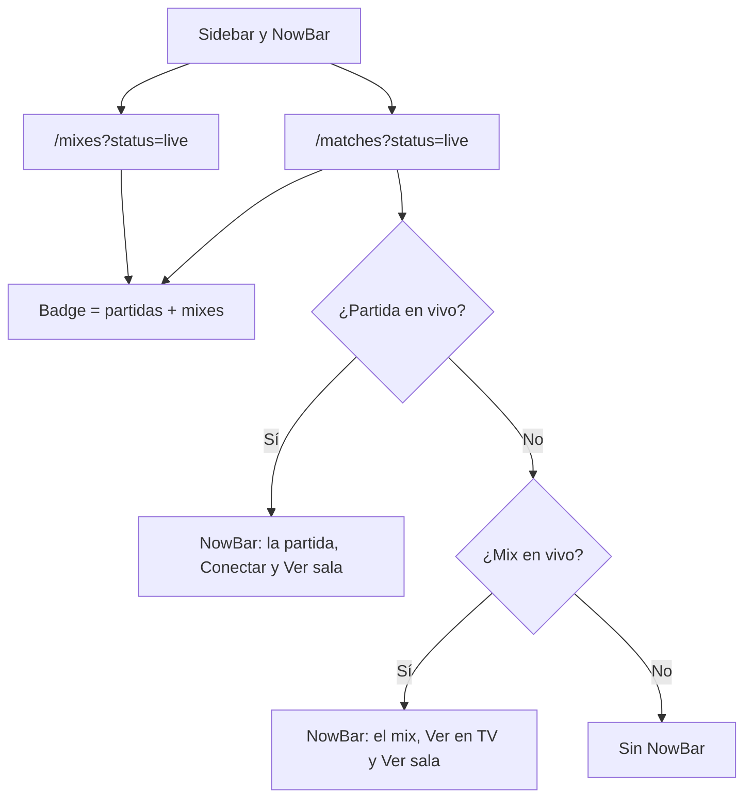

# Los mixes en vivo en el sidebar y en la NowBar: documentación

## Qué hace

El ítem "Partidas" del sidebar lleva un badge rojo con un punto y la cantidad de partidas en vivo. Hasta el 2026-11-04 ese número salía solo de `/api/v1/matches?status=live`, que trae las partidas oficiales y PCW pero no los mixes ni las del matchmaking (esas salen de `/api/v1/mixes`). Con un mix en juego en el #1 el badge no aparecía, aunque Partidas sí lo mostraba en su bloque "En vivo".

Ahora el badge suma las dos fuentes, y la NowBar (la franja "EN VIVO" de arriba de cada página) muestra un mix cuando no hay ninguna partida oficial o PCW en vivo.

## Reglas

| Qué | Regla |
|---|---|
| Número del badge | `total` de `/matches?status=live` más la cantidad de mixes de `/mixes?status=live` (la lista pide hasta 20). Con 0, o mientras cargan las dos, no se muestra. |
| Consultas | El badge, la NowBar y el bloque "En vivo" de Partidas comparten `liveMixesOptions` (se refresca cada 20 s). Las partidas siguen cada minuto. |
| Qué destaca la NowBar | Primero la partida oficial o PCW. Si no hay, el primer mix con novedades del servidor (`stale: false`) y, si todos están sin novedades, el primero. Solo mixes con `live_uid`. |
| Mix en la NowBar | Título "Equipo A 2 : 3 Equipo B"; debajo "Mix · mapa · Ronda N de M · servidor"; botones "Ver en TV" (si tiene SourceTV) y "Ver sala" (`/mixes/live/$uid`). Sin "Conectar": el listado de mixes no trae la dirección del servidor. |
| Cuándo se oculta | Dentro de la sala de lo que muestra: `/match/$id` o `/mixes/live/$uid`. |

## Qué cambia para cada rol

| Rol | Qué cambia | Página del manual |
|---|---|---|
| Todos los roles con sesión | El badge de "Partidas" cuenta también los mixes y el matchmaking, y la NowBar muestra un mix en vivo cuando no hay partidas oficiales. | Ninguna: el manual no describe el badge ni la NowBar |

## Términos y privacidad

Sin cambios. Los datos que muestra (equipos, marcador, mapa, servidor y SourceTV del mix) ya eran públicos en Partidas.

## Dónde está cada cosa

| Qué | Archivo / ubicación |
|---|---|
| Conteo del badge y lo destacado de la NowBar | `web/frontend/src/features/shell/api/queries.ts` (`useBadgeCounts`, `useFeaturedLive`, `pickFeaturedMix`) |
| Claves de caché del shell | `web/frontend/src/features/shell/api/keys.ts` |
| NowBar | `web/frontend/src/features/shell/components/NowBar.tsx` |
| Consulta de mixes en vivo | `web/frontend/src/features/mixes/api/queries.ts` (`liveMixesOptions`) |
| Pruebas | `web/frontend/src/features/shell/components/NowBar.test.tsx` |
