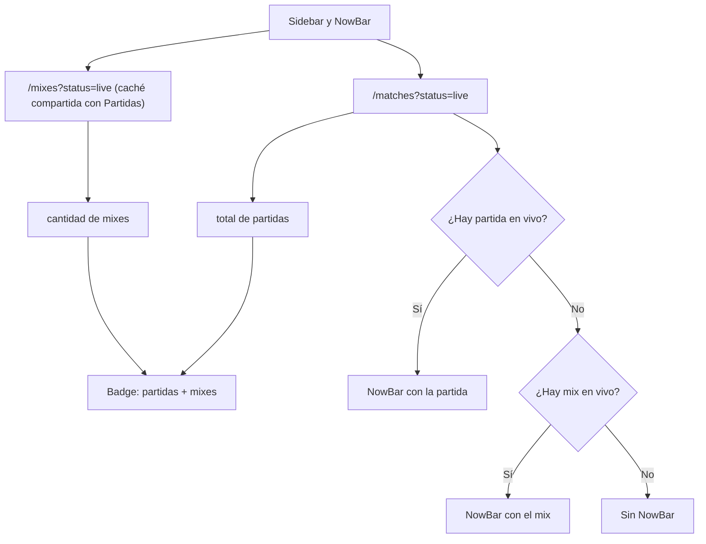

# Plan: los mixes en vivo en el sidebar y en la NowBar

> Planeación original. Estado: **aprobado por Daniel el 2026-11-04** ("Sí, hazlo, y la NowBar también").

## Decisiones tomadas

| Tema | Decisión |
|---|---|
| Qué se cuenta | El badge "en vivo" de "Partidas" suma las partidas en vivo de `/api/v1/matches?status=live` (oficiales y PCW) y los mixes en vivo de `/api/v1/mixes?status=live` (mix y matchmaking). Hasta ahora solo contaba las primeras, y los mixes no aparecían (reporte de Daniel, 2026-11-04, con un mix del matchmaking en juego en el #1). |
| Consultas | Se reutiliza `liveMixesOptions`, la que ya pide el bloque "En vivo" de Partidas. Así comparten la caché y se pide una sola vez. |
| Prioridad en la NowBar | Primero una partida oficial o PCW en vivo, como hasta ahora. Si no hay ninguna, el primer mix en vivo que no esté `stale`. Si todos están `stale`, el primero. |
| Botones del mix en la NowBar | "Ver en TV" (SourceTV, si el mix lo tiene) y "Ver sala", que lleva a `/mixes/live/$uid`. No lleva "Conectar": el listado de mixes no trae la dirección del servidor. |
| Ocultar | La NowBar se oculta dentro de la sala de lo que muestra (`/match/$id` o `/mixes/live/$uid`). |
| Dependencia circular | `mixes/api/queries.ts` importa `shellKeys` de `shell/api/queries.ts`. Para que el shell pueda importar `liveMixesOptions` sin ciclo, `shellKeys` pasa a `shell/api/keys.ts`. |
| Backend | Sin cambios. Solo la web, en `feat/frontend-fase-1`. |

## 1. El flujo completo

## 2. Cambios en la web

- `features/shell/api/keys.ts` (nuevo): `shellKeys`.
- `features/shell/api/queries.ts`: `useBadgeCounts` suma los mixes; `useFeaturedLive` devuelve la partida o, si no hay, el mix.
- `features/shell/components/NowBar.tsx`: dibuja el mix (nombres, mapa, ronda, servidor, "Ver en TV", "Ver sala").
- `features/mixes/api/queries.ts` y `features/series/api/booking.ts`: importan `shellKeys` desde `keys.ts`.
- Pruebas de Vitest para el conteo y para la NowBar con un mix.

## 3. Requisitos antes de empezar

Ninguno.

## 4. Orden de implementación

1. Mover `shellKeys`.
2. Conteo del badge y `useFeaturedLive`.
3. NowBar con el mix.
4. Pruebas, `typecheck`, `lint`.
5. Documentación, manual, changelog y fila del README.
