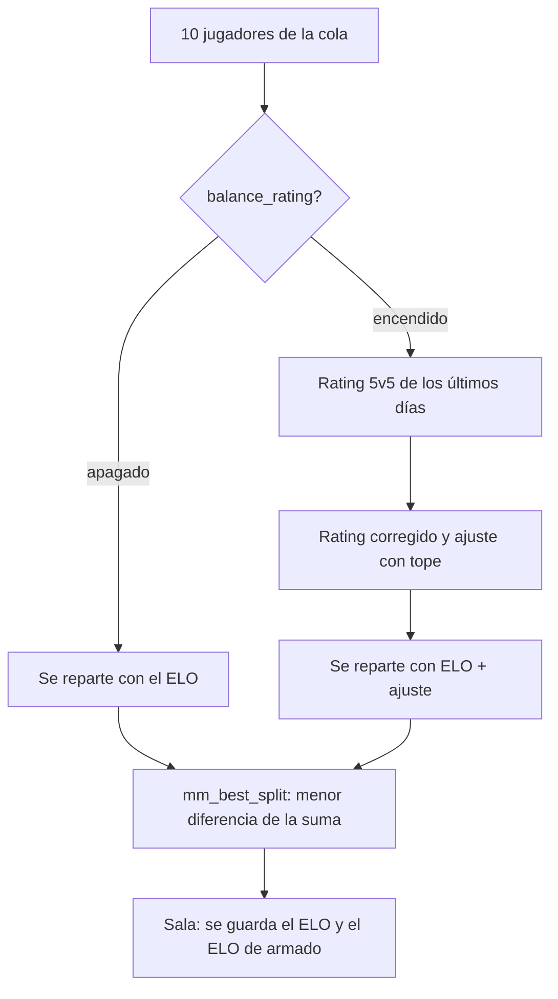

# Equipos del matchmaking más parejos con el rating: documentación

## Qué hace

Al armar una sala, el matchmaking reparte a los jugadores en dos equipos. Hasta ahora buscaba que la suma de ELO de los dos quedara lo más igual posible. Con el interruptor **Equipos parejos con el rating** encendido (Administración › Matchmaking › General), reparte con un **ELO de armado**: el ELO más un ajuste por el rating de las partidas 5v5 recientes.

Así, un jugador con 900 de ELO que juega como uno de 1100 no termina en el equipo que ya era el más fuerte. El ELO sigue pesando más: el ajuste tiene tope y una diferencia grande de ELO no se da vuelta.

Apagado (como viene), todo funciona como antes.



## La cuenta

```
rating corregido = (mapas × rating + mapas de corrección × 1,00) / (mapas + mapas de corrección)
ajuste           = peso × (rating corregido − 1,00), redondeado y entre −tope y +tope
ELO de armado    = ELO + ajuste
```

- El rating es el de `player_recent_rating`: stats sumadas de las partidas 5v5 terminadas de los últimos `balance_rating_days` días.
- Sin partidas en esos días, el ajuste es 0.
- Los mapas de corrección acercan a 1,00 el rating de quien jugó poco: dos mapas buenos no dan el ajuste completo.

| Campo de `mm_config` | Por defecto | Qué es |
|---|---|---|
| `balance_rating` | `false` | Encendido o apagado |
| `balance_rating_weight` | 200 (0 a 1000) | Puntos por cada 1,00 de rating sobre o bajo 1,00 (20 por cada 0,10) |
| `balance_rating_cap` | 100 (0 a 500) | Máximo que sube o baja el ELO de armado |
| `balance_rating_prior_maps` | 5 (0 a 100) | Mapas de corrección |
| `balance_rating_days` | 60 (1 a 365) | Días de partidas 5v5 que se miran |

Ejemplos con los valores por defecto:

| ELO | Rating (mapas) | Rating corregido | Ajuste | ELO de armado |
|---|---|---|---|---|
| 900 | 1,40 (20) | 1,32 | +64 | 964 |
| 1030 | 0,80 (20) | 0,84 | −32 | 998 |
| 1000 | 1,90 (2) | 1,26 | +51 | 1051 |
| 1100 | sin partidas | — | 0 | 1100 |

## Qué no cambia

- **Quién entra a la sala:** la ventana de ELO de la cola sigue con el ELO.
- **El capitán** (el de más ELO de cada equipo) y **quién banea primero** (el equipo con menos ELO promedio).
- **La probabilidad de ganar y el ELO que se gana o pierde**, que siguen con el ELO. Si el armado deja al equipo de menos ELO con los de mejor rating y ese equipo gana, suma un poco más que con equipos de igual ELO, como en cualquier sala despareja. Así el ELO no se mezcla con el rating.
- Los grupos no se separan y dos que se bloquearon no van juntos, como siempre.

## Datos

- `mm_lobby_players.balance_elo`: el ELO de armado con que se repartió cada jugador (null con el interruptor apagado y en las salas anteriores).
- `mm_balance_elos(fichas, elos)`: el ELO de armado en el mismo orden, o null si está apagado. Solo la usa la base (`revoke` a `anon` y `authenticated`).
- `mm_try_build` la llama una vez por cada combinación de 10 que arma, antes de `mm_best_split`.
- `mm_admin_config` devuelve los campos nuevos y `mm_set_config` los guarda. La API (`GET`/`PUT /api/v1/admin/mm/config`) los pasa tal cual: no cambió.

## Qué cambia para cada rol

| Rol | Qué cambia | Página del manual |
|---|---|---|
| Jugador | Si un admin lo enciende, los equipos se reparten también con el rating reciente. Su ELO y lo que gana o pierde no cambian | [`jugador/buscar-partida.md`](../../manual/jugador/buscar-partida.md) |
| Admin | Bloque **Equipos parejos con el rating** en Administración › Matchmaking › General, con un ejemplo que se actualiza con los valores | [`admin/matchmaking.md`](../../manual/admin/matchmaking.md) |

## Términos y privacidad

- **Términos:** la sección 8 decía que el matchmaking "arma los equipos según el ELO". Ahora dice que también puede usar el rating de las partidas recientes, si la liga lo enciende. Cambió en `/terminos` (`TermsPage.tsx`) y en `terms/terminos.html`, con la fecha del 4 de noviembre de 2026 (`LEGAL_UPDATED`).
- **Privacidad:** sin cambios. El rating ya se guardaba y se publicaba.

## Dónde está cada cosa

| Qué | Archivo |
|---|---|
| Base | `supabase/replanteo/73_mm_equipos_con_rating.sql` |
| Inversa | `docs/bitacora/2026-10-14-replanteo-modelo-datos/reversas/73_mm_equipos_con_rating.sql` |
| Prueba de la base | `pruebas/probar_73.sh` y `pruebas/prueba_73.sql` |
| Formulario del admin | `web/frontend/src/features/matchmaking/admin/GeneralForm.tsx` (`BalanceExample`) |
| La cuenta en la web (el ejemplo) | `web/frontend/src/features/matchmaking/admin/balance.ts` y su prueba |
| Tipos y demo | `web/frontend/src/features/matchmaking/types.ts` y `demo.ts` |
