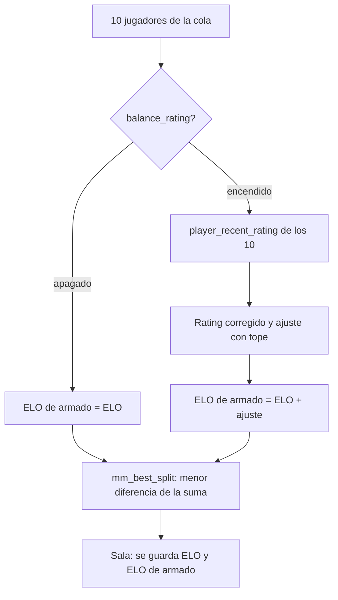

# Plan: equipos del matchmaking más parejos con el rating

> Planeación original. Estado: **propuesta**, pendiente de aprobación. Pedido por Daniel el 2026-11-04 (punto 1 de 3).

## Qué pasa hoy

`mm_try_build` junta a 10 jugadores de la cola y `mm_best_split` (`supabase/replanteo/48_matchmaking.sql`) prueba todas las divisiones en dos equipos. Elige la que deja menos diferencia en la **suma de ELO**, sin separar grupos ni juntar bloqueados. El rating no se mira.

Hay jugadores con 900 de ELO que juegan mucho mejor que otros de 1030. El ELO tarda en alcanzarlos, y mientras tanto los equipos quedan desparejos.

Datos de producción del 2026-11-04: 110 jugadores con ELO. Las cuentas son de los últimos 60 días en partidas 5v5, con `player_recent_rating`.

| Jugadores con | n | ELO (media / desvío) | Rating (media / desvío) | Correlación ELO-rating |
|---|---|---|---|---|
| 1 mapa o más | 104 | 1000 / 74 | 0,85 / 0,38 | 0,62 |
| 5 mapas o más | 51 | 1012 / 99 | 0,97 / 0,34 | 0,75 |
| 10 mapas o más | 34 | 1029 / 109 | 1,04 / 0,30 | 0,80 |

Se parecen bastante, pero no del todo. Con pocos mapas el rating varía mucho: la mediana es de 4 mapas.

## Decisiones tomadas

| Tema | Decisión propuesta | Por qué |
|---|---|---|
| Qué se cambia | Solo cómo se reparten los 10 en dos equipos. Quién entra a la sala (la ventana de ELO), el capitán, quién banea primero, la probabilidad de ganar y el ELO que se gana o pierde siguen con el ELO | El pedido es que los equipos queden parejos. El ELO sigue siendo el ELO |
| Cómo entra el rating | Cada jugador tiene un **ELO de armado** = ELO + ajuste por rating. `mm_best_split` minimiza la diferencia de la suma del ELO de armado | Es el mismo algoritmo, con otro número. Apagado, el ajuste es 0 y todo queda como hoy |
| Ajuste | `peso × (rating corregido − 1,00)`, con un tope de ± `tope` | 1,00 es el rating de un jugador promedio |
| Rating corregido | `(mapas × rating + mapas_previos × 1,00) / (mapas + mapas_previos)` | Con pocos mapas se acerca a 1,00: un jugador nuevo con dos mapas buenos no recibe el ajuste completo |
| Sin rating | Ajuste 0 | Nadie gana ni pierde por no tener partidas |
| Que el ELO pese más | El tope (100 por defecto) es chico al lado de la distancia de ELO entre jugadores (el desvío ronda los 100 y el rango va de 790 a 1310) | Una diferencia de 200 de ELO nunca se da vuelta |
| Interruptor | `mm_config.balance_rating` (apagado por defecto), con su peso, tope, mapas previos y días en Administración › Matchmaking | Lo pidió Daniel: apagado funciona como hoy |

### Valores por defecto (configurables)

| Campo | Valor | Qué es |
|---|---|---|
| `balance_rating` | `false` | Encendido o apagado |
| `balance_rating_weight` | 200 | Puntos de ELO de armado por cada 1,00 de rating (20 por cada 0,10) |
| `balance_rating_cap` | 100 | Máximo que sube o baja el ELO de armado |
| `balance_rating_prior_maps` | 5 | Mapas "promedio" que se suman para corregir el rating |
| `balance_rating_days` | 60 | Días de partidas 5v5 que se miran (`player_recent_rating`) |

### Ejemplos con los valores por defecto

| Jugador | ELO | Rating (mapas) | Rating corregido | Ajuste | ELO de armado |
|---|---|---|---|---|---|
| A | 900 | 1,40 (20) | 1,32 | +64 | 964 |
| B | 1030 | 0,80 (20) | 0,84 | −32 | 998 |
| C | 1000 | 1,90 (2) | 1,26 | +51 | 1051 |
| D | 1100 | sin partidas | — | 0 | 1100 |

A y B pasan de 130 de diferencia a 34: el armado los trata casi como iguales. Pero D, sin rating, sigue arriba de todos.

## 1. El flujo

## 2. Base de datos (replanteo nuevo)

- `mm_config`: las cinco columnas de la tabla de arriba, con sus `check`.
- `mm_lobby_players.balance_elo integer` (null en las salas anteriores): queda el número con que se armó, para revisar después.
- `mm_balance_elos(p_players uuid[], p_elos int[]) returns int[]`: el ELO de armado de cada uno. Si `balance_rating` está apagado, devuelve `p_elos` tal cual.
- `mm_try_build`: llama a `mm_balance_elos` y le pasa el resultado a `mm_best_split`. La ventana de ELO de la cola sigue con `elo`.
- `mm_admin_config` / su `set`: los campos nuevos.
- Inversa del replanteo y prueba en SQL: con el interruptor apagado, las mismas divisiones que hoy. Encendido, los ejemplos de arriba.

## 3. API y web

- `GET`/`PUT /api/v1/admin/mm/config`: los cinco campos (esquemas y tipos).
- Administración › Matchmaking: un bloque "Equipos parejos con el rating", con el interruptor, los cuatro números y un texto corto con el ejemplo de A y B.
- La sala no muestra el ELO de armado a los jugadores: siguen viendo su ELO. Queda para el admin, si hace falta.

## 4. Lo que hay que tener en cuenta

- **La probabilidad de ganar sigue con el ELO.** Si el armado pone a A (900) con mejores jugadores, su equipo puede tener menos ELO promedio que el otro. Si gana, suma un poco más de lo que sumaría con equipos de igual ELO. Es lo que ya pasa con cualquier sala despareja, y así el ELO no se contamina con el rating. Alternativa, si Daniel prefiere: calcular la probabilidad con el ELO de armado (no lo recomiendo).
- **Costo:** `player_recent_rating` se llama una vez por intento de armado, con 10 jugadores. Es una consulta chica, pero `mm_tick` corre cada 2 s: si hace falta, el rating se guarda en caché una vez por minuto.

## 5. Manual, términos y privacidad

- Manual: `jugador/` (la página del matchmaking): una línea que diga que los equipos se arman con el ELO y, si está encendido, también con el rating reciente. `admin/`: los campos nuevos.
- Términos y privacidad: sin cambios. El rating ya es público y no se guarda nada personal nuevo.

## 6. Requisitos antes de empezar

- Que Daniel apruebe los valores por defecto y la decisión de la probabilidad de ganar.
- Rama: `main`. Confirmar si también va a `feat/mm-claim-en-sala`, como pedía la regla del 2026-11-02.

## 7. Orden de implementación

1. Replanteo con su inversa y pruebas SQL (staging).
2. API y su prueba.
3. Web (Administración › Matchmaking).
4. Documentación, manual y changelog.
5. Desplegar sin un mix en curso, con el interruptor apagado. Encenderlo desde el admin y mirar las primeras salas.
