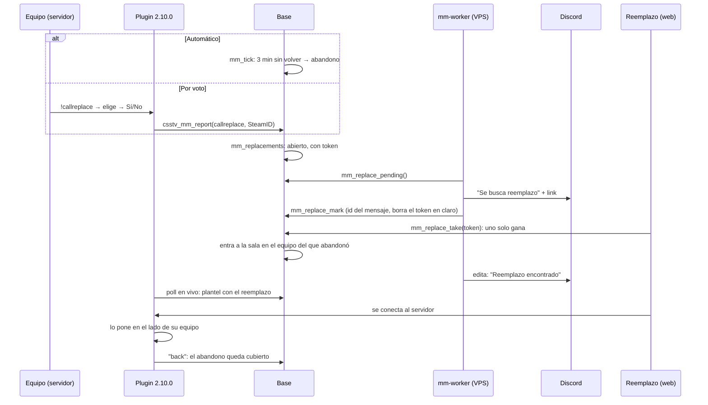
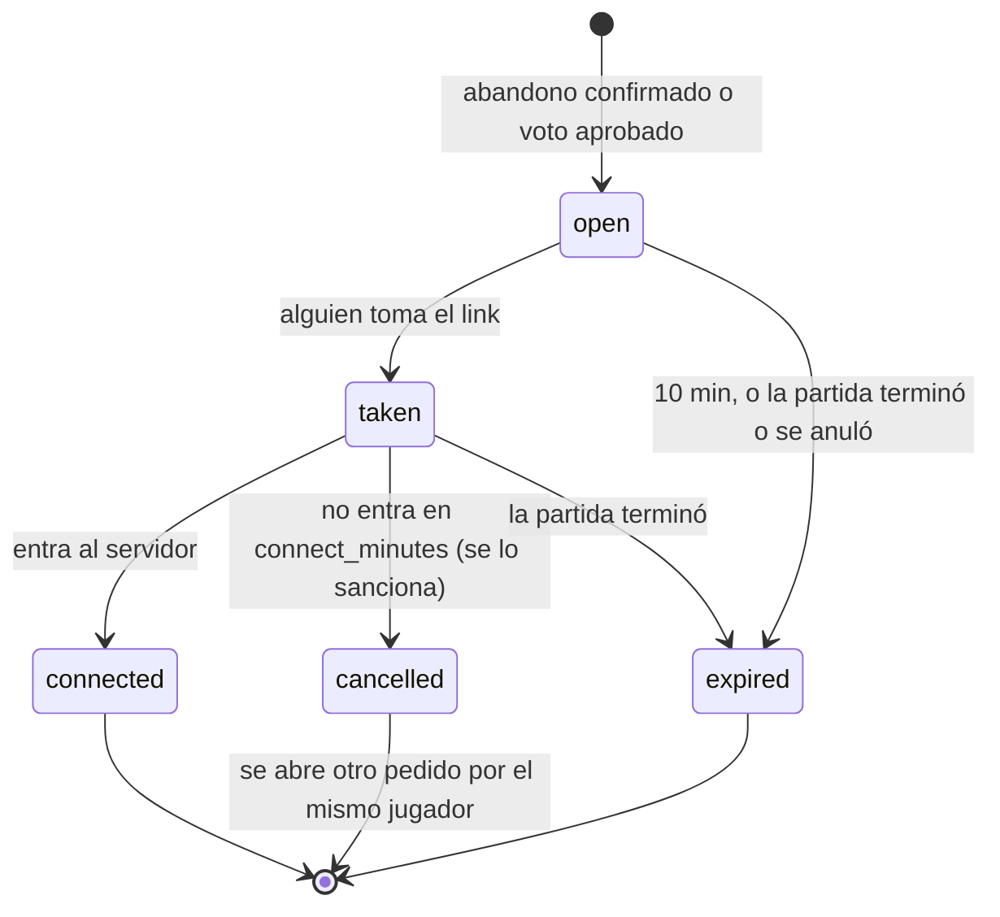

# Reemplazos en el matchmaking: documentación

## Qué hace

Cuando un jugador abandona una sala del matchmaking en vivo, se publica un aviso en el Discord de la liga (#avisos, con `@player`) con un link de un solo uso. El primer jugador que lo toma entra a la sala en el equipo del que abandonó, se conecta al servidor con la contraseña de la sala y el plugin lo pone en el lado de ese equipo. El equipo deja de jugar con uno menos.

El abandono se confirma de dos formas:

- **Automática:** el jugador no volvió en `reconnect_minutes` (3). Es la regla de siempre.
- **Por voto:** un compañero escribe `!callreplace`, elige al desconectado y su equipo vota Sí/No. Pasa con más del `replace_vote_pct` (80 %) de los compañeros conectados, y el que no vota cuenta como No. El desconectado queda como abandono en ese momento, sin esperar los 3 minutos.

Todo se enciende con `mm_config.replace_enabled`, que viene **apagado**. Apagado, el abandono funciona como antes y `!callreplace` no se puede usar.

## Estados de un pedido

El mensaje de Discord muestra tres estados (`mm_replace_shown`): **abierto** (con el link y cuándo vence), **encontrado** (`taken` y `connected`) y **cerrado** (`expired` y `cancelled`). El worker edita el mensaje cuando el estado que muestra no es el actual.

## Reglas

| Regla | Dónde |
|---|---|
| Se llama un reemplazo por cada abandono, y a lo sumo uno abierto (o tomado sin conectar) por equipo a la vez. El siguiente sale cuando se cierra el anterior | Índice único `mm_replacements_team_active` y `mm_replace_sweep` |
| No se llama si faltan menos de `replace_min_rounds_left` (4) rondas para el fin del tiempo reglamentario: el mínimo entre `max_rounds − rondas jugadas` y `max_rounds / 2 + 1 − rondas del que va ganando` (13-10 en MR15 son 3). Sin datos del mix en vivo, se permite | `mm_replace_rounds_left` y `mm_replace_can_open` |
| Un pedido vencido no se vuelve a abrir por el mismo jugador; uno cancelado (el que lo tomó no entró) sí | `mm_replace_sweep` |
| Quién puede tomarlo: lo mismo que para entrar a la cola (`mm_block_reason`: correo confirmado, sin sanción ni exclusión ni baneo, mixes y días de cuenta mínimos, anticheat si se exige), SteamID vinculado, sin otra sala y sin haber jugado esa partida (ni el que abandonó) | `mm_replace_reason` |
| Dos clics a la vez: el `update … where status = 'open'` bloquea la fila y solo uno lo consigue. El otro recibe `V3901` (409) "Ya lo tomó otro jugador" | `mm_replace_take` |
| Si estaba en la cola, sale. Si buscaba con su grupo, sale el grupo entero | `mm_replace_take` |
| El que lo tomó tiene `connect_minutes` (5) para entrar. Si no entra, sale de la sala, se lo sanciona ("No te conectaste a la partida que tomaste como reemplazo") y se abre otro pedido | `mm_replace_sweep` |
| Un abandono está **cubierto** cuando el reemplazo entró al servidor (`replaced_by`). Uno cubierto no cuenta para los 2 que dan la derrota automática (`forfeit_team`), ni para el ajuste de ELO del equipo por abandono, ni para `abandons=` del poll (el `!gg` sin diferencia) | `mm_tick`, `mm_elo_delta` y `csstv_mm_poll` |
| El que abandonó queda abandonado, con su sanción y su ELO de abandono, como siempre. Si vuelve después de que entró el reemplazo, queda de espectador | Plugin (`Mm_LiveSide`) |
| ELO del reemplazo: el normal (Daniel, 2026-11-05), con el peso por rondas jugadas (`elo_weight`: no cuenta si jugó menos del 35 %) | Sin cambios en `elo_apply_match` |
| Voto: solo el equipo del que falta (Daniel, 2026-11-05). Dura `replace_vote_seconds` (30 s) y después el equipo espera `replace_vote_cooldown_s` (60 s) para otro | Plugin |
| El aviso de Discord no lleva nombres: el modo, el mapa y el marcador. Solo el mensaje abierto menciona a `@player`; las ediciones no mencionan a nadie | `src/jobs/mm-replace.ts` |
| El token del link se genera en la base, se guarda en claro solo hasta que el worker lo publica (o vence) y después queda solo su hash (`sha256`) | `mm_replace_open` y `mm_replace_mark` |

## Datos

- **`mm_config`:** `replace_enabled` (false), `replace_link_minutes` (10), `replace_min_rounds_left` (4), `replace_vote_pct` (80), `replace_vote_seconds` (30) y `replace_vote_cooldown_s` (60).
- **`mm_lobby_players`:** `replaces_user_id` (entró como reemplazo de quién) y `replaced_by` (en el que abandonó, cuando su reemplazo entró al servidor).
- **`mm_replacements`:** `lobby_id`, `team`, `replaced_user_id`, `source` (`auto` o `vote`), `status`, `token` (en claro hasta publicarse), `token_hash`, `expires_at`, `taken_by`, `taken_at`, `connect_deadline`, `connected_at`, `discord_message_id`, `posted_status`, `post_attempts` (a los 5 fallos se deja de intentar). Con RLS y sin políticas: solo por funciones.
- **Poll del servidor (`csstv_mm_poll`):** `t1`/`t2` y `n1`/`n2` sin los reemplazados y con el reemplazo; `abandons=` sin los cubiertos; `replace=1,0` (si se puede pedir en cada equipo); `replace_vote=80,30,60`; `away=STEAM_0:X:Y|equipo|nick;…` (los desconectados sin abandonar, el nick sin `|;=` ni saltos).
- **Ficha de la sala (`mm_player_card`):** `replacement` y `replaced`.
- **Manual (`manual_valores`):** `mm.reemplazo_link`, `mm.reemplazo_voto` y `mm.reemplazo_rondas`.

## Funciones

| Función | Quién la llama | Qué hace |
|---|---|---|
| `mm_replace_info(token)` | Web (con sesión) | La partida (modo, mapa, marcador, equipo), el estado del link, si es mío y por qué no lo puedo tomar |
| `mm_replace_take(token)` | Web (con sesión) | Toma el link y entra a la sala. Devuelve la sala |
| `mm_replace_pending()` / `mm_replace_mark(id, shown, message_id, ok)` | Worker (`service_role`) | Avisos a publicar o editar, y cómo quedaron |
| `mm_replace_sweep(sala)` / `mm_replace_close_finished()` | `mm_tick` | Vencer, sacar al que no entró, abrir los que faltan, cerrar los de salas terminadas |
| `mm_replace_open`, `mm_replace_arrived`, `mm_replace_can_open`, `mm_replace_out`, `mm_replace_reason`, `mm_replace_rounds_left` | Internas | |

## API

| Ruta | Qué |
|---|---|
| `GET /api/v1/mm/replace/{token}` | `mm_replace_info`. El token tiene que ser de 32 caracteres hexadecimales |
| `POST /api/v1/mm/replace/{token}` | `mm_replace_take` y devuelve el estado liviano (`mm_my_live`) con la sala. 409 `CONFLICT` si otro llegó primero o venció |

Las dos piden sesión y comparten un límite de 10 pedidos por minuto por cuenta (regla `replace`, binding `RL_REPLACE`).

## Worker del matchmaking

`scripts/mm-worker.mts` (servicio `cmleague-mm`), después de cada `mm_tick`, llama a `runReplaceNotices` (`src/jobs/mm-replace.ts`): publica con `POST <webhook>?wait=true` (para tener el id del mensaje) y edita con `PATCH <webhook>/messages/<id>`. Usa `DISCORD_QUEUE_WEBHOOK_URL`, `DISCORD_QUEUE_ROLE_ID` y `FRONTEND_URL` de `/etc/cmleague/season.env`. Sin el webhook avisa en el log al arrancar y no publica nada. Un error de los avisos se anota una sola vez (no cada 2 s) y no frena a `mm_tick`.

## Plugin (reporter 2.10.0)

- **`!callreplace`** (`sm_callreplace`): solo con una sala del matchmaking en juego, para un jugador de la sala que está en su lado, si la base lo permite para su equipo (`replace=`), sin otro voto en curso y fuera de la espera del equipo. Abre un menú con los compañeros desconectados (`away=`, sin los que ya volvieron) y, al elegir, un voto Sí/No (`VoteMenu`) para los compañeros conectados. Si pasa y el jugador sigue afuera, manda `csstv_mm_report(callreplace)`.
- **Plantel en vivo (`Mm_LiveRoster`):** si cambió, se actualiza sin `mp_restartgame`. El reemplazo que ya está en el servidor pasa al lado de su equipo y se avisa `back`; el reemplazado que volvió pasa a espectador.
- **`Mm_LiveEnforce`:** cada segundo, con la sala en vivo, quien tiene un SteamID válido y no es de la sala (de afuera, o el reemplazado) pasa a espectador. Los que Steam todavía no validó no se tocan.
- **`Mm_LiveSide`:** en una sala en vivo, el lado del equipo de la sala del jugador (o 0 si no es de la sala). Lo usa `Recon_WantedSide`: el reemplazo entra solo a su lado al conectarse ("entró de reemplazo en …", según `g_sMmJoined`: los que entraron al plantel con la partida en vivo) y el reemplazado no vuelve. `jointeam` no deja a nadie de afuera de la sala elegir un lado durante la partida (un admin puede moverlo con `!team`).

## Web

- **`/mm/reemplazo/<token>`** (`ReplacePage`): la partida y el equipo, y **Entrar como reemplazo**. Si no lo puede tomar, el motivo; si se tomó o venció, lo dice; si es suyo, **Ir a la sala**. Al tomarlo lleva a `/play`. Sin sesión, la guarda de `_app` pide iniciarla y vuelve.
- **Sala:** "Entró de reemplazo" debajo del reemplazo, y "Abandonó: pierde ELO y entró un reemplazo en su lugar" en el reemplazado.
- **Administración › Matchmaking › General:** bloque **Reemplazos** con el interruptor y los cinco valores.

## Qué cambia para cada rol

| Rol | Qué cambia | Página del manual |
|---|---|---|
| Jugador | Puede pedir un reemplazo con `!callreplace` y votarlo; puede entrar como reemplazo desde el aviso de Discord; un abandono cubierto ya no hace perder la partida | [Buscar partida](../../manual/jugador/buscar-partida.md) y [Jugar en el servidor](../../manual/jugador/jugar-en-el-servidor.md) |
| Admin | Enciende los reemplazos y fija el link, las rondas mínimas y el voto | [Configurar el matchmaking](../../manual/admin/matchmaking.md) |
| Dueño de un servidor externo | Nada (flow, el #2, hoy no toma salas) | — |

## Términos y privacidad

- **Términos (sección 7, moderación):** el voto de tu equipo puede darte por abandonado antes de que termine tu plazo para volver, la liga puede llamar a otro jugador en tu lugar, y si vuelves después quedas de espectador.
- **Términos (sección 8, matchmaking):** el aviso en Discord (modo, mapa y marcador, sin nombres), el ELO normal del reemplazo y la sanción si toma el lugar y no se conecta.
- **Privacidad:** sin cambios. El aviso no publica nombres ni datos de cuentas; quién reemplazó a quién queda en la sala, como el resto de los datos de la partida.
- Actualizados `/terminos` (`TermsPage.tsx`, fecha en `meta.ts`) y `terms/terminos.html`, con fecha 2026-11-05.

## Dónde está cada cosa

| Qué | Archivo / ubicación |
|---|---|
| Base | `supabase/replanteo/75_mm_reemplazos.sql` y su inversa en `docs/bitacora/2026-10-14-replanteo-modelo-datos/reversas/75_mm_reemplazos.sql` |
| Pruebas de la base | `pruebas/probar_75.sh` (con `prueba_75.sql`) y `pruebas/concurrencia_75.sh` |
| Prueba con bots | `pruebas/e2e_bots_75.sh` (comandos de la build de pruebas: `sm_callreplace_as` y `sm_mm_sides`) |
| Aviso en Discord | `web/backend/src/jobs/mm-replace.ts` y `scripts/mm-worker.mts` |
| API | `web/backend/src/routes/mm.ts` (rutas `/api/v1/mm/replace/{token}`), `src/lib/ratelimit.ts` y `wrangler.toml` (`RL_REPLACE`), `src/lib/manual.ts` (marcadores) |
| Pruebas de la API | `web/backend/test/unit/mm-replace.test.ts` |
| Plugin | `server/addons/sourcemod/scripting/csstv/mm.inc` (bloque "Reemplazos"), `csstv/qol.inc` (`Recon_WantedSide`, `Recon_Place` y `Cmd_JoinTeam`) y `csstv_reporter.sp` (2.10.0) |
| Web | `web/frontend/src/features/matchmaking/ReplacePage.tsx` (y su prueba), `routes/_app/mm.reemplazo.$token.tsx`, `admin/GeneralForm.tsx`, `room/RoomOverview.tsx`, `source.ts`, `demo.ts` y `types.ts` |
| Entorno del worker | `deploy/vps/season.env.example` → `/etc/cmleague/season.env` |
| Manual | `docs/manual/jugador/buscar-partida.md`, `jugador/jugar-en-el-servidor.md` y `admin/matchmaking.md` |
| Términos | `web/frontend/src/features/legal/pages/TermsPage.tsx`, `lib/meta.ts` y `terms/terminos.html` |
