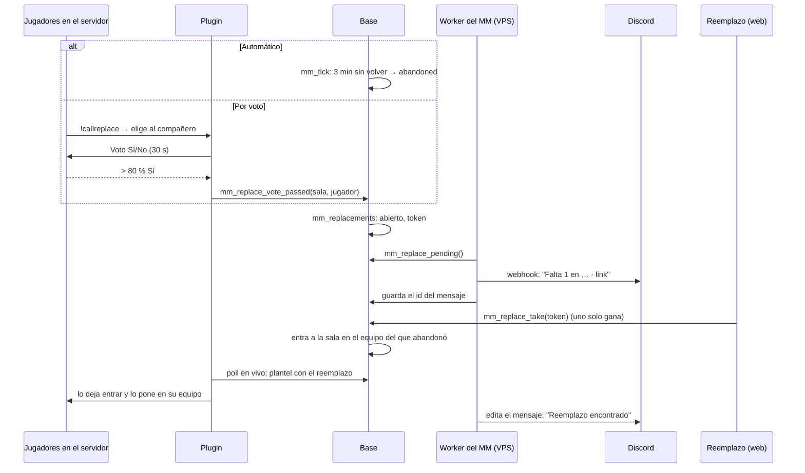
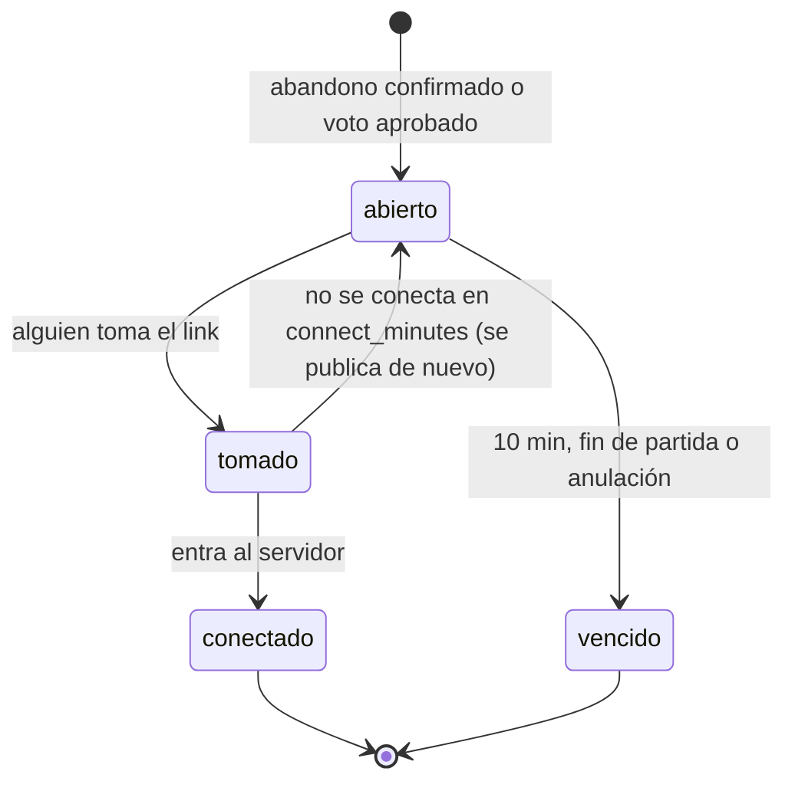

# Plan: llamar reemplazos cuando alguien abandona un mix del matchmaking

> Planeación original. Pedido por Daniel el 2026-11-04 (punto 2 de 3). **Aprobado el 2026-11-05**, con las decisiones de la sección "Lo que decidió Daniel".

## Qué pasa hoy

Si un jugador de una sala en vivo se desconecta, tiene `reconnect_minutes` (3) para volver. Si no vuelve, `mm_tick` lo marca `abandoned` y lo sanciona. Con 2 abandonos, ese equipo pierde por abandono (`forfeit_team`). Con 2 en cada equipo, la partida se anula. Mientras tanto se juega 4 contra 5 y nadie puede entrar a completar el equipo.

## Decisiones tomadas

| Tema | Decisión propuesta |
|---|---|
| Cuándo se llama un reemplazo | **Automático:** al confirmarse un abandono (los 3 minutos), si `mm_config.replace_enabled`. **Por voto:** `!callreplace` en el juego, para no esperar los 3 minutos |
| Aviso | Mensaje en Discord por webhook (el mismo canal y rol que el aviso de la cola, o uno propio si Daniel quiere), con un link de un solo uso |
| Quién puede tomarlo | Un usuario con sesión que cumpla lo mismo que para entrar a la cola: SteamID vinculado, sin sanción, sin otra sala, `min_mixes` y `min_account_days`. Además, que no haya jugado ya en esa partida (ni el que abandonó) |
| Dos clics a la vez | El link se toma con un `update … where status = 'open' returning`: Postgres bloquea la fila y solo uno lo consigue. El segundo ve "Ya lo tomó otro jugador" |
| Después de tomarlo | El link deja de servir. El mensaje de Discord se edita a "Reemplazo encontrado" (se guarda el id del mensaje) |
| Vencimiento | El link vence si la partida termina, si se anula o a los `replace_link_minutes` (10). El mensaje se edita a "Vencido" |
| No llamar al final | No se llama si quedan menos de `replace_min_rounds_left` rondas (4) para el final del tiempo reglamentario |
| El que abandonó | Queda `abandoned` con su sanción y su ELO de abandono, como hoy. Si el voto lo dio por abandonado antes de los 3 minutos, también. Si vuelve después de que entró el reemplazo, queda de espectador |
| Derrota por abandono | Un abandono cubierto por un reemplazo **no cuenta** para los 2 que dan la derrota automática, ni para el ajuste de ELO por abandono del equipo (`mm_elo_delta`). El equipo vuelve a estar completo |
| ELO del reemplazo | El normal, con el peso por participación que ya existe (`elo_weight`: no cuenta si jugó menos del 35 % de las rondas). Propuesta: **si su equipo pierde, no le baja**. Entra en desventaja y eso no debería castigarlo (`replace_protect_loss`, encendido) |
| Varios reemplazos | Uno por cada abandono, y a lo sumo uno abierto por equipo a la vez |

### `!callreplace`

- Solo con la sala en vivo y algún compañero desconectado (de tu mismo equipo, sin `abandoned`).
- Abre un menú con los desconectados de tu equipo y eliges uno. Si hay uno solo, igual se pide confirmar.
- Se abre un voto con un menú de **Sí / No** para **los jugadores conectados de los dos equipos**, porque el reemplazo también afecta al rival. Duración: `replace_vote_seconds` (30 s).
- Pasa con **más del 80 %** de los conectados (`replace_vote_pct`). El que no vota cuenta como "No".
- Si pasa: el desconectado queda `abandoned` en el acto (sanción y ELO de abandono) y sale el aviso a Discord.
- Si no pasa, o el jugador vuelve durante el voto: no pasa nada. Un nuevo `!callreplace` del mismo equipo queda en espera `replace_vote_cooldown_s` (60 s).
- **Pregunta para Daniel:** ¿votan los dos equipos (propuesta) o solo el equipo del que falta?

## Lo que decidió Daniel (2026-11-05)

Estas respuestas mandan sobre lo que propone la tabla de arriba:

| Pregunta | Respuesta |
|---|---|
| ¿Quién vota en `!callreplace`? | **Solo el equipo del que falta** (los compañeros conectados). Sigue haciendo falta más del 80 % |
| ¿Se protege el ELO del reemplazo si su equipo pierde? | **No: ELO normal**, con el peso por rondas jugadas de siempre. No hay `replace_protect_loss` |
| ¿Por dónde sale el aviso? | **Igual que el aviso de la cola:** el mismo webhook (`DISCORD_QUEUE_WEBHOOK_URL`) y el mismo rol (`@player`) |
| Valores por defecto | Los de este plan (10 min de link, 4 rondas, 80 %, 30 s de voto, 60 s de espera), configurables en Administración › Matchmaking |
| Rama | Se trabaja sobre `feat/frontend-fase-1` después de traer `main` (la `73`); la base, la API, el VPS y el plugin también van en `feat/mm-claim-en-sala`. El replanteo es el `75` |

Precisiones de la implementación, sin cambiar lo decidido:

- El aviso a Discord lo publica el worker del matchmaking (`mm-worker`), no la API: el abandono lo confirma `mm_tick`, sin nadie que haga un pedido. El worker necesita las dos variables de Discord y `FRONTEND_URL`.
- El token del link se genera en la base. Se guarda en claro solo hasta que el worker lo publica; después queda solo su hash.
- Un abandono cuenta como **cubierto** (no suma para la derrota automática ni para el ajuste de ELO del equipo) cuando el reemplazo **entró al servidor**, no cuando tomó el link.
- El voto de `!callreplace` llega a la base como un evento más de `csstv_mm_report` (`callreplace`), con la clave del servidor.

## 1. El flujo

## 2. Base de datos (replanteo nuevo)

- Tabla `mm_replacements`: `id`, `lobby_id`, `team`, `replaced_user_id`, `token_hash` (se guarda el hash, nunca el token), `status` (`open`, `taken`, `connected`, `expired`, `cancelled`), `source` (`auto` o `vote`), `requested_by`, `discord_message_id`, `created_at`, `expires_at`, `taken_by`, `taken_at`. Sin acceso directo, solo por funciones.
- `mm_lobby_players`: `replaces_user_id` (a quién reemplaza) y `replaced boolean` en el que abandonó.
- `mm_config`: `replace_enabled`, `replace_link_minutes`, `replace_min_rounds_left`, `replace_vote_pct`, `replace_vote_seconds`, `replace_vote_cooldown_s` y `replace_protect_loss`.
- Funciones:
  - `mm_replace_open(sala, equipo, jugador, origen)`: la llaman `mm_tick` y el voto.
  - `mm_replace_vote_passed(token del servidor, sala, steamid)`: el plugin, con la clave del servidor como en el poll.
  - `mm_replace_pending()` y `mm_replace_mark(id, message_id)`: el worker.
  - `mm_replace_info(token)`: qué partida es, el mapa, el marcador y si sigue abierto, para la página del link.
  - `mm_replace_take(token)`: valida al usuario, toma la fila con bloqueo y lo inserta en `mm_lobby_players`.
- `mm_tick` (en vivo): abre el reemplazo al confirmar un abandono, vence los links y vuelve a abrir el que no se conectó. Los abandonos cubiertos no cuentan para `forfeit_team`.
- `mm_elo_delta`/`elo_apply_match`: el abandono cubierto no ajusta al equipo, y la protección de derrota del reemplazo.
- Poll del servidor en vivo: devuelve el plantel con el reemplazo (`t1`/`t2`), igual que en el calentamiento.

## 3. Plugin (reporter, versión nueva)

- `!callreplace`: el menú de desconectados, el voto con `Menu`/`VoteMenu`, el cooldown y el pedido a la base.
- En vivo, `Mm_UpdateRoster` acepta el plantel nuevo. Hoy solo corre en el calentamiento. El reemplazo entra con la contraseña de la sala, queda en su equipo y se avisa `connected`. Si vuelve el que abandonó, va a espectador.
- `Mm_GgMinDiff` y el aviso "pierde la partida: abandonaron 2" usan los abandonos sin cubrir que manda la base.
- Se despliega en **los tres servidores** (#1, #2 flow con su build licenciado y #3), aunque el #2 y el #3 hoy no tomen salas.

## 4. Worker, API y web

- Worker del MM (`mm-worker`): en cada vuelta, `mm_replace_pending()` publica los avisos nuevos y edita los tomados y vencidos (`PATCH` del webhook con el id del mensaje). Va con `allowed_mentions` solo para el rol, como el aviso de la cola.
- API: `GET /api/v1/mm/replace/{token}` (la info) y `POST /api/v1/mm/replace/{token}` (tomarlo), con límite por IP.
- Web: la página `/mm/reemplazo/<token>`. Sin sesión, pide iniciarla y vuelve. Muestra la partida, el equipo y el marcador, con el botón **Entrar como reemplazo**. Si el link se tomó o venció, lo dice. Al tomarlo, lleva a la sala con el botón para conectarse, como cualquier sala.
- Administración › Matchmaking: los campos nuevos.

## 5. Manual, términos y privacidad

- Manual: `jugador/` (abandonos y reemplazos, `!callreplace`, el voto, qué pasa con el ELO del reemplazo) y `admin/` (los campos).
- **Términos: sí cambian.** La sección de sanciones y abandonos del matchmaking pasa a decir que el voto puede dar por abandonado a un jugador antes de los 3 minutos, y cuenta las reglas del ELO del reemplazo. Se actualizan `/terminos` y `terms/terminos.html`.
- Privacidad: el aviso en Discord muestra el mapa y el marcador, no los nombres de los jugadores. Si se decide mostrar el nombre del que abandonó, va en `/privacidad`.

## 6. Requisitos antes de empezar

- Que Daniel decida: quién vota (los dos equipos o uno), la protección del ELO del reemplazo, el canal de Discord (¿el de #avisos con `@player`?) y los valores por defecto.
- Probar con bots en el servidor local: el voto, el plantel en vivo y la reconexión del que abandonó.

## 7. Orden de implementación

1. Replanteo con su inversa y pruebas SQL, incluidos los dos clics a la vez (dos sesiones con `mm_replace_take` en paralelo).
2. Worker y API, con sus pruebas.
3. Plugin y prueba con bots.
4. Web (página del link y admin).
5. Documentación, manual, términos y changelog.
6. Desplegar sin un mix en curso: base, API, worker, web y el plugin en #1, #2 y #3 (se carga en el próximo cambio de mapa). Con `replace_enabled` apagado hasta probar un mix.
