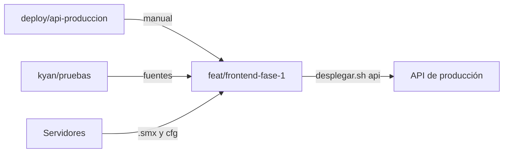

# La rama del frontend igual a producción: documentación

## Qué hace

Deja `feat/frontend-fase-1` como fuente única de lo que corre en producción, para poder llevarla a `main`. Antes había dos diferencias:

- La API de producción salía de `deploy/api-produccion`, una rama solo local, porque a esta le faltaba el manual de usuario.
- Los servidores corrían plugins más nuevos que los de la rama. Sus fuentes estaban solo en `kyan/pruebas`, que no se puede mezclar porque trae tienda, VIP y anticheat.

No cambia lo que ven los usuarios. A los servidores de juego no se les subió nada: el repo copió lo que ellos ya tenían.

## Qué corre en cada servidor (2026-11-04)

| Plugin | #1 | #2 (flow) | #3 |
|---|---|---|---|
| `csstv_reporter` 2.9.3 | Genérico | Licenciado (`cedf12a8-…`) | En `disabled/` |
| `csstv_qol` 1.3.1, `csstv_coach` 1.1.1, `csstv_pedir` 1.0.1 | Sí | Sí | Sí |
| `csstv_password` 1.1.0 | Sí | Sí | Sí |
| `v34_dm` 1.0.1 | Sí | Sí | No |
| `v34_retake` y `v34_wingman` 1.0.1 | No | No | Sí |

El #1 **no** lleva un build licenciado, como decía la documentación: su reporter no tiene ningún ID adentro y da el mismo `.code` que el genérico.

## Cómo se comprobó que las fuentes son las que corren

Comparar el md5 no sirve, porque cada compilación cambia. Se compilaron las fuentes con el mismo compilador (`spcomp` 1.8.0.5963), se desempaquetaron los `.smx` y se compararon sección por sección.

- `.code`, `.natives`, `.publics` y `.pubvars` son idénticos en los 8 plugins.
- `.data` difiere solo en 4 a 7 bytes, que son la fecha y la hora de compilación.
- El reporter del #2 se comparó compilándolo con su ID de licencia.

Los binarios de `kyan/pruebas` están viejos aunque declaren la misma versión (por ejemplo, `csstv_qol` 1.3.1 pesa 21 KB ahí y 35 KB en los servidores). Por eso el repo lleva los de los servidores.

## El anticheat queda afuera

La app no está en producción. El 2026-11-04 estas eran las condiciones:

| Qué | Estado |
|---|---|
| Tablas de datos `ac_*` | 0 filas (`ac_config` tiene solo su fila de configuración) |
| `AC_API_SECRET` en el VPS | No está |
| `require_anticheat` | `false` |
| `cml_anticheat_bridge` en los servidores | No está cargado |
| Llamadas desde la web publicada | Ninguna |

Las tablas siguen porque el replanteo `48` las exige. Al desplegar la API desde esta rama, las rutas del anticheat dejan de existir, sin efecto para nadie. En `/play` sigue la línea "Anticheat no obligatorio", que sale del estado del matchmaking.

## Diferencias de configuración entre servidores

| Archivo | Diferencia | Repo |
|---|---|---|
| `cfg/csstv/live.cfg` | El #3 tiene `mp_friendlyfire 1` y `mp_flashlight 1`; el #1 y el #2, `0` | Igual al #1 y al #2 |
| `cfg/sourcemod/csstv_qol.cfg` | `csstv_qol_end_kick` es `40` en el #1 y `0` en el #2 y el #3 | Igual al #1 |
| `cfg/sourcemod/csstv_reporter.cfg` | `csstv_mm` es `1` solo en el #1 | `0`, con un comentario. Sin tokens ni claves |

Antes de esto, el `live.cfg` del repo decía `mp_freezetime 6` y `mp_c4timer 35`, y los tres servidores usan `15` y `40`.

## Qué cambia para cada rol

Nada para los usuarios.

## Términos y privacidad

Sin cambios. El anticheat ya figura como "En preparación" en esos textos.

## Dónde está cada cosa

| Qué | Archivo / ubicación |
|---|---|
| Manual en la API | `web/backend/src/routes/manual.ts`, `src/lib/manual.ts` y `src/lib/manual-node.ts` |
| Copia del manual al build | `web/backend/scripts/build.mjs` |
| Fuentes de los plugins | `server/addons/sourcemod/scripting/` |
| Binarios (genéricos) | `server/addons/sourcemod/plugins/` |
| Build licenciado de flow | `server/licencias/server-cm-league-2/` (no se versiona) |
| Configuración de referencia | `server/cfg/` |
| Lo que sigue solo en `kyan/pruebas` | Tienda, VIP, anticheat y `cml_anticheat_bridge` |
