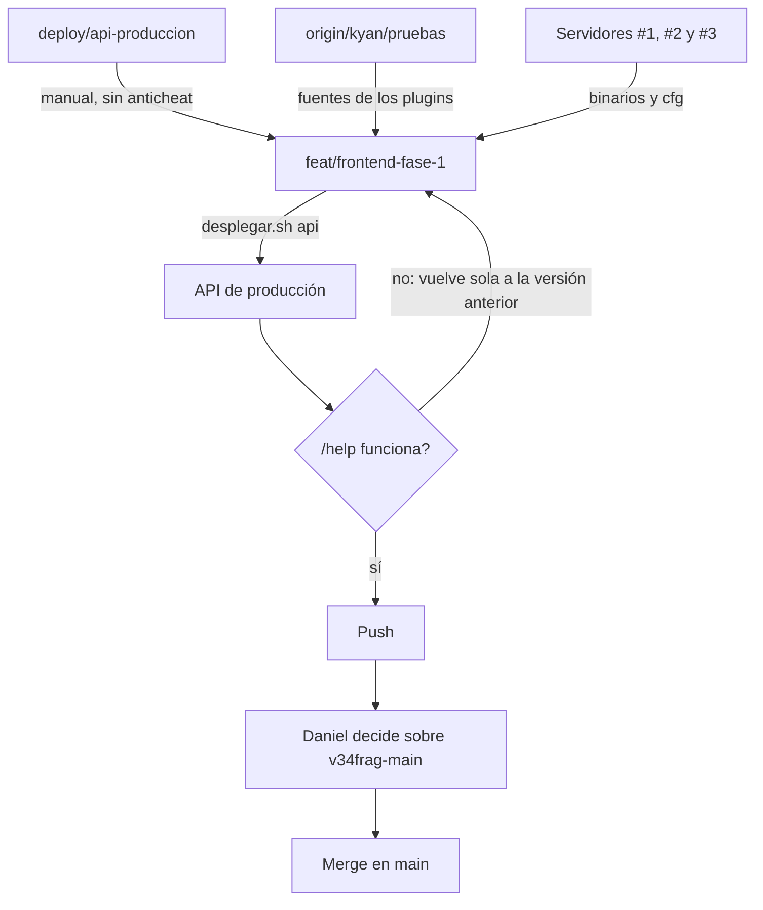

# Plan: dejar la rama del frontend igual a producción y llevarla a `main`

> Planeación original. Estado: **aprobado por Daniel el 2026-11-04**.

## Decisiones tomadas

| Tema | Decisión | Por qué |
|---|---|---|
| Manual de usuario en la API | Se trae de `deploy/api-produccion` a `feat/frontend-fase-1` | La web de la rama llama a `/api/v1/manual`, y la API de la rama no tiene esa ruta. Desplegarla desde la rama rompería `/help` |
| Rutas del anticheat | **No se traen** (Daniel, 2026-11-04) | La app no está en producción: tablas de datos con 0 filas, sin `AC_API_SECRET`, sin agente en la rama, sin plugin puente cargado y la web no las llama |
| Tablas `ac_*` | Se quedan | El replanteo `48` las exige. No se borra nada de la base |
| Plugins | La rama queda pareja con lo que corre en el #1 y el #2 (Daniel, 2026-11-04) | Hoy la rama tiene el reporter 2.9.1 y los servidores el 2.9.3, más plugins que no están versionados en esta rama |
| De dónde salen las fuentes | De `origin/kyan/pruebas`, archivo por archivo, no con un merge | Compiladas, dan el mismo `.code` que los binarios de los servidores. `CLAUDE.md` prohíbe mezclar esa rama porque trae tienda, VIP y anticheat |
| Binarios `.smx` del repo | Se copian de los servidores, tal cual | Así el md5 del repo es exactamente el de lo que corre. Los de `kyan/pruebas` están viejos, aunque declaren la misma versión |
| `cml_anticheat_bridge` | No se trae | Es parte del anticheat y no está cargado en ningún servidor |
| `live.cfg` y `csstv_qol.cfg` | Se copian del #1 | Es lo que corre. El #2 tiene el mismo `live.cfg` |
| `warmup.cfg` y `end.cfg` | No cambian | La rama ya es igual a los tres servidores. `kyan/pruebas` les suma `cml_ac_mix`, que no está desplegado |
| Servidores de juego | No se les sube nada | El objetivo es que el repo copie a los servidores, no al revés |
| Bitácoras | Se traen las de los plugins que entran | `PENDIENTES.md` (punto 1.44) pide versionar esos plugins con su bitácora |
| Merge en `main` | Al final, y después de que Daniel decida qué hacer con los cambios sin commit de `v34frag-main` | Esos cambios no están en la rama y tocan archivos que el merge también toca |

## 1. El flujo completo

## 2. API

- **Archivos nuevos:** `lib/manual.ts`, `lib/manual-node.ts`, `routes/manual.ts` y `test/unit/manual.test.ts`.
- **Cambian:** `app.ts` (sin las líneas del anticheat), `node.ts`, `lib/auth.ts`, `lib/types.ts`, `scripts/build.mjs` y `tsconfig.json`.
- **No se traen:** `routes/anticheat*.ts`, `schemas/anticheat.ts`, `jobs/anticheat-retention.ts`, los scripts `anticheat-*`, `AC_API_SECRET` ni las reglas `acLink` y `acClaim`.
- **Efecto del despliegue:** producción deja de servir las rutas `/api/v1/anticheat/*`, `/api/v1/me/anticheat/*`, `/api/v1/players/{id}/anticheat` y `/api/v1/admin/anticheat/*`. Nadie las usa.

## 3. Plugins

- **Fuentes de `origin/kyan/pruebas`:** `csstv_reporter.sp` (2.9.3), `csstv/qol.inc`, `csstv/rr.inc`, `csstv/summary.inc`, `csstv_qol.sp`, `csstv_coach.sp`, `csstv_pedir.sp`, `v34_dm.sp`, `v34_retake.sp`, `v34_wingman.sp` y sus carpetas `dm/`, `retake/` y `wingman/`.
- **Configuración de esos plugins:** `configs/retake/de_dust2_ob.cfg` y `configs/2v2/de_dust2_ob.cfg`.
- **Binarios:** `csstv_reporter`, `csstv_qol`, `csstv_coach`, `csstv_pedir` y `v34_dm` del #1; `csstv_password` del #2; `v34_retake` y `v34_wingman` del #3.
- **`csstv_reporter.cfg`:** los valores nuevos de `kyan/pruebas` y lo que el #1 tiene y el repo no. Sin tokens ni claves.

## 4. Requisitos antes de empezar

- Acceso al VPS y a los paneles (autorizado por Daniel el 2026-11-04).
- Ninguna partida o sala de matchmaking en curso al reiniciar la API.

## 5. Orden de implementación

1. Traer el manual a la API, y correr typecheck, pruebas y build.
2. Traer las fuentes, los binarios y las cfg de los plugins, y las bitácoras.
3. Compilar las fuentes de la rama y comparar el `.code` con los binarios de los servidores.
4. Commit en `feat/frontend-fase-1`, sin `dev-vars.py` ni la guía del aviso de la cola (Daniel, 2026-11-04).
5. Desplegar la API desde la rama y comprobar el manual.
6. Documentar, actualizar `PENDIENTES.md` y `CLAUDE.md`, y hacer push.
7. Mostrarle a Daniel los cambios sin commit de `v34frag-main` y, con su decisión, hacer el merge. Los 8 conflictos se resuelven con la versión de la rama.
